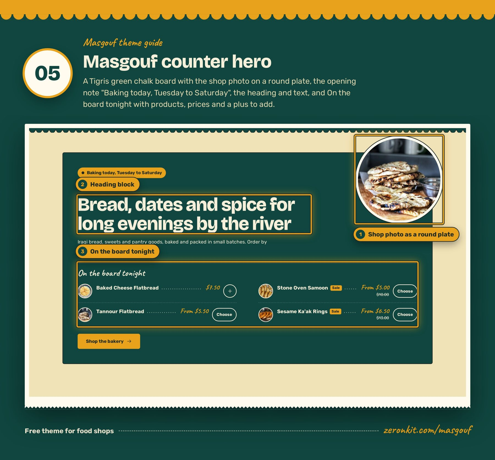
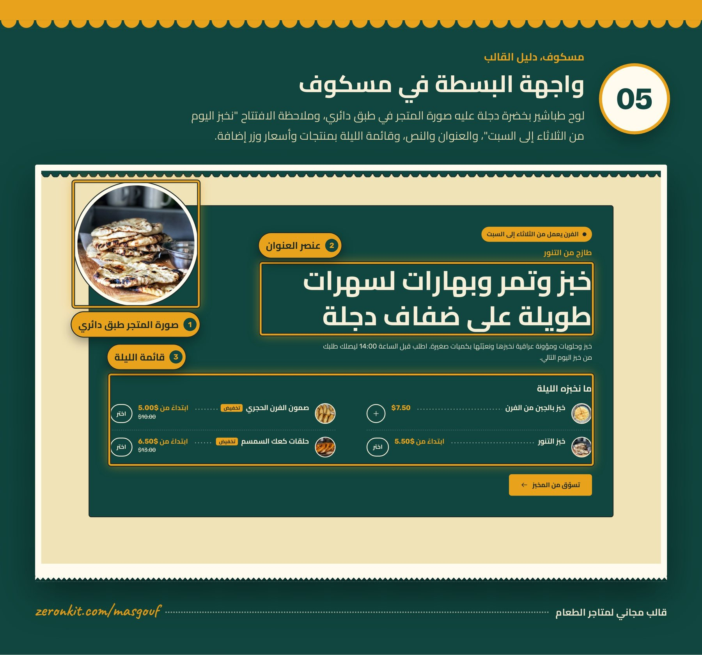

# Masgouf, a free Shopify theme for bakeries and food shops

<h2 align="center">Set up your stall step by step: the guide has 38 screenshots</h2>

<table><tr><td valign="top" width="50%">

### Guide (English)

- [1. A stall on the river](docs/guide.md#1-a-stall-on-the-river)
- [2. Putting the stall up](docs/guide.md#2-putting-the-stall-up)
- [3. Painting the sign: colours, fonts and the header](docs/guide.md#3-painting-the-sign-colours-fonts-and-the-header)
- [4. Stocking the larder: products and store data](docs/guide.md#4-stocking-the-larder-products-and-store-data)
- [5. The counter: your home page](docs/guide.md#5-the-counter-your-home-page)
- [6. The menu card: product page](docs/guide.md#6-the-menu-card-product-page)
- [7. Shelves: collections and search](docs/guide.md#7-shelves-collections-and-search)
- [8. The basket](docs/guide.md#8-the-basket)
- [9. The other pages](docs/guide.md#9-the-other-pages)
- [10. The footer and the baking week](docs/guide.md#10-the-footer-and-the-baking-week)
- [11. Small settings that matter](docs/guide.md#11-small-settings-that-matter)
- [12. Arabic and other languages](docs/guide.md#12-arabic-and-other-languages)
- [13. On a phone](docs/guide.md#13-on-a-phone)
- [14. When something looks wrong](docs/guide.md#14-when-something-looks-wrong)
- [15. Help and changes](docs/guide.md#15-help-and-changes)

</td><td valign="top" width="50%" dir="rtl">

### الدليل (العربية)

- [1. بسطة على ضفة النهر](docs/guide-ar.md#1-بسطة-على-ضفة-النهر)
- [2. نصب البسطة](docs/guide-ar.md#2-نصب-البسطة)
- [3. طلاء اللافتة: الألوان والخطوط والترويسة](docs/guide-ar.md#3-طلاء-اللافتة-الألوان-والخطوط-والترويسة)
- [4. ملء المخزن: المنتجات وبيانات المتجر](docs/guide-ar.md#4-ملء-المخزن-المنتجات-وبيانات-المتجر)
- [5. البسطة: الصفحة الرئيسية](docs/guide-ar.md#5-البسطة-الصفحة-الرئيسية)
- [6. بطاقة القائمة: صفحة المنتج](docs/guide-ar.md#6-بطاقة-القائمة-صفحة-المنتج)
- [7. الرفوف: المجموعات والبحث](docs/guide-ar.md#7-الرفوف-المجموعات-والبحث)
- [8. السلة](docs/guide-ar.md#8-السلة)
- [9. الصفحات الأخرى](docs/guide-ar.md#9-الصفحات-الأخرى)
- [10. التذييل وأسبوع الخَبز](docs/guide-ar.md#10-التذييل-وأسبوع-الخبز)
- [11. إعدادات صغيرة تفرق](docs/guide-ar.md#11-إعدادات-صغيرة-تفرق)
- [12. العربية واللغات الأخرى](docs/guide-ar.md#12-العربية-واللغات-الأخرى)
- [13. على الهاتف](docs/guide-ar.md#13-على-الهاتف)
- [14. حين يبدو شيء غير صحيح](docs/guide-ar.md#14-حين-يبدو-شيء-غير-صحيح)
- [15. المساعدة والتغييرات](docs/guide-ar.md#15-المساعدة-والتغييرات)

</td></tr></table>

The guide is also on the website: [zeronkit.com/masgouf-guide](https://zeronkit.com/masgouf-guide/) and [zeronkit.com/masgouf-guide-ar](https://zeronkit.com/masgouf-guide-ar/).

Masgouf is a free Shopify theme for bakeries, sweet shops, date and spice pantries, tea and coffee counters and small grocers, in English and Arabic. Made by [ZeronKit](https://zeronkit.com).

Masgouf is Baghdad's river fish, grilled upright around an open fire on the Tigris bank, at the evening stalls of Abu Nuwas street. The theme is built like one of those stalls: Tigris green chalk boards with dotted leaders to the price, paper order tickets, photos as small round plates, turmeric for the fire and sumac for prices. The design is called the Riverside Stall.

Version 1.0.2. See the [changelog](CHANGELOG.md) for what changed and what to do after updating.

**Free, source-available, not for resale.** This repository is not open source and is not under the GPL. You may use and change Masgouf on stores you own or run. You may not resell, redistribute, sublicense or upload it to theme marketplaces. See [LICENSE](LICENSE).

## Download

- Latest version: [masgouf-1.0.2.zip](https://zeronkit.com/downloads/masgouf-1.0.2.zip) from zeronkit.com, or the same file attached to the [v1.0.2 release](https://github.com/zeronkit/masgouf-shopify-theme/releases/tag/v1.0.2) on GitHub ([direct link](https://github.com/zeronkit/masgouf-shopify-theme/releases/latest/download/masgouf-1.0.2.zip)).
- Guide: [zeronkit.com/masgouf-guide](https://zeronkit.com/masgouf-guide/) (English) and [zeronkit.com/masgouf-guide-ar](https://zeronkit.com/masgouf-guide-ar/) (Arabic).
- What changed: [CHANGELOG.md](CHANGELOG.md) (English and Arabic).
- In Shopify admin: `Online Store` > `Themes` > `Add theme` > `Upload zip file`.

## What it does for a food shop

- Bake times on the header chips, a bake schedule section and a baking week in the footer.
- Sizes, boxes and packs as menu lines, each with its own price, on the product page, the collection board and the home page.
- Ingredients with allergens in bold, Contains and May contain labels, diet labels, a nutrition table, weight and servings, all from `masgouf.*` metafields or product tags.
- Delivery days with an order cut-off on every product.
- A free delivery meter in the cart, an open gift note, and a turmeric checkout button.
- Journal posts become recipe cards with an At a glance ingredient list and Shop the ingredients.
- Pages of its own: a stall map for the collections list, a stall front contact page, an About page as a day at the stall, an FAQ board, a 404 board and a shutter-down password page.
- English and Arabic with full right to left support and its own Cairo Arabic font.
- No app dependencies, no build step, no frameworks, no tracking.

## Requirements

- A Shopify store that allows custom themes.
- Search & Discovery (free Shopify app) for filters and complementary products.
- Translate & Adapt (free Shopify app) for your own content in more languages.

## Updating

Uploaded themes don't update by themselves. Duplicate your current theme, upload the new zip, copy your settings and check every page before you publish. Changes are listed in [CHANGELOG.md](CHANGELOG.md).

## Support

Free and given as is, with no warranty. Help is best effort, by email at info@zeronkit.com. Updates come when needed, with no schedule.

## Licence

Copyright (c) 2026 ZeronKit. ZeronKit Free Theme Licence. The copyright and author notices must stay in the files.
