<div dir="rtl">

# دليل قالب مسكوف

الإصدار 1.0.0، حُدّث في 26 نوفمبر 2026. من إعداد ZeronKit ‏(https://zeronkit.com).

الكلمات المكتوبة بهذا الشكل `code style` هي أسماء الإعدادات كما تظهر في محرر القالب في Shopify بالإنجليزية. إن كانت لوحة Shopify عندك بالعربية فقد تراها مترجمة، لكنها في المكان نفسه.

## 1. بسطة على ضفة النهر

مسكوف قالب Shopify مجاني للمتاجر التي تبيع الطعام: مخبز، أو محل حلويات، أو دكان تمور وبهارات، أو ركن للشاي والقهوة، أو بقالة صغيرة تخبز شيئًا من خبزها. يعمل القالب بالعربية والإنجليزية، وحين يختار الزبون العربية تنقلب كل صفحة لتُقرأ من اليمين إلى اليسار.

الاسم مأخوذ من أكلة بغدادية معروفة. المسكوف سمك نهري، غالبًا من الشبوط، يُشقّ من ظهره ويُنصب على أوتاد حول نار مكشوفة من حطب المشمش، فينضج على مهل في الدخان بينما يجلس الناس ويشربون الشاي. وكان شارع أبي نؤاس على الضفة الشرقية لدجلة مكانه الأشهر. في أمسيات الصيف كانت البسطات هناك توقد نارها وتكتب أسعار اليوم بالطباشير على ألواحها، فتختار سمكتك من الحوض وتأكلها قرب الماء مع خبز التنور الحار وصحن طرشي.

بُني القالب على صورة بسطة من تلك البسطات في الليل، واسم تصميمه "بسطة النهر" (Riverside Stall):

- القصب والورق: لون خلفية الصفحة لون القصب اليابس، والاستمارات والملاحظات على ورق كريمي، بعضها بحافة ممزقة مثل تذكرة الطلب.
- ألواح الطباشير بخضرة دجلة: قوائم المنتجات مكتوبة على ألواح خضراء داكنة، كما تُكتب الأسعار على لوح البسطة.
- الخط المنقّط: بين اسم الصنف وسعره سطر من النقاط، كما في قائمة المطعم المطبوعة.
- الأطباق الدائرية: الصور أطباق صغيرة مستديرة بجانب الكلمات. تقرأ القائمة أولًا ثم تؤكدها الصورة.
- الكركم والسمّاق: أصفر الكركم لون النار ولون الأزرار الرئيسية، وأحمر السمّاق للأسعار والتخفيضات.
- خط اليد: الأسعار والملاحظات القصيرة بخط يشبه الكتابة باليد، كأن صاحب البسطة كتبها بنفسه.
[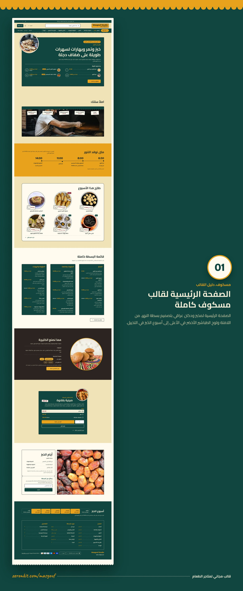](images/home-overview-ar.jpg)
### ما الذي يقدمه لمتجر الطعام

من يشتري الخبز أو الحلويات عبر الإنترنت يريد أجوبة بسيطة: متى خُبز ومتى يصل؟ ماذا فيه، وهل يناسب طفلًا عنده حساسية من المكسرات؟ كم حجم العلبة؟ هل يصير التوصيل مجانيًا إن أضفت صينية أخرى؟ هل أستطيع إرساله هدية مع بطاقة؟

مسكوف يجيب عن هذه الأسئلة في الصفحة نفسها:

- أوقات الخَبز وأيامه: وقت الخبزة الأولى على شرائح الأصناف في الترويسة، وجدول للخَبز يعرض يوم الفرن ساعة بساعة، وأيام إيقاد الفرن في التذييل.
- أيام التوصيل في كل منتج، مع آخر موعد للطلب.
- المكوّنات ومسببات الحساسية بخط عريض، وجدول القيم الغذائية، والوزن وعدد الحصص.
- الأحجام أسطر قائمة لكل منها سعره، مثل "12 قطعة ....... 14.00$".
- مؤشر في السلة يخبر الزبون كم بقي له ليحصل على توصيل مجاني.
- حقل لبطاقة الإهداء مفتوح في السلة من البداية.
- وصفات في المدونة تذكر مكوناتها وتربطها بمنتجاتك.

كل هذا داخل القالب نفسه، بلا تطبيق إضافي.

### الترخيص

- مسكوف مجاني، تستعمله وتعدّل فيه على أي متجر تملكه أو تديره.
- لا يجوز بيعه ولا مشاركة ملفاته ولا رفعه إلى أسواق القوالب ولا نسبته إليك.
- يُقدَّم كما هو، دون أي ضمان. النص الكامل في ملف `LICENSE` داخل الملف المضغوط.
- مصدره الوحيد ZeronKit، وهو غير موجود في متجر قوالب Shopify.

### ما تحتاجه قبل البدء

- متجر Shopify على أي باقة.
- صور منتجاتك. الصور المربعة التي يتوسطها الطعام هي الأفضل، لأن القالب يقصّ كثيرًا منها على شكل دائرة.
- كلمات متجرك: سطر قصير للافتة، وساعات العمل، وأيام التوصيل، وآخر موعد لاستلام الطلبات.
- نحو ساعة للإعداد الأول.

## 2. نصب البسطة

### 2.1 رفع الملف المضغوط

1. نزّل `masgouf-1.0.0.zip` من مربع التنزيل في أعلى هذه الصفحة، ولا تفك ضغطه.
2. في لوحة Shopify افتح `Online Store` ثم `Themes`.
3. اضغط `Add theme` واختر `Upload zip file`، ثم اختر الملف.
4. يظهر مسكوف في مكتبة القوالب غير منشور، ومتجرك الحالي يبقى كما هو.

### 2.2 المعاينة قبل النشر

1. اضغط `Customize` بجانب مسكوف، فيُفتح المحرر على الصفحة الرئيسية.
2. من قائمة الصفحات أعلى المحرر انتقل إلى منتج ومجموعة والسلة.
3. اضغط أيقونة الهاتف في الأعلى لترى شكل المتجر على الهاتف.
4. حين يعجبك ما تراه، ارجع إلى `Themes` وافتح قائمة `...` بجانب مسكوف واختر `Publish`.

### 2.3 خمسة إعدادات تملؤها أولًا

القالب جاهز للعمل، لكن هذه الإعدادات تخص متجرك وحدك. افتح `Theme settings` (أيقونة الفرشاة على يسار المحرر).

1. التوصيل المجاني: في `Cart` تحت `Free delivery bar` اكتب المبلغ في `Free delivery from (amount in the store currency)`، وهو نفس مبلغ الشحن المجاني في `Settings` ثم `Shipping and delivery`. وفي `Countries with free delivery` اكتب رموز الدول من حرفين مثل `US,CA`، أو اتركه فارغًا إن كان التوصيل المجاني لكل الدول. إن لم يكن عندك توصيل مجاني فاترك المبلغ فارغًا ولن يظهر المؤشر.
2. بريدك: في `Brand assets` اكتب في `Store contact email` العنوان الذي يراسلك عليه الزبائن، فيظهر في صفحة التواصل. اتركه فارغًا إن أردت النموذج وحده.
3. وصف المتجر في محركات البحث: في `Brand assets` أيضًا اكتب جملة أو جملتين في `Home page description for search engines`.
4. بطاقة الإهداء: في `Cart` فعّل `Enable order note`، فيظهر في السلة حقل مفتوح عنوانه "ملاحظة الهدية أو الطلب".
5. قالبا صفحتين: من `Online Store` ثم `Pages` افتح صفحة "من نحن" واجعل `Theme template` هو `about`، ثم صفحة الأسئلة الشائعة واجعله `faq`. القسم 9 يشرح ما يفعله كل منهما.

### 2.4 التحديث لاحقًا

لا يحدّث Shopify القالب المرفوع بملف مضغوط من تلقاء نفسه. حين يصدر إصدار جديد:

1. من `Themes` افتح قائمة `...` لقالب مسكوف الحالي واختر `Duplicate`، لتبقى عندك نسخة احتياطية.
2. ارفع الملف الجديد، فيصل غير منشور.
3. اضبطه مثل قالبك الحالي، إما من المحرر، وإما بنسخ `config/settings_data.json` وملفات مجلد `templates` من القديم إلى الجديد عبر `Edit code`.
4. راجع الرئيسية ومنتجًا ومجموعة والسلة وصفحة التواصل باللغتين، ثم انشره.

تغييرات كل إصدار مكتوبة في ملف `CHANGELOG.md` داخل الملف المضغوط وفي آخر هذا الدليل.

## 3. طلاء اللافتة: الألوان والخطوط والترويسة

ابدأ بهذا مبكرًا. حين تضبط الألوان واللافتة، تأتي كل صفحة تجهّزها بعدها بشكل متجرك.

### 3.1 أشكال جاهزة

في مسكوف أربعة أشكال جاهزة. افتح `Theme settings` واختر واحدًا من أعلى اللوحة:

| الشكل | طابعه |
| --- | --- |
| Riverside (الافتراضي) | القصب وخضرة دجلة والكركم والسمّاق |
| Roastery | ألوان البن المحمّص وعناوين بخط عريض الأطراف |
| Greengrocer | أخضر الأعشاب ومسافات أوسع |
| Patisserie | خط رفيع مذيّل وأزرار بإطار |

وتحت `Style` تغيّر أجزاء من الشكل دون أن تبدأ من جديد:

- `Palette` يبدّل الألوان الرئيسية دفعة واحدة، مثل `Flour` و`Golden crust` و`Fresh herb` و`Espresso (dark)`. اترك `Custom (use the colour schemes)` إن أردت ضبط كل لون بنفسك.
- `Font pairing` يعطيك أزواجًا جاهزة من الخطوط. اختر `Arabic friendly` إن كان أكثر زبائنك يقرؤون بالعربية، و`Custom (font pickers)` لتستعمل خطوط `Typography`.
- `Corners` و`Button style` و`Spacing` و`Animations` تغيّر الزوايا والأزرار والمسافات والحركة في المتجر كله.

### 3.2 ألوانك أنت

يلوّن مسكوف البسطة بستة أنظمة ألوان، ولكل قسم إعداد `Color scheme` يختار واحدًا منها.

| النظام | اللون الافتراضي | أين تراه |
| --- | --- | --- |
| scheme-1 | القصب `#F1E3B8` | الصفحة نفسها |
| scheme-2 | خضرة دجلة `#10463F` | ألواح الطباشير والقائمة والتذييل |
| scheme-3 | الورق `#FFFBEF` | التذاكر والبطاقات وبطاقة الزيارة |
| scheme-4 | الكركم `#E9A21B` | جدول الخَبز |
| scheme-5 | الفحمي `#2B2421` | قسم المكونات |
| scheme-6 | أبيض | لاستعمالك الخاص |

لتغيير لون:

1. افتح `Theme settings` ثم `Colors`.
2. اضغط على نظام، فترى `Background` و`Text` و`Accent and links` و`Button` و`Button label`.
3. اضغط على اللون واكتب قيمة جديدة أو اختر من اللوحة.
4. يتغير اللون في كل قسم يستعمل هذا النظام.

احرص على تباين واضح بين النص والخلفية. الحبر الداكن على القصب أو الورق مقروء، وكذلك النص الكريمي على خضرة دجلة.

### 3.3 الخطوط

افتح `Theme settings` ثم `Typography`:

- `Heading font` للعناوين، وهو افتراضيًا Bricolage Grotesque.
- `Body font` لبقية النصوص، وهو افتراضيًا Rubik.
- `Chalk hand font` تُكتب به الأسعار والملاحظات القصيرة على ألواح الطباشير، وهو افتراضيًا Caveat.
- `Heading size` و`Body size` يكبّران النص أو يصغّرانه.

أغلب خطوط المكتبة بلا حروف عربية، لذلك يحمل مسكوف خطه العربي الخاص، القاهرة (Cairo)، ويكتب به كل كلمة عربية. تبقى الصفحات العربية مرتبة أيًّا كانت الخطوط التي تختارها.

### 3.4 شريط الإعلانات

الشريط الرفيع في أعلى الصفحة. اضغط `Announcement bar` في المحرر.

- أضف عنصر `Message` لكل رسالة، وتكفي رسالتان أو ثلاث. لكل رسالة `Text` و`Link` و`Icon` مثل `Delivery` أو `Gift`.
- `Display` يكون `Static` أو `Rotating fade` أو `Marquee`، و`Time per message` يحدد السرعة.
- `Let shoppers close the bar` يضيف زر إغلاق.

على الهاتف يجب أن تتسع كل رسالة في سطر واحد. "توصيل مجاني داخل أمريكا للطلبات من 70$" طول مناسب.

### 3.5 ترويسة البسطة

للترويسة صفّان. اضغط `Header` في المحرر لتعدّلها.
[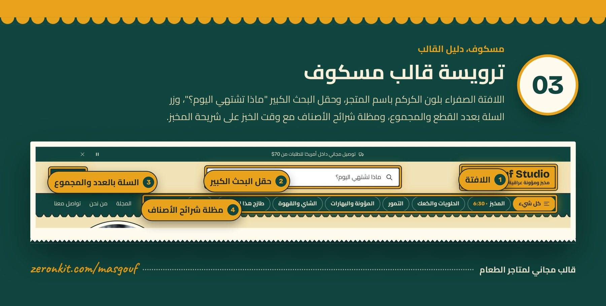](images/header-ar.jpg)
اللافتة: في البداية لافتة بلون الكركم عليها اسم متجرك.

- ارفع شعارًا في `Logo`، أو اتركه فارغًا فيُكتب اسم المتجر بخط العناوين. لكتابة اسم آخر استعمل `Text logo`.
- `Note under the shop name` هو السطر الصغير المكتوب باليد على اللافتة، مثل "مخبز ودكان عراقي". اتركه فارغًا ليظهر نص القالب.

حقل البحث: الحقل الكبير في الوسط يسأل "ماذا تشتهي اليوم؟". هو المدخل الأول إلى المتجر، فمن يبحث عن طعام يعرف غالبًا الكلمة التي يريدها: كليچة، تمر، هيل. القسم 3.7 يشرحه.

السلة: في الطرف الآخر، وتعرض عدد القطع والمجموع حين يكون في السلة شيء.

المظلة: الصف الثاني يتدلى كمظلة البسطة بحافة مموّجة، وعليه:

- زر `Everything` يفتح القائمة كاملة على لوح (انظر 3.6).
- ثم شريحة لكل مجموعة، مأخوذة من القائمة المختارة في `Menu`. إن كان لعنصر في القائمة عناصر فرعية صار كل فرعي شريحة، وكل رابط رئيسي إلى مجموعة يصير شريحة أيضًا.
- وفي الطرف الآخر كلمات بسيطة للصفحات مثل المدونة ومن نحن وتواصل معنا، وهي الروابط الرئيسية التي ليست مجموعات.

وقت الخبز على الشرائح: في `Hints on the category chips` اكتب سطرًا لكل مجموعة: معرّف المجموعة (handle)، ثم نقطتين، ثم تلميحًا قصيرًا. مثلًا:

```
bakery: 6:30
sweets: from 9:00
```

يظهر التلميح بخط اليد بعد الاسم، مثل "المخبز · 6:30". استعمله لساعة خروج أول صينية، أو لعبارة "اليوم فقط". تجد معرّف المجموعة في آخر رابطها.

إعدادات أخرى في الترويسة:

- `Layout` يبقى `Market stall: sign, chalk menu board, basket`، وبقية التخطيطات أشرطة أبسط إن احتجتها يومًا.
- `Sticky header` يحدد هل تبقى الترويسة ظاهرة أثناء التمرير.
- `Show search` و`Show account` و`Show cart` تُظهر هذه الأجزاء أو تخفيها.
- `Show country/region selector` و`Show language selector` يضعان محددَي البلد واللغة في الترويسة.
- `Color scheme` و`Menu and search color scheme` يلوّنان صف اللافتة وصف المظلة.

### 3.6 اللوح كله (القائمة)

اضغط `Everything` فتنزل القائمة كاملة من تحت المظلة على لوح طباشير واحد.
[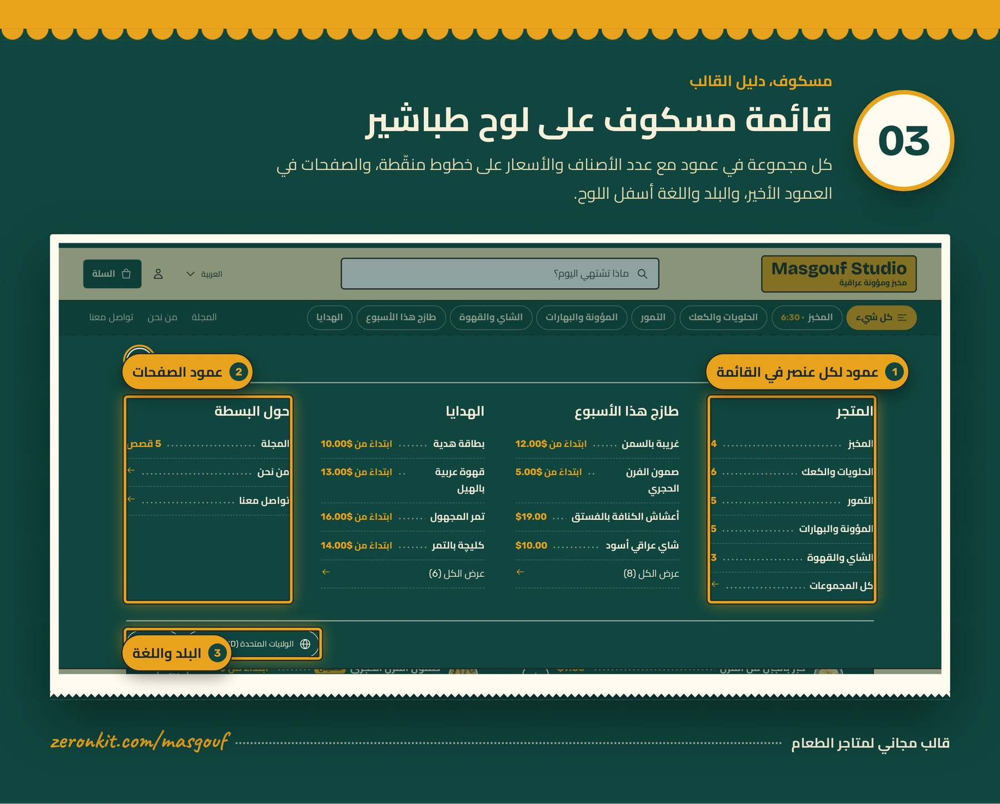](images/board-menu-ar.jpg)
- كل عنصر رئيسي في قائمتك يصير عمودًا، وعناصره الفرعية أسطر عليها عدد المنتجات، أو سعر "ابتداءً من" إن كانت منتجات.
- للصفحات والمدونة عمود خاص في النهاية.
- محددا البلد واللغة أسفل اللوح.

اللوح مبني من القائمة نفسها التي تصنع الشرائح. رتّب القائمة من `Online Store` ثم `Navigation` (انظر 4.5) فيتبعها اللوح. ويخفي `Show the Shop navigator button` زر `Everything`.

### 3.7 البحث على تذكرة طلب

اضغط حقل البحث فتتدلى منه تذكرة ورقية بحافة ممزقة، كالورقة التي تُقتطع من دفتر الطلبات.
[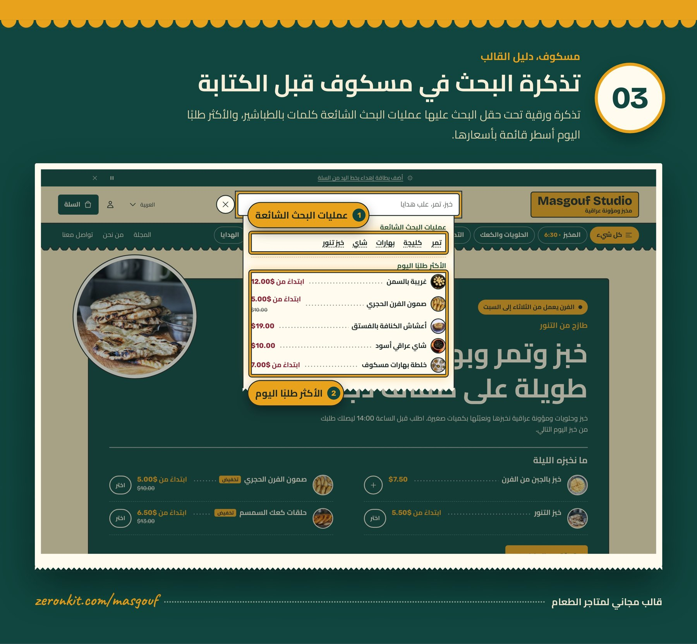](images/search-ticket-ar.jpg)
قبل أن يكتب الزبون شيئًا تعرض التذكرة قائمتين، تضبطهما من `Theme settings` ثم `Search`:

- `Popular searches`: كلمات تفصل بينها فواصل، مثل `كليچة, تمر, بقلاوة, شاي, هيل` (بفاصلة إنجليزية)، تظهر كلمات يكفي النقر عليها.
- `Popular today collection`: اختر مجموعة فتظهر أوائل منتجاتها أسطر قائمة بأسعارها. ضع فيها الأكثر مبيعًا أو خبز هذا الصباح.
[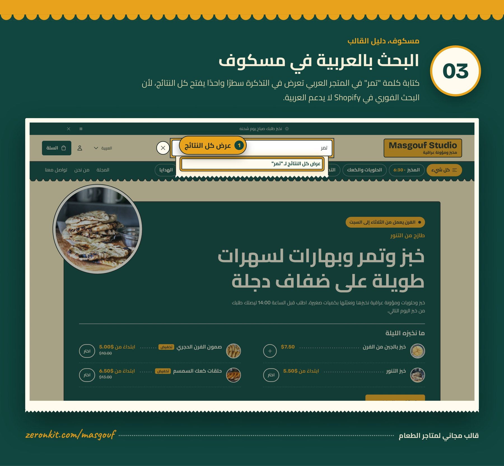](images/search-typing-ar.jpg)
في المتجر الإنجليزي تمتلئ التذكرة ما إن يبدأ الزبون بالكتابة باقتراحات ومنتجات ومجموعات وصفحات ومقالات. ويشغّل `Enable search suggestions` في اللوحة نفسها هذا البحث الفوري أو يوقفه.

لا زر بحث في التذكرة. يضغط الزبون Enter، أو زر البحث في لوحة مفاتيح الهاتف، فتفتح صفحة البحث بكل النتائج.

أما البحث الفوري في Shopify فلا يدعم كل اللغات، والعربية منها. لذلك تعرض التذكرة في المتجر العربي سطرًا واحدًا يفتح كل نتائج الكلمة، وصفحة النتائج تعمل كالمعتاد.

## 4. ملء المخزن: المنتجات وبيانات المتجر

يعرض مسكوف معلومات كثيرة عن الطعام، وكلها اختيارية. لكل جزء بديل، فالمنتج الذي ليس له إلا اسم وسعر وصورة يظهر سليمًا. لكن كلما ملأت أكثر، أجابت صفحاتك عن أسئلة أكثر.

### 4.1 الأحجام والعبوات

الخبز والحلويات تُباع بالعلبة أو الصينية أو الكيس، فاجعل كل واحدة منها متغيرًا (variant):

- سمِّ الخيار بما هو عليه: `Size` أو `Box` أو `Pack` أو `Flavour`.
- اجعل لكل قيمة اسمًا واضحًا فيه الكمية، مثل "12 قطعة" و"24 قطعة"، أو "كيس من 6".
- اجعل لكل متغير سعره. يكتب مسكوف كل قيمة سطرًا في القائمة بسعرها، فيقارن الزبون بين العلب بنظرة واحدة.

وإن كان لحجم ما سعر قبل التخفيض (`Compare-at price`) ظهر سطر التخفيض في أعلى صفحة المنتج، حتى لو كان الحجم المختار بسعره الكامل.

### 4.2 الصور

كثير من الصور في مسكوف تُقصّ دوائر: في الرئيسية والقوائم والسلة والبحث. أفضلها الصور المربعة التي يتوسطها الطعام مع شيء من الفراغ حوله، والصورة الملتقطة من الأعلى لطبق أو صينية تبدو طبيعية جدًا داخل دائرة.

يسمح Shopify بتحديد النقطة المهمة في الصورة (افتح الصورة في `Files` أو في المنتج واسحب النقطة)، ويُبقي مسكوف هذه النقطة في وسط الدائرة.

واكتب وصفًا بديلًا قصيرًا لكل صورة، مثل "كليچة بالتمر على قماش مطرّز". هذا يساعد من يستعمل قارئ الشاشة، ويساعد محركات البحث.

### 4.3 تفاصيل الطعام (الحقول الإضافية)

الحقول الإضافية (metafields) خانات زائدة على المنتج، ويقرؤها مسكوف من مجال الأسماء `masgouf`. لإضافة حقل اذهب إلى `Settings` ثم `Custom data` ثم `Products`، واضغط `Add definition` واستعمل المجال والمفتاح في الجدول. بعدها تملؤه في أسفل صفحة كل منتج في لوحة التحكم.

| المجال والمفتاح | النوع | ما يعرضه |
| --- | --- | --- |
| `masgouf.ingredients` | Multi-line text | قائمة المكوّنات |
| `masgouf.allergens` | List of single line text | يحتوي على، مثل الحليب والبيض |
| `masgouf.may_contain` | List of single line text | قد يحتوي على |
| `masgouf.dietary` | List of single line text | خالٍ من، وأنواع الحمية مثل نباتي |
| `masgouf.nutrition` | Multi-line text | جدول القيم الغذائية، صف في كل سطر |
| `masgouf.nutrition_basis` | Single line text | عنوان عمود الكمية، مثل لكل 100 غ |
| `masgouf.serving_size` | Single line text | عنوان عمود الحصة، مثل لكل قطعة (30 غ) |
| `masgouf.net_weight` | Single line text | الوزن الصافي |
| `masgouf.pieces` | Single line text | عدد القطع في العبوة |
| `masgouf.servings` | Single line text | عدد الحصص |
| `masgouf.delivery_days` | List of single line text | أيام توصيل هذا المنتج، مثل `tue` |
| `masgouf.fresh_note` | Text | ملاحظة عن الطزاجة |
| `masgouf.storage` | Text | طريقة الحفظ |
| `masgouf.shelf_life` | Text | مدة الصلاحية |
| `masgouf.recipe` | Rich or multi-line text | وصفة أو فكرة تقديم |
| `masgouf.recipe_article` | Article reference | مقال في المدونة فيه الوصفة كاملة |
| `masgouf.pairing` | List of products | منتجات تناسبه |

ملاحظتان عن جدول القيم الغذائية:

- اكتب كل صف في سطر بهذا الشكل `الاسم | الكمية | الكمية في الحصة`، مثل `Energy | 1799 kJ / 430 kcal | 540 kJ / 129 kcal`.
- ابدأ السطر بعلامة `-` ليصير صفًا فرعيًا، مثل `- of which sugars | 24 g | 7.2 g`.

ويمكن ضبط الوزن والحصص على المتغير نفسه، وقيمة المتغير تتقدم على قيمة المنتج، فتعرض علبة الأربع والعشرين قطعة وزنها الخاص.

### 4.4 وسوم تعمل لأجلك

بلا حقول إضافية يستطيع مسكوف أن يعرض مسببات الحساسية والحمية من وسوم المنتج:

- `allergen:nuts` و`allergen:milk` و`allergen:sesame` وأمثالها تضيف مسبب حساسية.
- `diet:vegan` و`diet:vegetarian` وأمثالها تضيف نوع الحمية.
- `new` يضع على المنتج شارة "جديد".

### 4.5 المجموعات والقائمة

اجعل لكل رف في دكانك مجموعة: المخبز، والحلويات والكعك، والتمور، والمؤونة والبهارات، والشاي والقهوة، والهدايا. أعطِ كل مجموعة صورة وسطرًا أو سطرين من الوصف، فالوصف يظهر على لوح المجموعة.

ثم ابنِ القائمة الرئيسية من `Online Store` ثم `Navigation` ثم `Main menu`. شكل مناسب لمخبز:

- "المتجر" وتحته مجموعاتك عناصر فرعية، فتصير شرائح على المظلة والعمود الأول في اللوح.
- "طازج هذا الأسبوع" و"الهدايا" وتحت كل منهما بعض المنتجات، فتصير أعمدة على اللوح بأسعار "ابتداءً من".
- "المدونة" و"من نحن" و"تواصل معنا" روابط عادية، فتصير كلمات الصفحات على المظلة.

تصل القائمة إلى ثلاثة مستويات.

### 4.6 الصفحات

أنشئ هذه الصفحات من `Online Store` ثم `Pages`:

- "من نحن" بقالب `about`. اكتب قصتك وضع عنوانًا من المستوى الثاني (Heading 2) قبل كل جزء. القسم 9.2 يريك النتيجة.
- "الأسئلة الشائعة" بقالب `faq`. اكتب كل سؤال عنوانًا من المستوى الثاني والجواب تحته.
- "تواصل معنا" بقالب `contact`.
- "الشحن والإرجاع" صفحة عادية.

### 4.7 المدونة

المدونة دفتر وصفاتك، سمّها المدونة أو الوصفات. إن كان في المقال قائمة نقطية عدّ مسكوف أول قائمة فيه مكوّنات الوصفة ووضعها على بطاقة بجانب الطريقة، كما يشرح القسم 9.5.

## 5. البسطة: الصفحة الرئيسية

رُتّبت الصفحة الرئيسية كأمسية على البسطة: لوح فيه أطباق الليلة، ثم الرفوف، ثم ساعات إيقاد الفرن، ثم ما خرج طازجًا، ثم القائمة كاملة، ثم مكوّنات الخبز، ثم طبق اليوم، ثم كيف يصل إليك الزبون. تستطيع نقل كل قسم أو إخفاءه أو حذفه، ولإضافة قسم اضغط `Add section`.

### 5.1 واجهة البسطة (Counter hero)

أول ما يراه الزبون: لوح أخضر في زاويته صورة متجرك على طبق دائري، وعنوان، وقائمة قصيرة بمنتجات الليلة.
[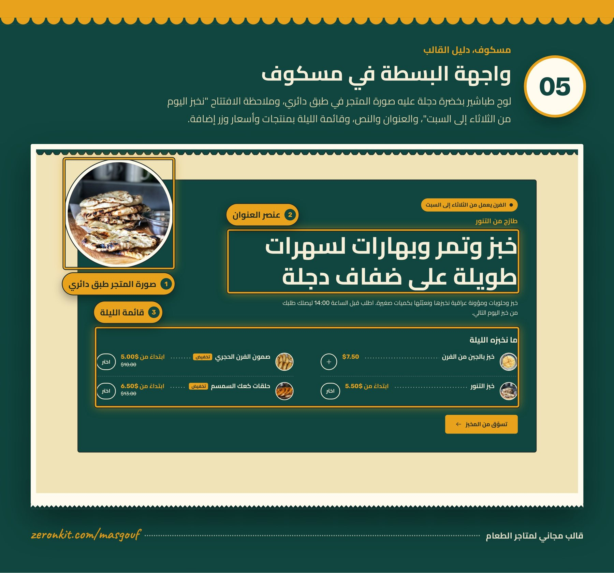](images/home-counter-ar.jpg)
- `Image`: أجمل صورة عندك، وتظهر في الطبق الدائري.
- `Opening note`: الشارة الصغيرة بلون الكركم فوق العنوان، مثل "نخبز اليوم من الثلاثاء إلى السبت". اتركها فارغة لتختفي.
- داخل اللوح تضيف عناصر: نصًا صغيرًا و`Heading` و`Text` و`Button`. اضغط `Add block` لتضيفها أو تنقلها.
- تحت `Counter board` يختار `Products` حتى ثمانية منتجات لأسطر القائمة. إن تركته فارغًا استُعملت `Collection` أو أحدث منتجاتك، و`Products to show` يحدد العدد.

في كل سطر زر "+". المنتج الذي له حجم واحد يدخل السلة مباشرة، والذي له أحجام يظهر عليه "اختر" فتنفتح أحجامه في مكانها.

### 5.2 املأ سلتك (Collection list)

رفوفك لافتات بأسمائها تتدلى من مظلة فوق صورة البسطة.
[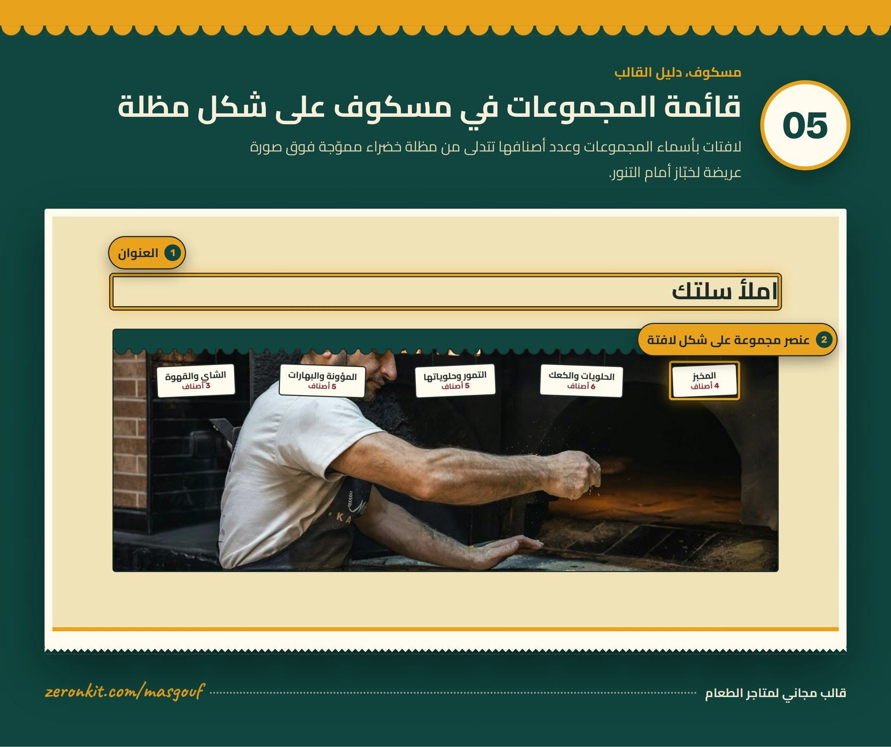](images/home-awning-ar.jpg)
- اجعل `Card shape` هو `Tabs hanging from an awning over a stall photo`. الشكلان الآخران `Round plates` و`Cards`.
- `Stall photo`: صورة عريضة لمحلك أو فرنك أو منضدتك.
- أضف عنصر `Collection` لكل رف.

### 5.3 متى نوقد التنور (Bake schedule)

شريط بلون الكركم يعرض يوم الفرن ساعة بساعة.
[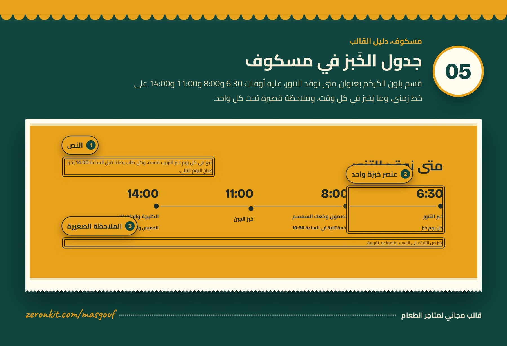](images/home-bake-ar.jpg)
- أضف عنصر `Bake` لكل وقت، فيه `Time` و`Item name` و`Note` (مثل "كل يوم خَبز").
- `Product` يربط السطر بمنتج، وإن كان `Item name` فارغًا ظهر اسم المنتج.
- `Small print` هو السطر تحت الخط الزمني، مثل "نخبز من الثلاثاء إلى السبت، والأوقات تقريبية".

الناس يحبون أن يعرفوا متى يخرج الخبز حارًّا، وهذا يدفعهم إلى الطلب قبل آخر موعد.

### 5.4 طازج هذا الأسبوع (Featured collection)

صينية من الأطباق الدائرية، على كل طبق بطاقة سعره.
[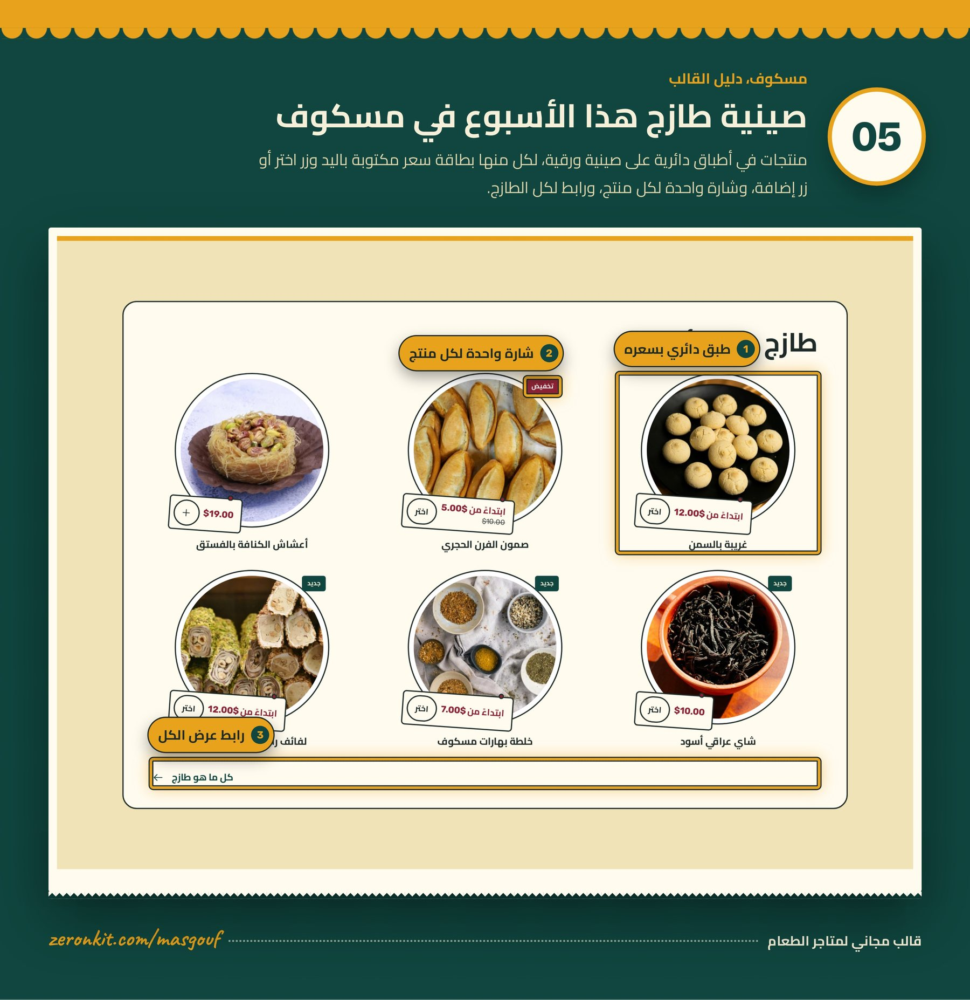](images/home-tray-ar.jpg)
- `Collection`: اختر منتجاتك الجديدة أو الموسمية.
- `Layout`: `Tray of round plates`، ويمكنك أيضًا اختيار `Grid` أو `Scrolling row`.
- `Products to show` و`Columns on desktop` يحددان حجم الصينية.
- `Show View all link` يضيف الرابط المكتوب باليد في آخرها.

لا يحمل المنتج أكثر من شارة واحدة: "نفد" أولًا، ثم "تخفيض"، ثم "جديد". القسم 11.3 يشرح متى تظهر شارة "جديد".

### 5.5 اللوح كله (Menu board)

قائمتك كاملة مكتوبة على ألواح طباشير في أعمدة، تحت كل اسم سطر قصير من وصفه.
[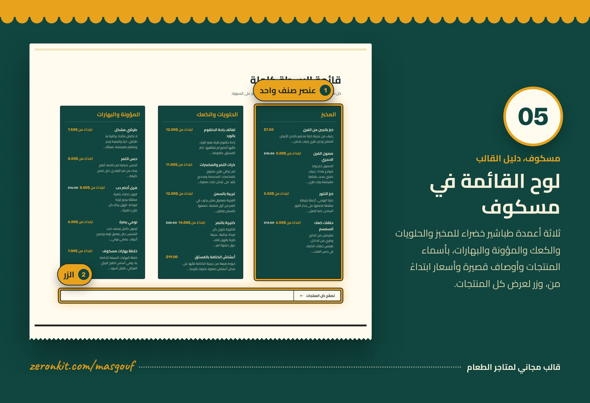](images/home-menu-board-ar.jpg)
- أضف عنصر `Menu category` لكل عمود واختر له `Collection`. يستبدل `Title` اسم المجموعة إن أردت اسمًا أقصر، و`Products to show` يحدد عدد الأسطر.
- `Show short descriptions` يضيف سطرًا من وصف كل منتج.
- `Show small photos` يضيف طبقًا صغيرًا لكل سطر.
- `Button label` و`Link` يصنعان الزر تحت اللوح.

### 5.6 مما نصنعه (Ingredients and allergens)

منتج واحد بكامل مكوّناته ومسببات الحساسية فيه، على قسم فحمي داكن. يرى الزبون أنك لا تخفي شيئًا مما تضعه في طعامك.
[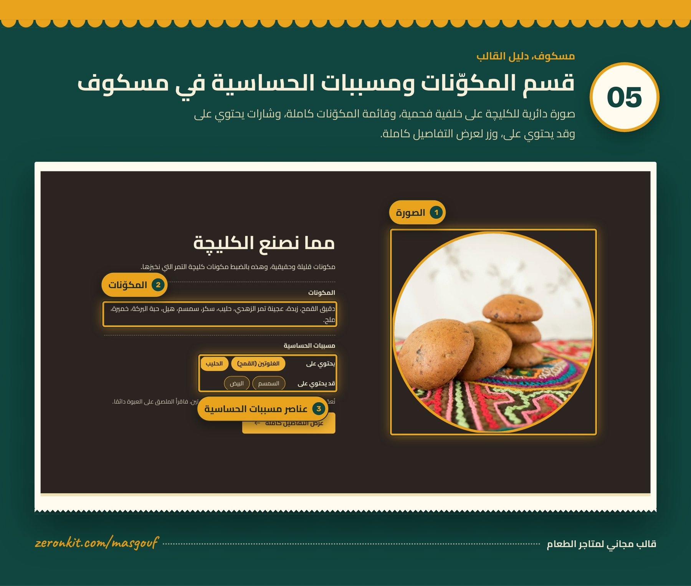](images/home-ingredients-ar.jpg)
- `Product`: المنتج المعروض. اتركه فارغًا ليُستعمل أول منتج متوفر.
- `Heading` و`Text`: اترك العنوان فارغًا ليُستعمل اسم المنتج.
- `Ingredients`: اتركه فارغًا ليُستعمل الحقل `masgouf.ingredients`.
- أضف عنصر `Allergen` لكل مسبب حساسية، واجعل `Status` هو `Contains` أو `May contain` أو `Free from`. إن لم تضف عناصر استُعمل الحقل `masgouf.allergens`.
- `Small print`: مثل "يُحضّر في مطبخ يتعامل مع المكسرات".

طابق كل مسبب حساسية مع ملصقات منتجاتك الحقيقية.

### 5.7 طبق اليوم (Featured product)

منتج واحد على بطاقة طباشير، بأحجامه وزر الإضافة إلى السلة في الرئيسية نفسها.
[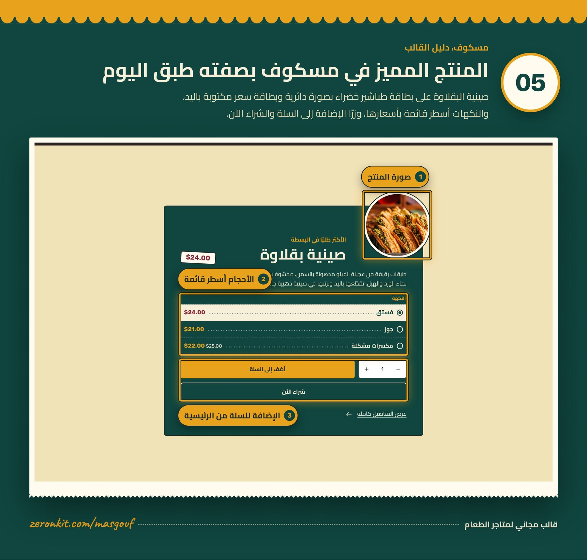](images/home-special-ar.jpg)
- `Product`: طبق اليوم.
- `Eyebrow text`: السطر الصغير فوق الاسم، مثل "المفضّل في البسطة".
- `Show accelerated checkout buttons` يُظهر زر "اشترِ الآن" وأزرار الدفع السريع.

### 5.8 أيام الخَبز (Visit the shop)

ساعات العمل، ومكانك، والاشتراك في النشرة على قسيمة تُقتطع من أسفل البطاقة.
[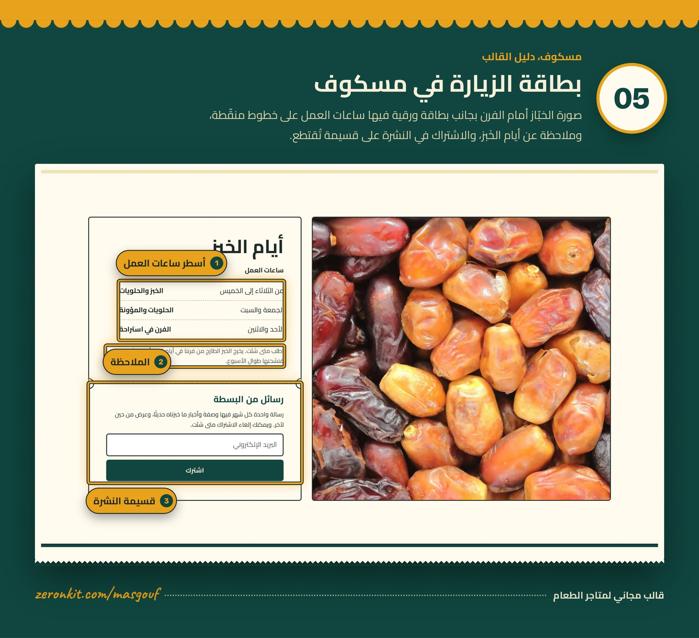](images/home-visit-ar.jpg)
- أضف عنصر `Opening hours row` لكل سطر، فيه `Days` و`Hours`. يمكن أن تكون الساعات كلمات، مثل "الفرن في استراحة".
- `Address`: اتركه فارغًا ليُستعمل عنوان متجرك.
- `Map link` و`Button label` يضيفان زرًا إلى الخريطة.
- تحت `Sign-up stub` يشغّل `Show the newsletter stub at the foot of the card` قسيمة الاشتراك، والمشتركون يُضافون إلى قائمة عملائك.

## 6. بطاقة القائمة: صفحة المنتج

كل صفحة منتج مرتّبة كبطاقة في قائمة الطعام. الاسم والسعر سطر واحد في الأعلى، وتحته تذكرة طلب ورقية فيها كل ما يلزم للطلب، والصورة طبق دائري على زاويتها.
[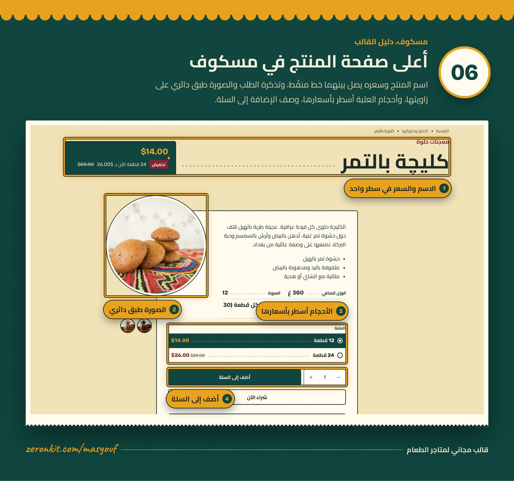](images/product-top-ar.jpg)
اضغط `Product information` في المحرر (بعد أن تفتح منتجًا من قائمة الصفحات).

إعدادات القسم:

- `Title and price position`: `Above the photos` يجعل الاسم والسعر سطرًا في الأعلى، و`In the order panel` يضعهما على التذكرة.
- `Gallery layout`: `Plate with thumbnails` هو الطبق الدائري مع أطباق صغيرة بجانبه.
- `Keep product details in view while scrolling` يُبقي الصورة بجانب التذكرة أثناء القراءة.
- `Show breadcrumb` يُظهر مسار التنقل الصغير فوق الاسم.
- `Heading above the food details` هو العنوان فوق لوحات المؤونة، وهو افتراضيًا "من المؤونة".

التذكرة مكوّنة من عناصر تسحبها لتغيّر ترتيبها، وهذا شرح كل منها.

### 6.1 الطلب من التذكرة

- `Title` و`Price`: الاسم والسعر، و`Show stock status` يضيف سطر التوفر.
- `Description`: وصف المنتج.
- `Weight and servings`: الوزن الصافي وحجم العبوة والحصص على خطوط منقّطة، من الحقول في 4.3. ويستعمل `Use the variant weight when no net weight is set` وزن المتغير.
- `Variant picker`: اجعل `Style` هو `Menu lines with prices`، فيصير كل حجم سطرًا بسعره. الشكلان الآخران `Buttons` و`Dropdown`.
- `Buy buttons`: الكمية والإضافة إلى السلة والشراء الآن. زر الإضافة هو الزر الممتلئ الوحيد، و"اشترِ الآن" بإطار فقط. و`Show pickup availability` يعرض الاستلام من المحل إن كنت تقدمه.
[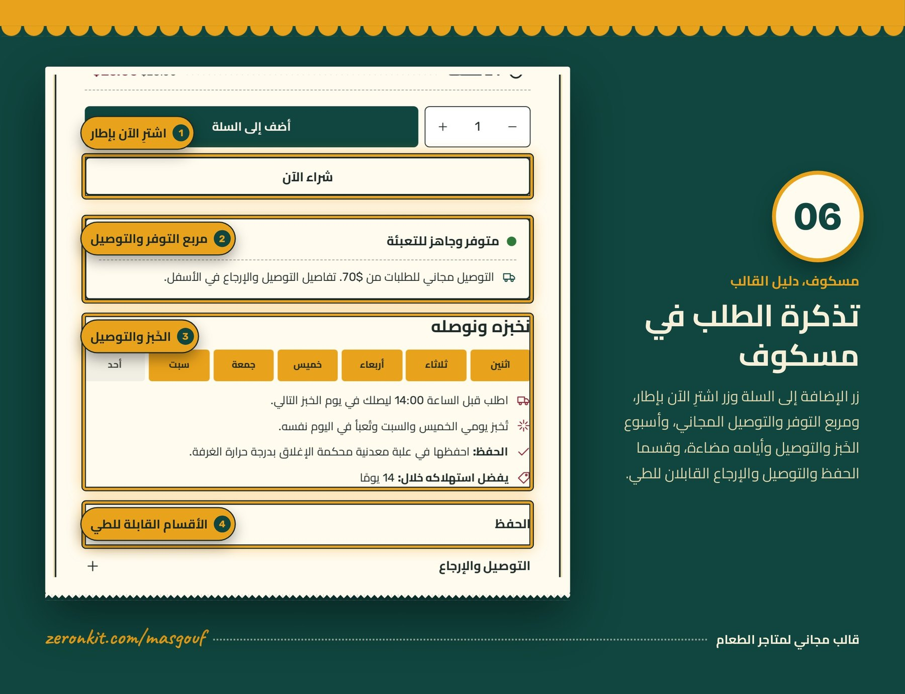](images/product-ticket-ar.jpg)
تحت الأزرار مربع صغير يقول هل المنتج متوفر، وفيه سطر واحد عن التوصيل مبني على إعدادات التوصيل المجاني (2.3) وبلد الزبون.

- `Delivery days and freshness`: أسبوع تُضاء فيه أيام التوصيل بلون الكركم. حدّد الأيام تحت `Delivery days`، واكتب آخر موعد في `Order cut-off note` ("اطلب قبل 14:00 ليصلك في يوم الخَبز التالي")، وسطرًا في `Freshness note`. والحقل `masgouf.delivery_days` في المنتج يحلّ محل الأيام المحددة، فتُشحن المؤونة في أيام غير أيام الخبز.
- `Collapsible tab`: قسم يُطوى. اجعل `Content source` هو `Storage` أو `Shipping and returns` فيأتي المحتوى من المنتج أو من سياساتك، و`Custom text only` يستعمل `Content` الذي تكتبه. اجمع نص التوصيل والإرجاع كله في قسم واحد حتى لا يتكرر في الصفحة.
- `Complementary products`: منتجات تكمّل هذا المنتج، تضبطها في تطبيق Search & Discovery.

لكل عنصر طعام إعداد `Placement`: `In the order panel` يضعه على التذكرة، و`Below the photos` يضعه في صف المؤونة تحتها.

### 6.2 حجم عليه تخفيض

لنفترض أن العلبة الكبيرة مخفّضة والصغيرة لا. يخبر لوح السعر في الأعلى الزبون بتخفيض الكبيرة حتى وهو يختار الصغيرة.
[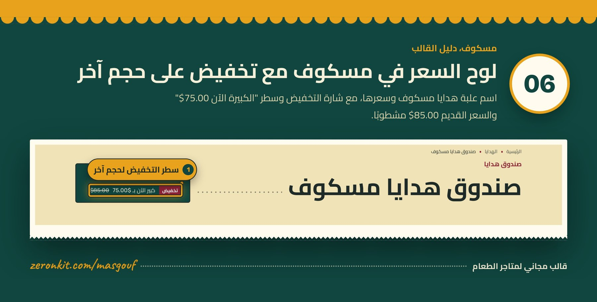](images/product-sale-ar.jpg)
لا تضبط شيئًا. أضف `Compare-at price` إلى الحجم المخفّض فيظهر السطر.

### 6.3 من المؤونة

تحت التذكرة صف من البطاقات فيه تفاصيل الطعام.
[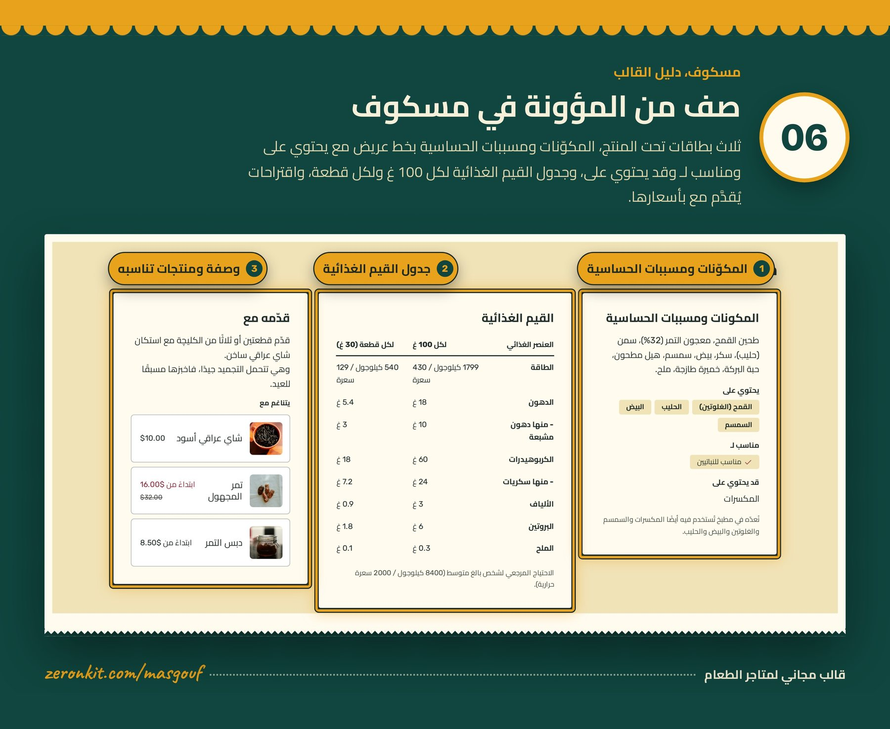](images/product-pantry-ar.jpg)
- `Ingredients and allergens`: قائمة المكوّنات من `masgouf.ingredients` مع مسببات الحساسية والحمية. ويجعل `Bold allergens in the ingredient list` مسببات الحساسية عريضة داخل القائمة، كما على ملصقات الطعام. و`Allergen note` سطر عن مطبخك.
- `Nutrition table`: يقرأ `masgouf.nutrition`. و`Amount column heading` و`Serving column heading` عنوانا العمودين حين تكون الحقول فارغة.
- `Recipe and pairing`: فكرة تقديم ومنتجات تناسب المنتج، من `masgouf.recipe` و`masgouf.recipe_article` و`masgouf.pairing`. ومع تشغيل `Fill with products from the same collection when none are chosen` لا يبقى فارغًا.

الخانات النصية داخل هذه العناصر (`Ingredients text` و`Nutrition rows` و`Recipe or serving idea`) بدائل فقط، وتظهر على كل منتج ليس له حقل خاص. لا تستعملها إلا في قالب مخصص لمنتج واحد، حتى لا تظهر قيم الخبز الغذائية على الكعك.

### 6.4 منتجات ذات صلة
[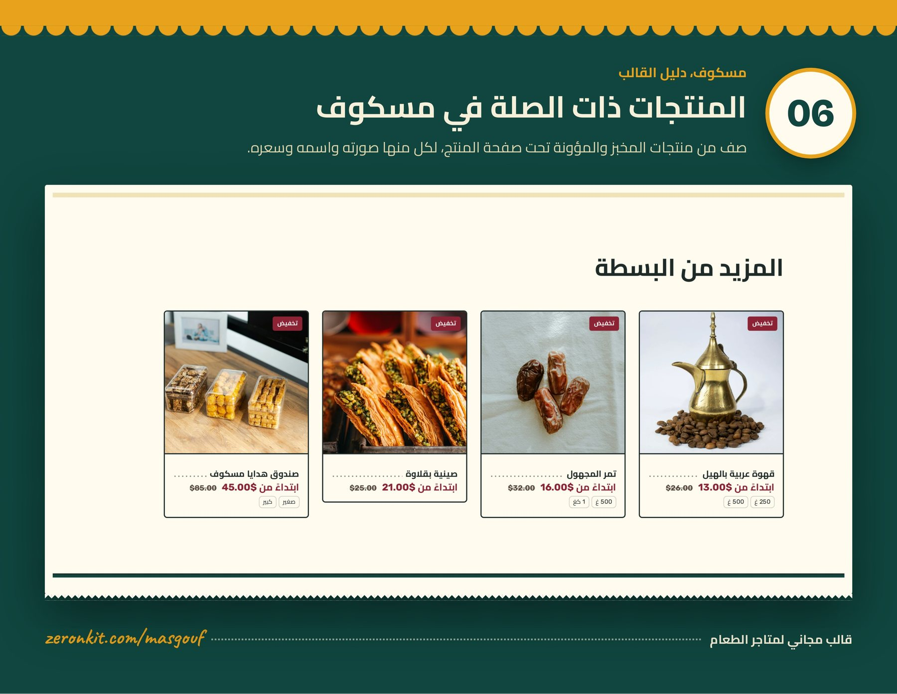](images/product-related-ar.jpg)
اضغط `Related products` لتضبط `Heading` و`Layout` (`Grid` أو `Scrolling row`) و`Products to show`. يتعلّم Shopify مع الوقت ما يقترحه، وإلى أن تتجمع عنده طلبات كافية يعرض مسكوف منتجات من المجموعة نفسها.

### 6.5 بطاقات الهدايا

منتج بطاقة الهدايا لا يظهر فيه زر "اشترِ الآن" ولا أسطر التوصيل ولا لوحات الطعام، ولا يحتاج إلى أي ضبط.

## 7. الرفوف: المجموعات والبحث

### 7.1 صفحة المجموعة

المجموعة لوح طباشير واحد، والمنتجات أسطر قائمة في عمودين: طبق دائري، ثم الاسم، ثم خط منقّط، ثم السعر.
[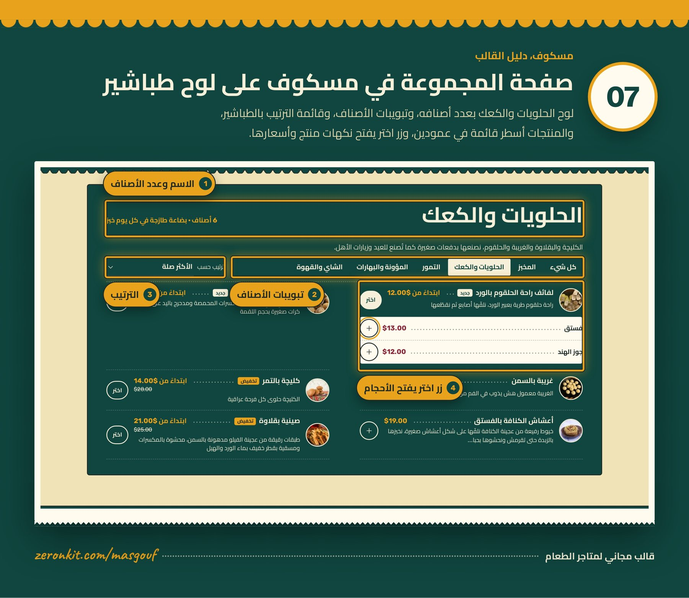](images/collection-ar.jpg)
- المنتج الذي له حجم واحد عليه "+" يضيفه فورًا، والذي له أحجام عليه "اختر" فتنفتح أحجامه أسطرًا بأسعارها، ولكل منها "+". الزبون المعتاد الذي يعرف ما يريد يملأ سلته دون أن يفتح صفحة منتج واحدة.
- التبويبات في الأعلى تأتي من الفلاتر، أو من `Category tabs menu`.
- `Banner note` هو الشارة الصغيرة المكتوبة باليد على اللوح، مثل "بضاعة طازجة كل يوم خَبز".
- `Show round product photos` و`Show a short description under each name` يغيّران شكل الأسطر.
- `Products per page` و`Pagination` (`Load more button` أو `Numbered pages` أو `Infinite scroll`) يحددان طريقة تحميل القائمة.
[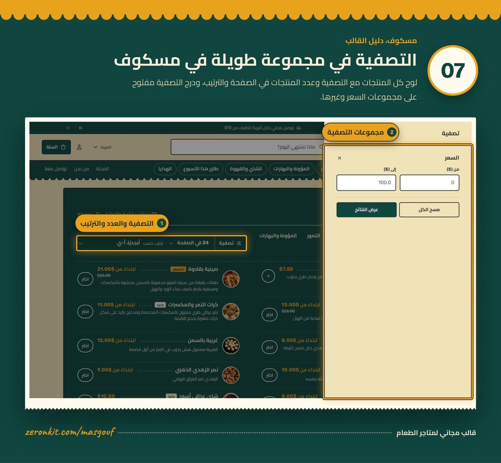](images/collection-filters-ar.jpg)
في القوائم التي فيها 12 منتجًا أو أكثر يظهر زر التصفية واختيار عدد المنتجات في الصفحة. وفي القوائم القصيرة يختفيان، لأن الزبون يقرأ اثني عشر سطرًا بنظرة. وتختفي كذلك مجموعات التصفية التي ليس فيها إلا خيار واحد. الفلاتر نفسها تضبطها في تطبيق Search & Discovery المجاني.

### 7.2 نتائج البحث
[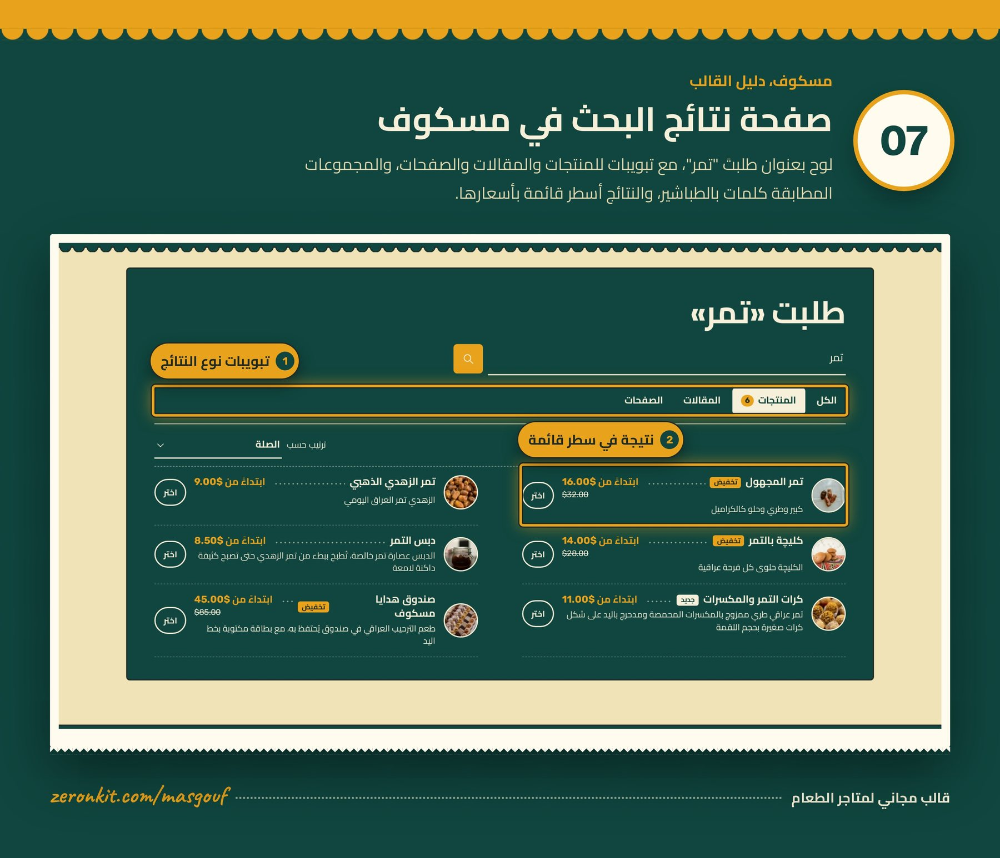](images/search-results-ar.jpg)
اضغط `Search results` (افتح صفحة البحث من قائمة الصفحات). تضبط `Heading` و`Products per page` والتصفية والترتيب. ويملأ `Suggested collection when nothing is found` البحث الذي لا نتيجة له بمنتجات تحت عبارة "ليس على اللوح اليوم".

### 7.3 كل الرفوف (قائمة المجموعات)

صفحة `/collections` خريطة لبسطتك: صورة عريضة عليها دبابيس مرقّمة، وتحتها دليل.
[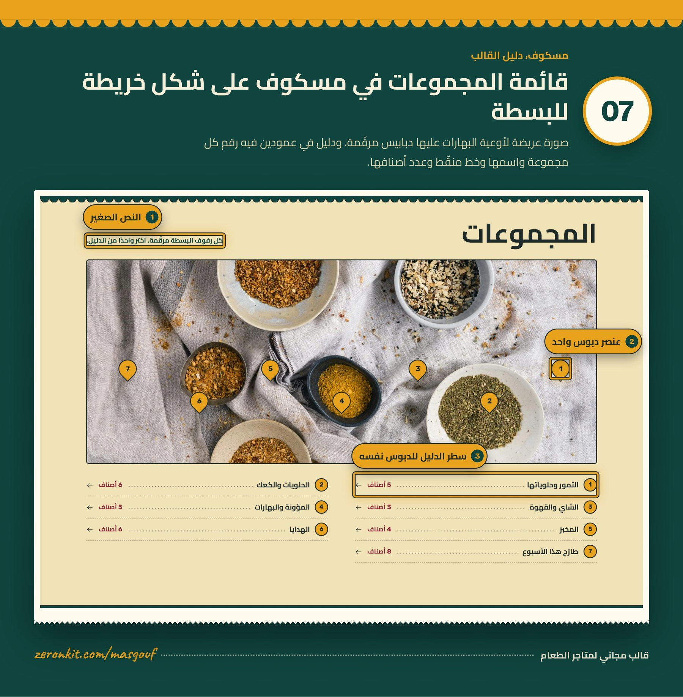](images/collections-map-ar.jpg)
- `Stall photo`: صورة عريضة لمحلك أو لطاولة السوق.
- بلا عناصر تحصل كل مجموعة على دبوس على طول أسفل الصورة. أضف عنصر `Pin` لكل مجموعة لتضعه بنفسك، فيحرك `Across the picture` و`Down the picture` الدبوس بالنسبة المئوية.
- حين يشير الزبون إلى سطر في الدليل يضيء دبوسه، والعكس كذلك.

## 8. السلة

### 8.1 تذكرة السلة (درج السلة)

أضف شيئًا إلى السلة فتنزل من زر السلة تذكرة ورقية ضيقة.
[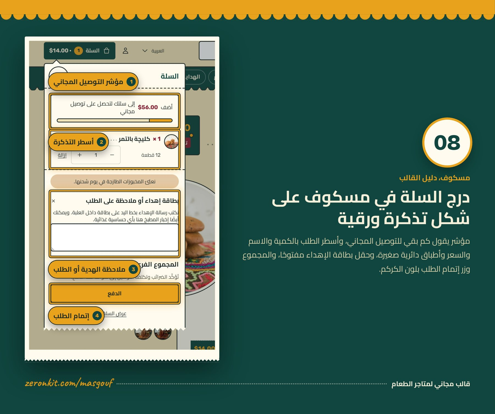](images/cart-drawer-ar.jpg)
من الأعلى إلى الأسفل:

- مؤشر السلة: "أضف 56.00$ إلى سلتك لتحصل على توصيل مجاني"، مع شريط يمتلئ. وعند بلوغ المبلغ يخبر الزبون أن سلته تُوصل مجانًا. يعتمد على `Free delivery from (amount in the store currency)` و`Countries with free delivery` (2.3)، ولا يظهر إلا لزبائن تلك الدول.
- الأسطر: الكمية والاسم والسعر، ثم الحجم وأزرار الكمية الصغيرة و"إزالة". ويضيف `Show small round photos on the ticket lines` في `Cart drawer` الأطباق الصغيرة.
- ملاحظة: `Note above the subtotal` في `Cart drawer`، مثل "المخبوزات الطازجة تُغلّف يوم شحنها".
- ملاحظة الهدية أو الطلب: حقل مفتوح يحتاج إلى `Enable order note` (2.3). تحته تلميح يقول إن بطاقات الإهداء تُكتب باليد. إن لم تكن تفعل ذلك فغيّر التلميح كما في 11.2.
- المجموع وزر إتمام الطلب ورابط عرض السلة.

إن كانت السلة فارغة عرضت بعض المنتجات ليبدأ منها الزبون، تختارها في `Collection` تحت `Empty cart`.

ولتستعمل صفحة كاملة بدل الدرج اجعل `Cart type` هو `Page` في `Theme settings` ثم `Cart`.

### 8.2 صفحة السلة (المنضدة)
[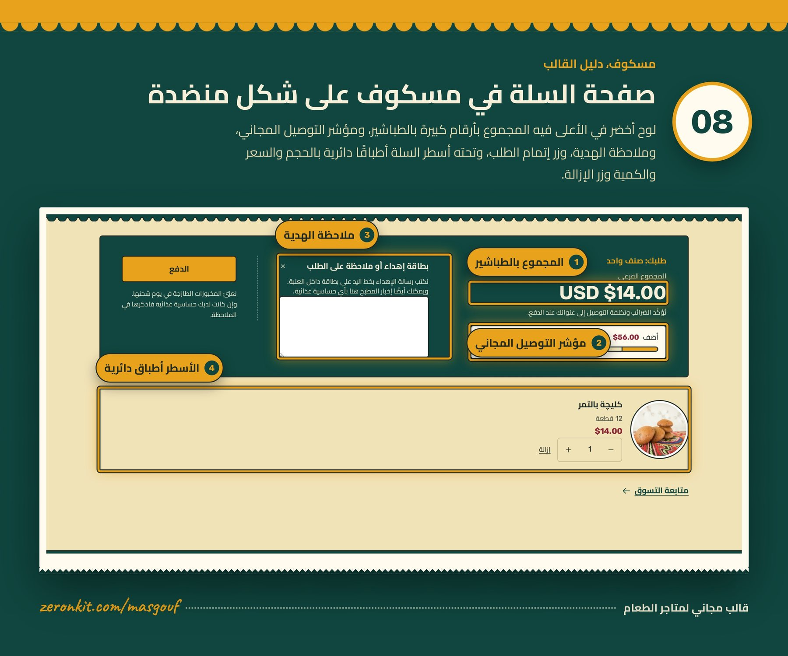](images/cart-page-ar.jpg)
صفحة السلة تبدأ بالحساب. اللوح في الأعلى فيه المجموع بأرقام كبيرة بالطباشير، والمؤشر، وملاحظة الهدية، وزر إتمام الطلب، ثم تأتي الأسطر أطباقًا دائرية في عمودين. اضغط `Cart` في المحرر لتضبط `Heading` و`Order note under the summary`.

وإذا كانت السلة فارغة بقي اللوح في مكانه يخبر الزبون بذلك، وتحته منتجات ما زالت للبيع أسطرَ قائمة بعنوان "ما زال على اللوح". تُظهر هذه الأسطر أو تخفيها بـ`Show product suggestions` تحت `Empty cart`، وتختار منتجاتها من `Collection`.

زر إتمام الطلب بلون الكركم في الدرج وفي الصفحة، فتبقى الخطوة الأخيرة بالشكل نفسه.

### 8.3 صفحة الدفع

صفحة الدفع في Shopify ليست جزءًا من القالب. لتشبه البسطة افتح `Settings` ثم `Checkout` ثم `Customize` واضبط الألوان والخطوط هناك: القصب `#F1E3B8` أو الورق `#FFFBEF` للخلفية، والحبر `#1E2A28` للنص، وخضرة دجلة `#10463F` للروابط، والكركم `#E9A21B` للأزرار، وخط Rubik للنصوص.

## 9. الصفحات الأخرى

### 9.1 تواصل معنا: واجهة البسطة
[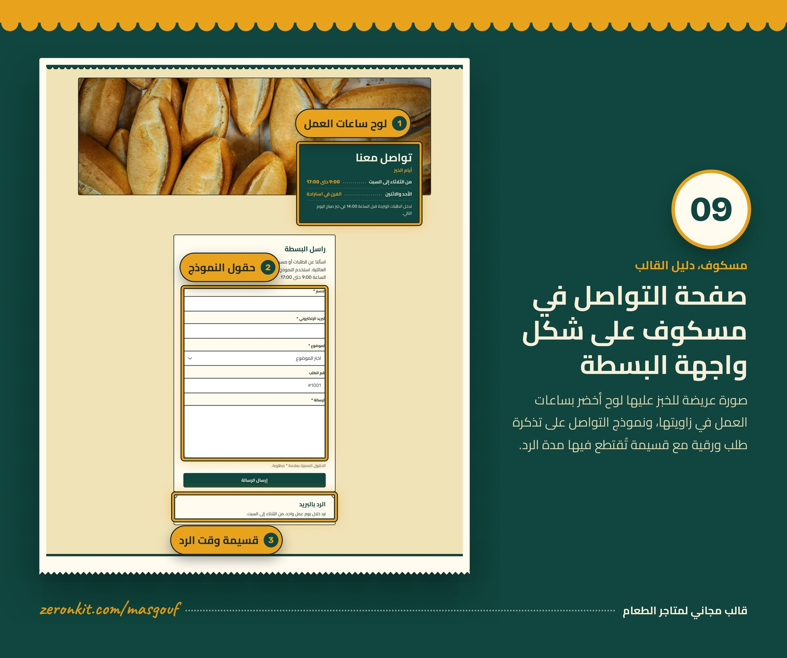](images/contact-ar.jpg)
اضغط `Contact form` في المحرر (بعد فتح صفحة التواصل).

- `Layout`: `Stall front: photo, hours board and a ticket form`. والتخطيطان الآخران `Form only` و`Form and information column`.
- `Stall photo`: الصورة العريضة في الأعلى.
- أضف عنصر `Opening hours row` لكل سطر في لوح الساعات، و`Phone` يضيف سطر الهاتف.
- حقول النموذج عناصر: `Name field` و`Email field` و`Phone field` و`Order number field` و`Topic dropdown` و`Message field`، تضيفها وتحذفها وترتبها. في `Topic dropdown` اكتب المواضيع تفصل بينها فاصلة إنجليزية، مثل `الطلبات, الحساسية, الصواني والهدايا, الجملة`.
- `Heading` و`Intro text` و`Button label` و`Success message` للكلمات.
- سطر البريد يأتي من `Contact email`، ثم من `Store contact email` في `Brand assets`. وإن كانا فارغين ظهر النموذج وحده.

تصل الرسائل إلى بريد متجرك في `Settings` ثم `General`.

### 9.2 من نحن: يوم في البسطة
[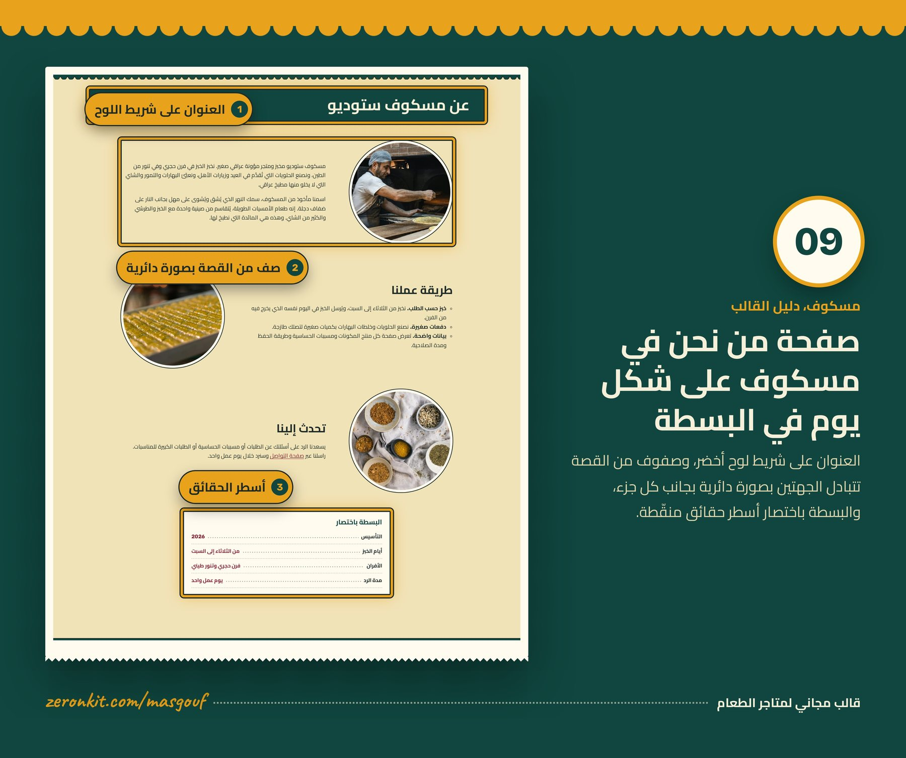](images/about-ar.jpg)
اجعل قالب صفحة "من نحن" هو `about`. يُقسم محتوى الصفحة صفوفًا عند كل عنوان من المستوى الثاني، ولكل صف صورة دائرية تنتقل من جهة إلى أخرى مع التمرير.

- أضف عناصر `Photo for a row` لتختار الصور بالترتيب، وبدونها تُستعمل صور المجموعات.
- وإن أردت كتابة الصفوف من المحرر فأضف عناصر `Story row` (`Image` و`Heading` و`Text`).
- أضف عنصر `Fact line` لكل معلومة في النهاية، فيه `Label` و`Value`، مثل "أيام الخَبز ....... من الثلاثاء إلى السبت".

### 9.3 الأسئلة الشائعة: أسئلة على اللوح
[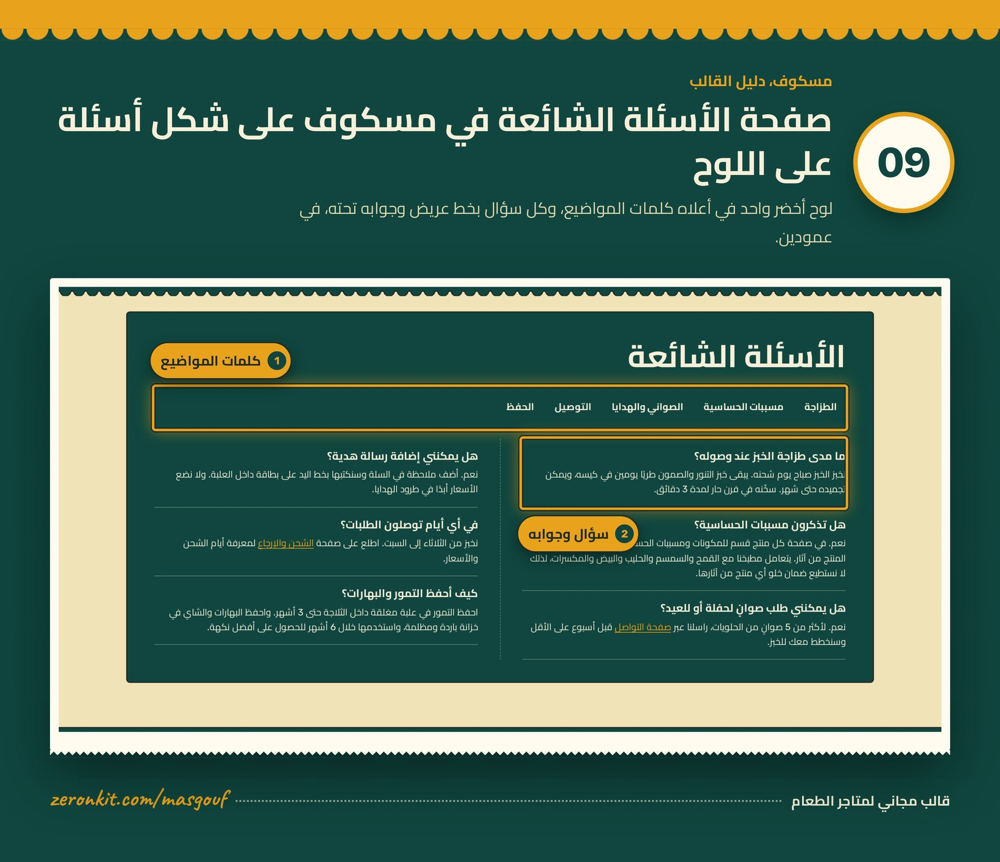](images/faq-ar.jpg)
اجعل قالب صفحة الأسئلة `faq`. كل عنوان من المستوى الثاني في الصفحة يصير سؤالًا، والنص تحته جوابه. الأجوبة كلها ظاهرة معًا، فمن يبحث عن معلومة عن الحساسية يقرؤها دون أن يضغط شيئًا.

أضف عنصر `Topic word` لكل موضوع، فيه `Label` و`Jumps to question number`. تظهر الكلمات في الأعلى وتنقل الزبون إلى السؤال.

### 9.4 المدونة
[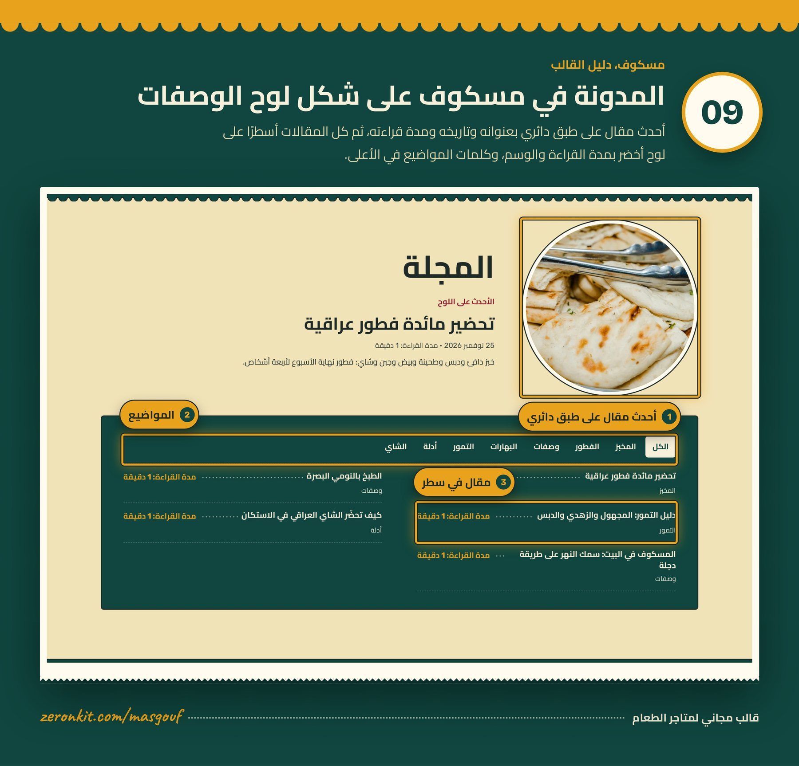](images/journal-ar.jpg)
أحدث مقال على طبق دائري في الأعلى، ثم كل المقالات أسطرًا على اللوح بمدة قراءتها. كلمات المواضيع مأخوذة من وسوم المقالات. اضغط `Blog posts` لتضبط `Show the newest post as a wide card` و`Posts per page`.

### 9.5 المقال بطاقة وصفة
[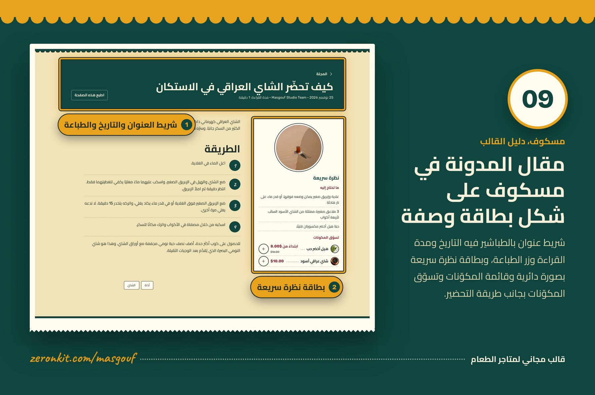](images/article-ar.jpg)
إن كان في المقال قائمة نقطية نقل مسكوف أول قائمة إلى بطاقة "نظرة سريعة" بجانب النص. ضع قبلها عنوانًا من المستوى الثاني مثل "ستحتاج إلى" فيصير عنوان البطاقة.

وتحت القائمة يعرض "تسوّق المكوّنات" حتى أربعة من منتجاتك بأسعارها. يُختار المنتج إن ورد اسمه في المقال، أو إن كان حقله `masgouf.recipe_article` يشير إلى المقال. فالمقال عن الشاي الذي يذكر "شاي عراقي أسود" و"حبات الهيل الأخضر" يبيع الاثنين.

اضغط `Blog post` لتضبط `Show author` و`Show reading time` و`Show print button`. زر الطباعة يطبع الوصفة دون الترويسة والتذييل.

### 9.6 الصفحات العادية
[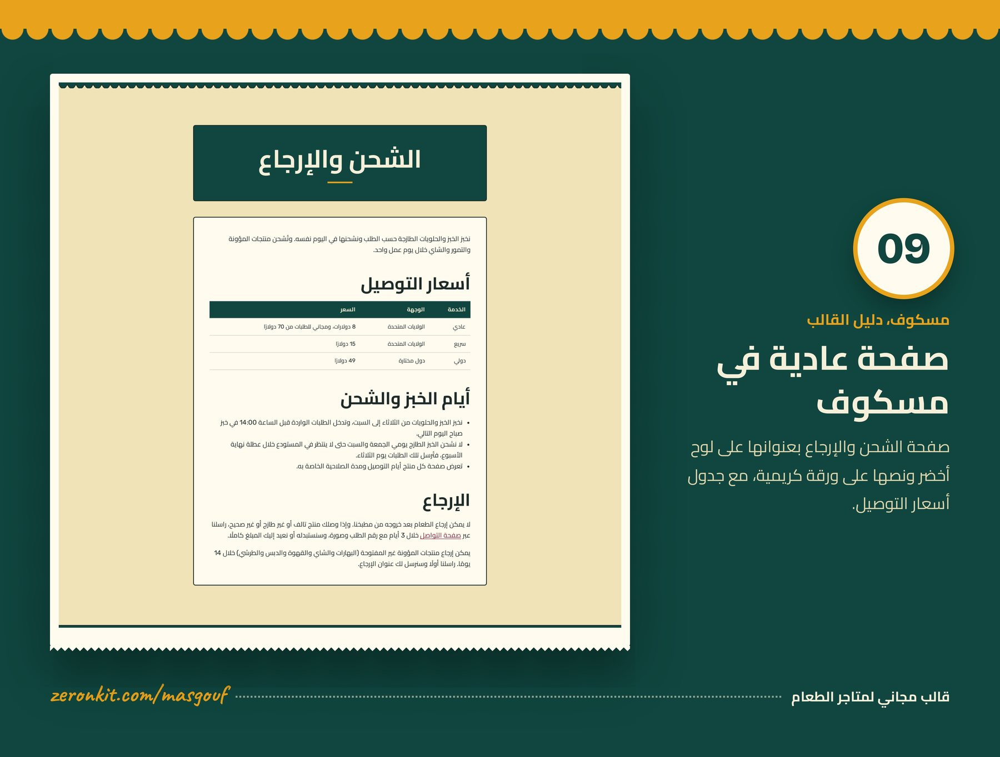](images/page-ar.jpg)
الشحن والإرجاع والخصوصية وأمثالها تستعمل قسم `Page`، و`Alignment` يضع العنوان في البداية أو في الوسط.

### 9.7 الصفحة غير الموجودة
[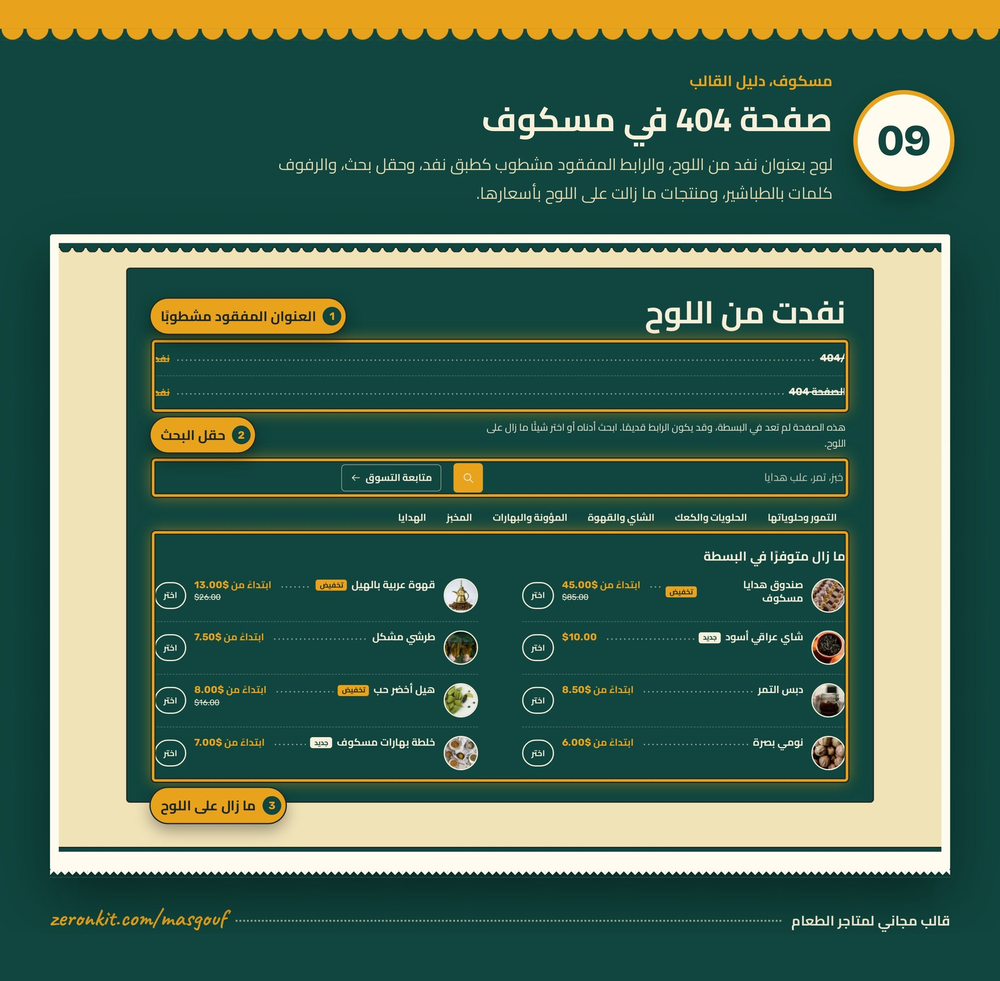](images/not-found-ar.jpg)
الرابط الخاطئ يفتح لوحًا مكتوبًا عليه "نفد من اللوح"، والرابط مشطوب كطبق انتهى. وتحته حقل بحث ورفوفك ومنتجات ما زالت للبيع. اضغط `Page not found` لتضبط `Heading` و`Show popular collections` و`Show products`.

### 9.8 صفحة كلمة المرور

ما دام متجرك مقفلًا يرى الزوار "الستارة مغلقة": لوح يملأ الشاشة عليه "مغلق حتى يوم الافتتاح"، ومواعيد الافتتاح والخَبز أسطر قائمة، وكلمة المرور سطر واحد بالطباشير، والاشتراك في النشرة. اضغط `Password page` لتضيف عناصر `Fact line` ولتشغّل `Show newsletter sign-up` أو توقفه.

## 10. التذييل وأسبوع الخَبز
[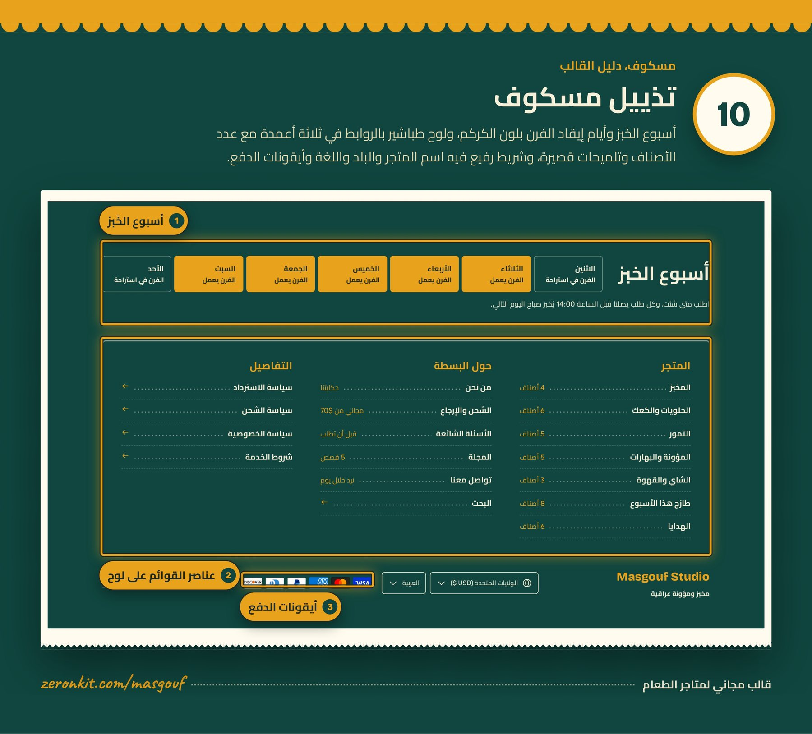](images/footer-ar.jpg)
يبدأ التذييل بأسبوع الخَبز: سبعة أيام، والأيام التي يُوقد فيها الفرن بلون الكركم. وتحته لوح طباشير واحد فيه روابطك في ثلاثة أعمدة، ولكل سطر تلميح صغير: عدد الأصناف في الرف، أو عدد القصص في المدونة، أو مبلغ التوصيل المجاني.

اضغط `Footer` في المحرر:

- `Layout`: `Riverside: baking week, menu boards, letter slip`.
- `Show the baking week` و`Baking days`. اكتب رموز الأيام تفصل بينها فواصل، مثل `tue,wed,thu,fri,sat`.
- أضف عنصر `Menu` لكل عمود واختر قائمته. العمود الثالث يعرض سياساتك حين يكون `Show policy links` مشغّلًا.
- `Show social icons` و`Show payment icons` و`Show country/region selector` و`Show language selector` تتحكم في الشريط الرفيع في الأسفل. روابط التواصل الاجتماعي تضعها في `Theme settings` ثم `Social media`.
- رابط "Theme by ZeronKit" الصغير يُطفأ من `Theme settings` ثم `Theme credit`.

## 11. إعدادات صغيرة تفرق

### 11.1 تعديل أي صفحة

1. افتح الصفحة في المحرر من قائمة الصفحات في الأعلى.
2. اضغط على قسم في اليسار لترى إعداداته.
3. اسحب النقاط بجانب القسم أو العنصر لتنقله، واضغط العين لتخفيه.
4. `Add section` في الأسفل يضيف قسمًا جديدًا. في مسكوف قسم `Content canvas` تجمع فيه ما تشاء من عناوين ونصوص وصور وأزرار وتطبيقات، وقسم `Custom Liquid` للشيفرة.
5. اضغط `Save`.

### 11.2 كلمات يكتبها القالب عنك

كثير من السطور الصغيرة يكتبها القالب، مثل "الفرن موقد" و"اطلب في أي يوم" و"تُكتب بطاقات الإهداء باليد". لتغييرها افتح `Online Store` ثم `Themes` ثم قائمة `...` ثم `Edit default theme content`، وابحث عن الكلمات وغيّرها، ولا تنسَ العربية.

### 11.3 بطاقات المنتجات وشارة "جديد"

في `Theme settings` ثم `Product cards`:

- `Show New badge for` عدد الأيام التي تبقى فيها شارة "جديد" على المنتج الجديد. المنتج الموسوم `new` تظهر عليه دائمًا، واجعل الرقم 0 لتعتمد على الوسم وحده.
- `Show sizes in stock` يعرض الأحجام على البطاقات ويشطب ما نفد منها.
- `Show second image on hover` و`Image ratio` يغيّران صور البطاقات.

## 12. العربية واللغات الأخرى

يأتي مسكوف بالإنجليزية والعربية. كل نصوص القالب مكتوبة باللغتين بعربية طبيعية، وكل صفحة تنقلب من اليمين إلى اليسار.

1. في لوحة Shopify افتح `Settings` ثم `Languages`، وأضف العربية واضغط `Publish`.
2. ثبّت تطبيق Translate & Adapt المجاني لترجمة المنتجات والمجموعات والصفحات والقوائم والحقول الإضافية.
3. يبدّل الزبون اللغة من المحدد في التذييل أو على لوح القائمة أو في الترويسة.

أمران يجب أن تعرفهما:

- إن كتبت نصًا إنجليزيًا في إعداد قسم ظهر بالإنجليزية في كل اللغات حتى تترجمه في Translate & Adapt. امسح الخانة ليعود نص القالب الأصلي باللغتين.
- ترجم حقول الطعام أيضًا، كالمكوّنات وطريقة الحفظ. الصفحة العربية التي مكوّناتها بالإنجليزية صعبة على من يحتاجها أكثر من غيره.

## 13. على الهاتف

كثير من زبائنك سيطلبون من الهاتف، وربما وهم في طريقهم إلى البيت.
[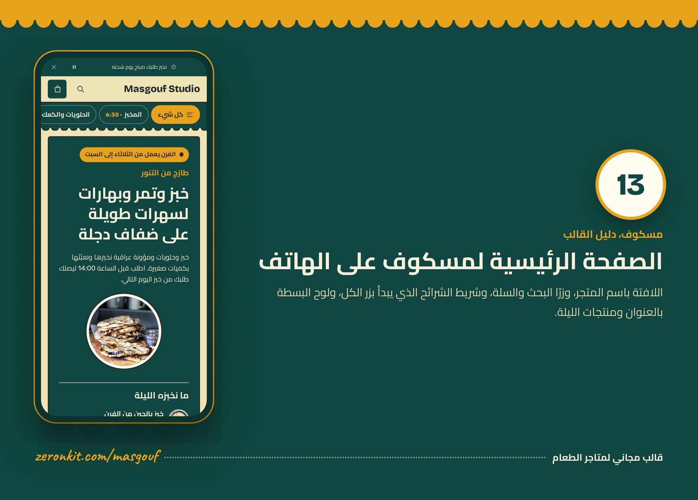](images/m-home-ar.jpg)
- تعرض الترويسة الاسم والبحث والسلة، وشريط الشرائح يتحرك أفقيًا ويبدأ بـ`Everything`.
[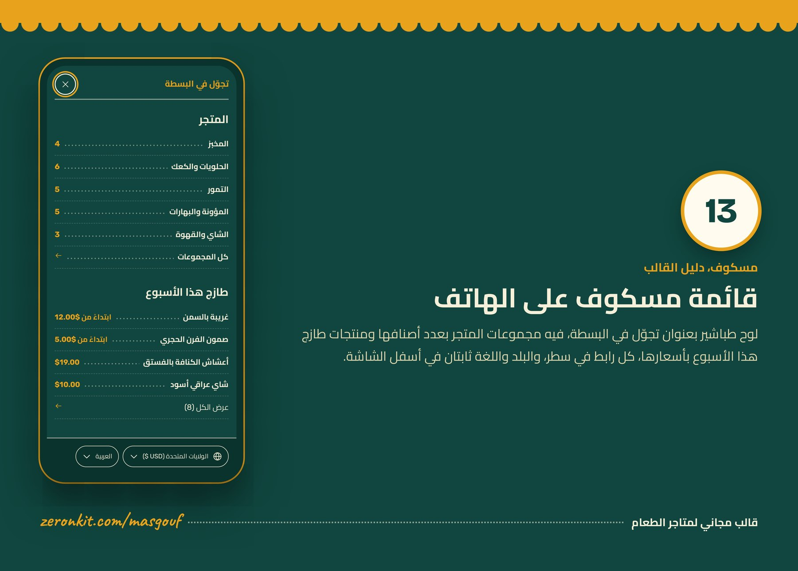](images/m-menu-ar.jpg)
- على الهاتف تملأ القائمة الشاشة لوحَ طباشير بعنوان "تجوّل في البسطة"، وكل رابط في سطر واحد. يبقى عنوان كل عمود في الأعلى وأسطره تمرّ تحته، ويبقى البلد واللغة في أسفل اللوح.
[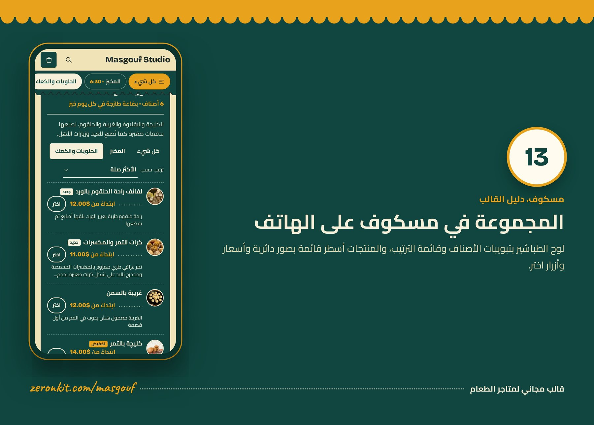](images/m-collection-ar.jpg)[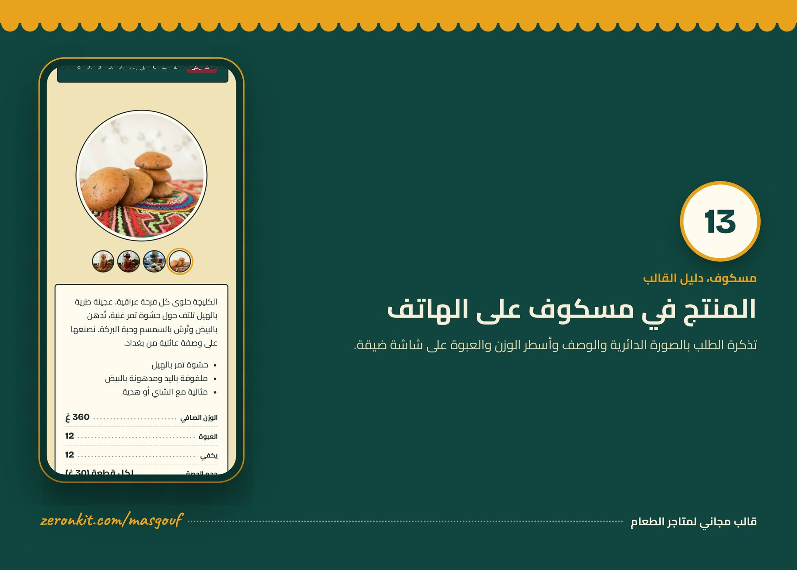](images/m-product-ar.jpg)[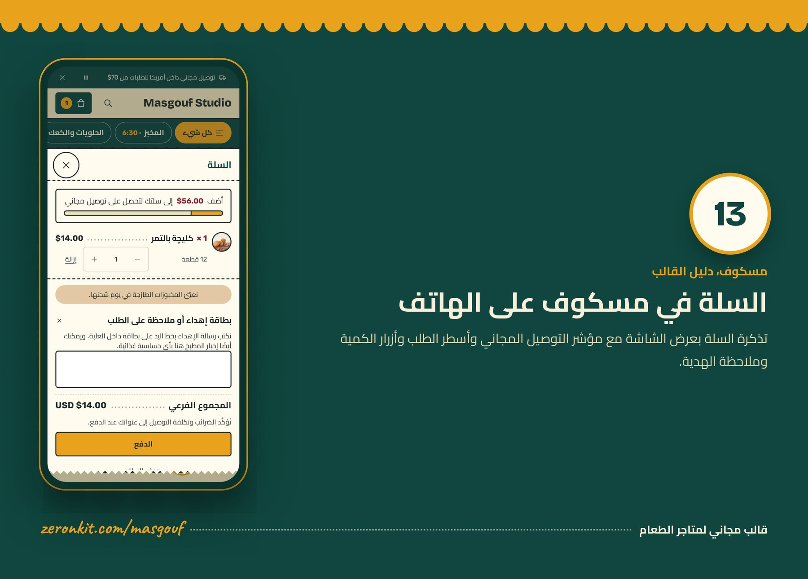](images/m-cart-ar.jpg)[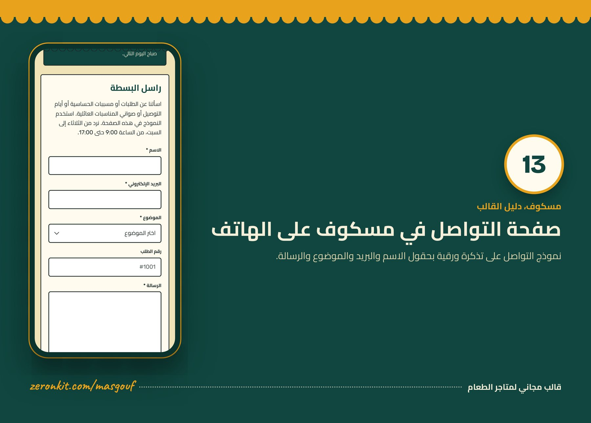](images/m-contact-ar.jpg)
ارتفاع كل زر ورابط على الهاتف 44 بكسل على الأقل، فيسهل الضغط عليه بالإبهام. لا تحتاج إلى ضبط شيء للهاتف، وفي بعض الأقسام إعداد خاص به مثل `Logo width on mobile` في `Header`.

## 14. حين يبدو شيء غير صحيح

**تظهر المنتجات نافدة لزبائن بعض الدول.** افتح `Settings` ثم `Markets`. إن كانت دولة في سوق ليس له كتالوج أو شحن عرض Shopify منتجاتك فيها غير متوفرة. انقل هذه الدول إلى سوقك الرئيسي، وتأكد أن لها سعر شحن في `Settings` ثم `Shipping and delivery`.

**يقول المنتج إنه نفد وعندك مخزون.** تأكد أن المخزون في موقع يلبّي الطلبات الإلكترونية، من `Settings` ثم `Locations`.

**لا يظهر مؤشر السلة.** راجع `Free delivery from (amount in the store currency)` في `Theme settings` ثم `Cart`، ثم قائمة الدول. المؤشر لا يظهر إلا لزبائن تلك الدول، وحين يتسوقون بعملة متجرك.

**المؤشر وصفحة الدفع مختلفان.** المؤشر يقرأ إعداد القالب وحده، فاستعمل المبلغ نفسه المكتوب في `Settings` ثم `Shipping and delivery`.

**لا توجد ملاحظة الهدية في السلة.** شغّل `Enable order note` في `Theme settings` ثم `Cart`.

**صفحة من نحن أو الأسئلة نص طويل واحد.** تأكد أن الصفحة تستعمل قالب `about` أو `faq`، وأن الأجزاء أو الأسئلة عناوين من المستوى الثاني وليست نصًا عريضًا.

**لا تظهر بطاقة "نظرة سريعة" في الوصفة.** يحتاج المقال إلى قائمة نقطية، أما القائمة المرقّمة فتبقى في طريقة التحضير.

**تظهر قيم الخبز الغذائية على الكعك.** النص المكتوب في عنصر طعام في قالب المنتج الرئيسي يظهر على كل منتج ليس له حقل خاص. امسح هذه الخانات واستعمل الحقول الإضافية لكل منتج.

**لا يظهر وقت الخبز على الشريحة.** في `Hints on the category chips` يجب أن يكون ما قبل النقطتين معرّف المجموعة كما في رابطها، لا اسمها.

**نص إنجليزي في المتجر العربي.** ترجم الإعداد في Translate & Adapt، أو امسحه ليظهر نص القالب العربي.

**لا توجد فلاتر في المجموعة.** تظهر الفلاتر في القوائم التي فيها 12 منتجًا أو أكثر. ثبّت Search & Discovery وأضف الفلاتر منه.

**لا تصل رسائل التواصل.** راجع بريد المتجر في `Settings` ثم `General`، وانظر في مجلد الرسائل غير المرغوب فيها.

## 15. المساعدة والتغييرات

المساعدة مجانية وبحسب الإمكان، عبر https://zeronkit.com أو على info@zeronkit.com. لا يوجد موعد ثابت للتحديثات.

### سجل التغييرات

**1.0.0، ملف محدَّث (26 نوفمبر 2026)**: إصلاحات صغيرة بعد مراجعة التخطيطات. عناوين الأعمدة في لوح القائمة صارت على خط واحد. في صفحة المنتج لم تعد الصورة الدائرية تغطي جدول المعلومات. وفي المتجر العربي صار السهم الصغير في تذكرة السلة يشير إلى زر السلة. تذكرة البحث بلا زر فوق الحقل، فلا يغطي شيء ما يكتبه الزبون. وعلى الهاتف يبقى شريط البلد واللغة فوق عناوين القائمة. وصفحة السلة الفارغة تحتفظ بلوحها وتعرض منتجات ما زالت للبيع. إن ثبّتّ 1.0.0 قبل هذا التاريخ فنزّله من جديد واتبع الخطوات في 2.4.

**1.0.0 (25 نوفمبر 2026)**: أول إصدار عام. مرّ القالب قبل صدوره بمراجعات على متجر تجريبي وبجولة لتخطيطات الصفحات. فيه ترويسة لوح القائمة وتذكرة البحث، وصفحة المنتج على شكل بطاقة قائمة والأحجام أسطر بأسعارها، ومؤشر التوصيل المجاني وملاحظة الهدية المفتوحة، وصفحات من نحن والأسئلة وبطاقة الوصفة وخريطة البسطة، وشارة واحدة لكل منتج، ووصف لكل صفحة لمحركات البحث، وإعداد بريد التواصل للمتجر، والعربية لكل نصوص القالب.

</div>
