# Masgouf theme guide

Version 1.0.0, updated 26 November 2026. Made by ZeronKit (https://zeronkit.com).

Words in `code style` match the Shopify theme editor word for word, so you can find each one by searching the editor.

## 1. A stall on the river

Masgouf is a free Shopify theme for shops that sell food: a bakery, a sweet shop, a pantry of dates and spices, a tea and coffee counter, or a small grocer that bakes a little too. It comes in English and Arabic. When a shopper switches to Arabic, every page flips to read from right to left.

The name comes from a Baghdad dish. Masgouf is river carp, split open along the back and set upright on stakes around an open fire of apricot wood. It cooks for an hour or more in the smoke while people sit and drink tea. For a long time the place to eat it was Abu Nuwas street, on the east bank of the Tigris. On summer evenings the stalls there lit their fires and chalked the day's prices on boards. You picked your fish from the tank and ate it by the water, with hot bread from the tannour and a plate of pickles.

The theme is built like one of those stalls at night, and it calls its look the Riverside Stall:

- Reed and paper: the page background is the colour of dry reed. Order forms and notes sit on cream paper, sometimes with a torn edge like a ticket.
- Chalk boards in Tigris green: lists of products are written on dark green boards, the way prices are chalked up at a stall.
- Dotted leaders: a name and its price are joined by a row of dots, like a printed menu.
- Round plates: photos are small round plates beside the words. You read the menu first and the photo backs it up.
- Turmeric and sumac: turmeric yellow is the colour of the fire and of the main buttons. Sumac red marks prices and sales.
- A chalk hand: prices and short notes are written in a handwriting font, as if someone at the counter wrote them.
[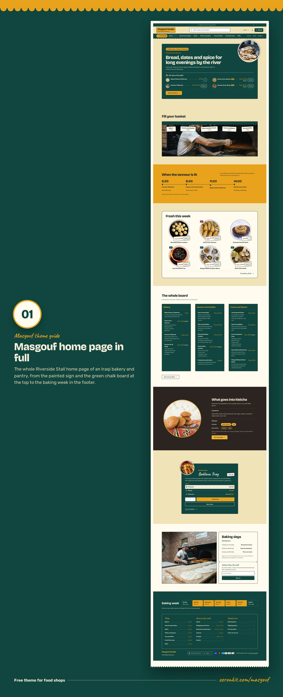](images/home-overview-en.jpg)
### What a food shop gets

A shopper buying bread or sweets online wants to know a few plain things. When was it baked, and when will it arrive? What is in it, and is it safe for my child with a nut allergy? How big is the box? Is there free delivery if I add one more tray? Can I send it as a gift with a note?

Masgouf answers these on the page:

- Bake times and baking days. Bake times can sit on the category chips in the header. A bake schedule shows the day at the oven. The footer shows which days the oven is lit.
- Delivery days on each product, with your order cut-off time.
- Ingredients and allergens, with the allergens in bold, plus a nutrition table and weight and servings.
- Sizes as menu lines, each with its own price, like "12 pieces ....... $14.00".
- A basket meter that tells the shopper how much more they need for free delivery.
- A gift note field that is already open in the cart.
- Recipes in the journal that list the ingredients and link to the products you sell.

All of it is built into the theme, with no app to install.

### Licence

- Masgouf is free. You can use it and change it on any store you own or run.
- You can't sell it, share the files, upload it to a theme marketplace or call it your own work.
- It is given as it is, with no warranty. The full text is in the `LICENSE` file inside the zip.
- ZeronKit is the only place it comes from. It is not in the Shopify Theme Store.

### What you need before you start

- A Shopify store on any plan.
- Your product photos. Square photos with the food in the middle look best, because the theme cuts many of them into circles.
- The words for your shop: a short line for the sign, your opening hours, your delivery days and your order cut-off time.
- About an hour for the first setup.

## 2. Putting the stall up

### 2.1 Upload the zip

1. Download `masgouf-1.0.0.zip` from the download box at the top of this page. Don't unzip it.
2. In Shopify admin open `Online Store`, then `Themes`.
3. Click `Add theme` and pick `Upload zip file`. Choose the zip.
4. Masgouf arrives in your theme library as an unpublished theme. Your live store doesn't change yet.

### 2.2 Look before you publish

1. Click `Customize` next to Masgouf. The theme editor opens on the home page.
2. Use the page picker at the top of the editor to visit a product, a collection and the cart.
3. Click the phone icon at the top to check the phone view.
4. When you are happy, go back to `Themes`, open the `...` menu next to Masgouf and choose `Publish`.

### 2.3 Five things to fill in first

The theme works out of the box, but these settings come from your shop, so only you can fill them in. Open `Theme settings` (the brush icon on the left of the editor).

1. **Free delivery.** In `Cart`, under `Free delivery bar`, type your free delivery amount in `Free delivery from (amount in the store currency)`. Use the same number as the free rate in `Settings`, `Shipping and delivery`. In `Countries with free delivery` add the two letter codes of those countries, for example `US,CA`. Leave it empty if free delivery applies everywhere. If you don't offer free delivery, leave the amount empty and no meter shows.
2. **Your email.** In `Brand assets`, type the address customers should write to in `Store contact email`. It shows on the contact page. Leave it empty if you only want the contact form.
3. **How Google describes you.** Also in `Brand assets`, write one or two sentences in `Home page description for search engines`.
4. **Gift notes.** In `Cart`, turn on `Enable order note`. The cart then shows an open field called "Gift note or order note".
5. **Two page templates.** In Shopify admin open `Online Store`, `Pages`. Open your About page and set `Theme template` to `about`. Open your FAQ page and set it to `faq`. Section 9 explains what these templates do.

### 2.4 Updating later

Shopify doesn't update a theme that was uploaded as a zip. When a new version comes out:

1. In `Themes`, open the `...` menu of your current Masgouf and choose `Duplicate`. This is your backup.
2. Upload the new zip. It arrives unpublished.
3. Set it up like your current theme. You can redo the settings in the editor, or copy `config/settings_data.json` and the files in `templates` from the old theme to the new one with `Edit code`.
4. Check the home page, a product, a collection, the cart and the contact page in both languages. Then publish.

The changes in each version are listed in `CHANGELOG.md` inside the zip and at the end of this guide.

## 3. Painting the sign: colours, fonts and the header

Do this early. Once the colours and the sign are right, every page you set up after this already looks like your shop.

### 3.1 Ready-made looks

Masgouf comes with four looks. Open `Theme settings` and pick one at the top of the panel:

| Look | What it feels like |
| --- | --- |
| Riverside (default) | Reed, Tigris green, turmeric and sumac |
| Roastery | Dark roast colours, slab headings |
| Greengrocer | Herb green, more air between parts |
| Patisserie | A fine serif and outline buttons |

Under `Style` you can change parts of a look without starting again:

- `Palette` swaps the main colours in one step, for example `Flour`, `Golden crust`, `Fresh herb` or `Espresso (dark)`. Keep `Custom (use the colour schemes)` to set every colour yourself.
- `Font pairing` gives ready pairs of fonts. `Arabic friendly` reads best if most of your shoppers use Arabic. `Custom (font pickers)` uses the fonts in `Typography`.
- `Corners`, `Button style`, `Spacing` and `Animations` change the shape and movement of the whole store.

### 3.2 Your own colours

Masgouf paints the stall with six colour schemes. Each section has a `Color scheme` setting that picks one of them.

| Scheme | Default colour | Where you see it |
| --- | --- | --- |
| scheme-1 | Reed `#F1E3B8` | The page itself |
| scheme-2 | Tigris green `#10463F` | Chalk boards, menu, footer |
| scheme-3 | Paper `#FFFBEF` | Tickets, cards and the visit card |
| scheme-4 | Turmeric `#E9A21B` | The bake schedule |
| scheme-5 | Charcoal `#2B2421` | The ingredients section |
| scheme-6 | Plain white | Free for your own use |

To change a colour:

1. Open `Theme settings`, then `Colors`.
2. Click a scheme. You see `Background`, `Text`, `Accent and links`, `Button` and `Button label`.
3. Click a colour and type a new value, or pick it.
4. Every section that uses this scheme changes at once.

Keep enough contrast between text and background. Ink on reed or paper reads well, and so does cream text on Tigris green.

### 3.3 Fonts

Open `Theme settings`, then `Typography`:

- `Heading font` is for titles. The default is Bricolage Grotesque.
- `Body font` is for all other text. The default is Rubik.
- `Chalk hand font` writes prices and small notes on the chalk boards. The default is Caveat. Pick another handwriting font if you want a different hand.
- `Heading size` and `Body size` make the text larger or smaller.

Most library fonts have no Arabic letters. Masgouf brings its own Arabic font, Cairo, and uses it for every Arabic word, so Arabic pages stay tidy whichever fonts you pick.

### 3.4 The announcement bar

The thin strip at the very top. Click `Announcement bar` in the editor.

- Add one `Message` block for each message. Two or three is plenty. Each one has `Text`, `Link` and an `Icon` (for example `Delivery` or `Gift`).
- `Display` can be `Static`, `Rotating fade` or `Marquee`. `Time per message` sets the pace.
- `Let shoppers close the bar` adds a close button.

On a phone each message has to fit on one line. "Free US delivery on orders from $70" is about as long as one can be.

### 3.5 The stall header

The header has two rows. Click `Header` in the editor to change it.
[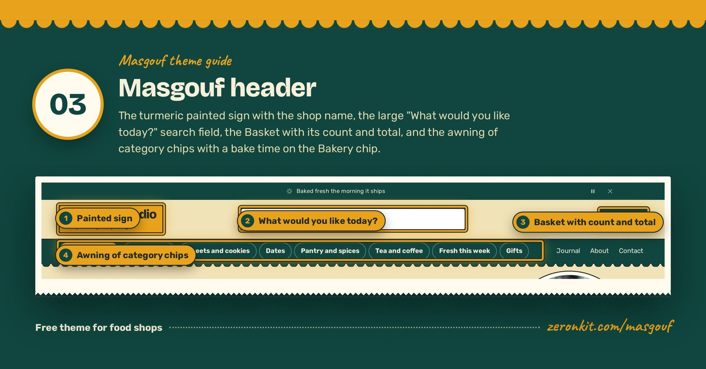](images/header-en.jpg)
**The painted sign.** On the left is a turmeric sign with your shop name.

- Upload a logo in `Logo`, or leave it empty and the shop name is written in the heading font. To write something else, use `Text logo`.
- `Note under the shop name` is the small handwritten line on the sign, for example "Iraqi bakery and pantry". Leave it empty for the theme's own line.

**The search field.** The big field in the middle asks "What would you like today?". It is the main way into the shop, because people looking for food often know the word they want: "kleicha", "dates", "cardamom". Section 3.7 covers it.

**The Basket.** On the right. When something is in the cart it shows the number of items and the total.

**The awning.** The second row hangs like a stall awning with a scalloped edge. On it:

- `Everything` opens the whole menu on a board (see 3.6).
- Then one chip per collection. They come from the menu in `Menu`. If a menu item has sub-items, each sub-item becomes a chip. A top level link to a collection also becomes a chip.
- On the far side, plain words for the pages, such as Journal, About and Contact. These are the top level links that are not collections.

**Bake times on the chips.** In `Hints on the category chips`, write one line per collection: the collection handle, a colon, then a short hint. For example:

```
bakery: 6:30
sweets: from 9:00
```

The hint shows in the chalk hand after the name, like "Bakery · 6:30". Use it for the hour the first tray comes out, or for "today only". You find a collection's handle at the end of its web address.

Other header settings:

- `Layout` keeps `Market stall: sign, chalk menu board, basket`. The other layouts are simpler bars, if you ever want one.
- `Sticky header` decides if the header stays at the top while scrolling.
- `Show search`, `Show account` and `Show cart` hide or show those parts.
- `Show country/region selector` and `Show language selector` put the selectors in the header.
- `Color scheme` and `Menu and search color scheme` paint the sign row and the awning row.

### 3.6 The whole board (menu)

Click `Everything` and the full menu drops down from the awning as one chalk board.
[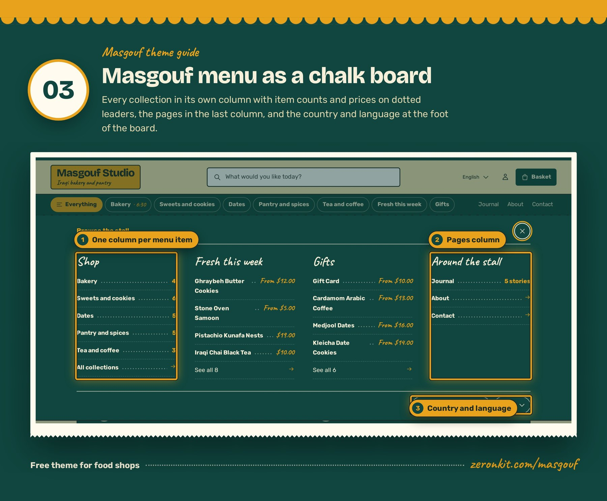](images/board-menu-en.jpg)
- Each top level item in your menu becomes a column. Its sub-items are lines with the number of products, or a "From" price for single products.
- Pages and the blog get their own column at the end.
- The country and language selectors sit at the foot.

The board is built from the same `Menu` as the chips. Arrange the menu in `Online Store`, `Navigation` (see 4.5) and the board follows. `Show the Shop navigator button` turns the `Everything` chip off.

### 3.7 Search as an order ticket

Click the search field and a paper ticket hangs from it, with a torn foot like a slip from an order pad.
[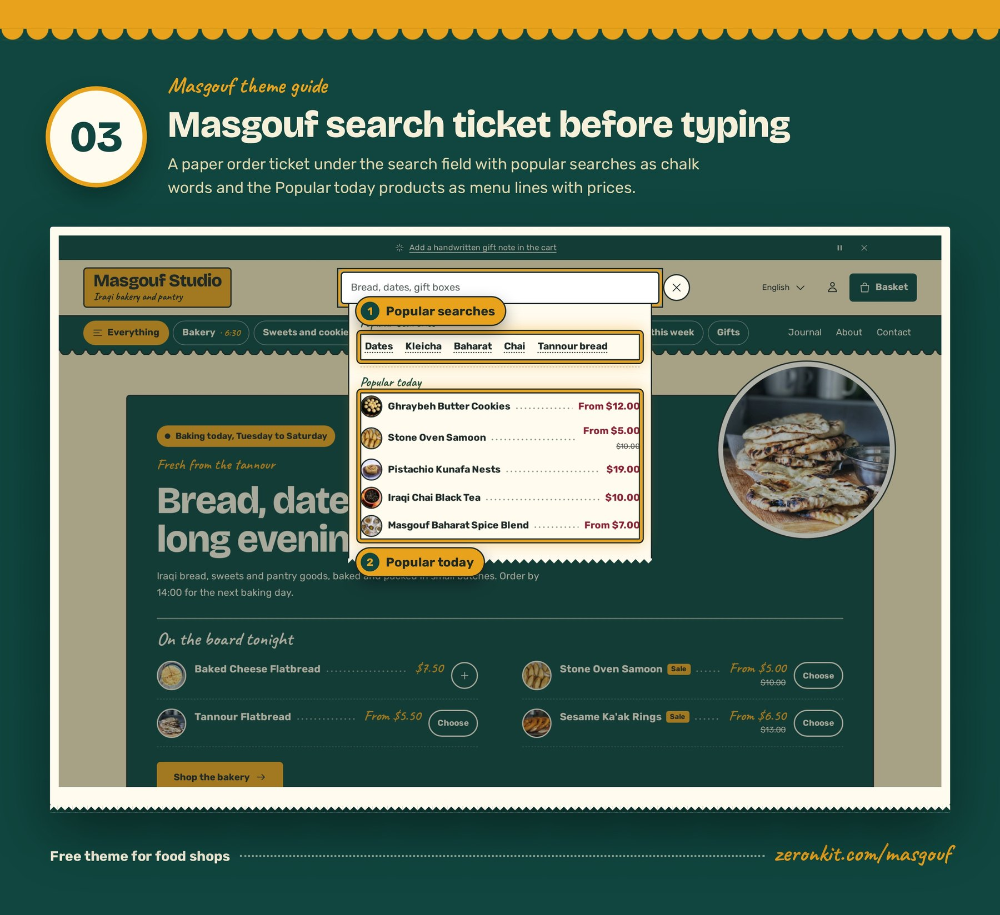](images/search-ticket-en.jpg)
Before the shopper types, the ticket shows two lists. You set both in `Theme settings`, `Search`:

- `Popular searches`: words separated by commas, for example `kleicha, dates, baklava, chai, cardamom`. They show as chalk words to tap.
- `Popular today collection`: pick a collection, and its first products show as menu lines with prices. Use your best sellers or what was baked this morning.
[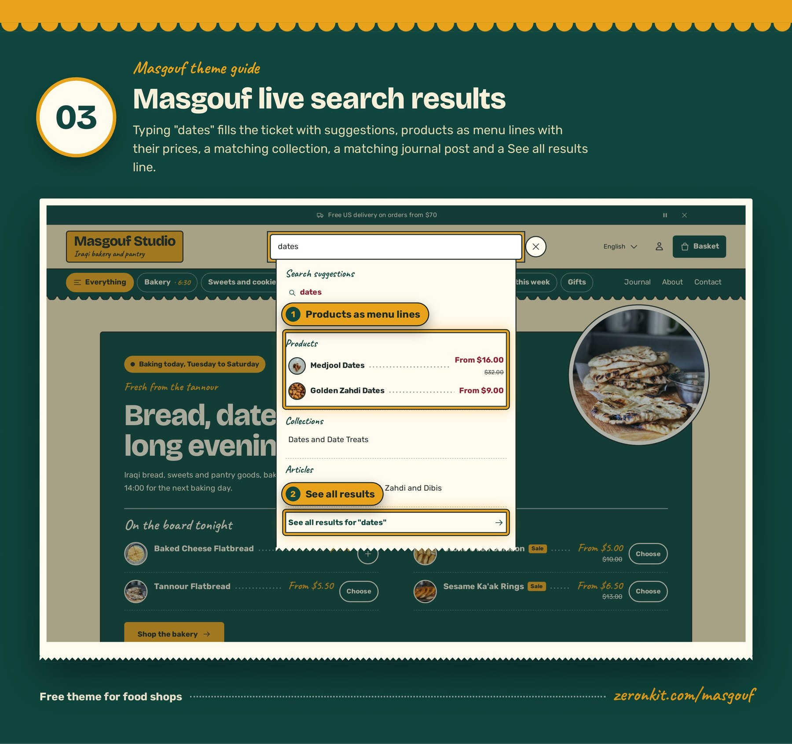](images/search-typing-en.jpg)
As soon as the shopper types, the ticket fills with suggestions, products, collections, pages and journal posts. `Enable search suggestions` in the same panel turns this live search on or off.

The ticket has no search button. The shopper presses Enter, or the search key on a phone keyboard, to open every result on the search page.

Shopify's live search doesn't support every language, and Arabic is one it skips. On the Arabic store the ticket shows a single line that opens all the results for the word, and the results page works as usual.

## 4. Stocking the larder: products and store data

Masgouf shows a lot of food information. All of it is optional. Every part has a fallback, so a product with only a title, a price and a photo still looks right. But the more you fill in, the more your product pages answer.

### 4.1 Sizes and packs

Bread and sweets are sold by the box, the tray or the bag. Make each one a variant:

- Name the option for what it is: `Size`, `Box`, `Pack` or `Flavour`.
- Give each value a clear name with the amount in it, for example "12 pieces" and "24 pieces", or "Pack of 6".
- Give each variant its own price. Masgouf writes every value as a menu line with its price, so shoppers compare the boxes at a glance.

If one size is on sale (it has a `Compare-at price`), the price at the top of the product shows a Sale line for it, even while a full price size is picked.

### 4.2 Photos

Many photos in Masgouf are cut into circles: on the home page, in lists, in the cart and in search. Square photos with the food in the centre and a little space around it work best. A top-down photo of a plate or a tray looks very natural in a round frame.

In Shopify you can set the focal point of a photo (open the photo in `Files` or on the product and drag the point). Masgouf keeps that point in the middle of the circle.

Write a short alt text for each photo, for example "Kleicha date cookies on an embroidered cloth". It helps people using screen readers and it helps search engines.

### 4.3 Food details (metafields)

Product metafields are extra fields on a product. Masgouf reads them from the `masgouf` namespace. To add one, go to `Settings`, `Custom data`, `Products`, click `Add definition`, and use the namespace and key below. Then fill it in at the bottom of each product page in admin.

| Namespace and key | Type | What it shows |
| --- | --- | --- |
| `masgouf.ingredients` | Multi-line text | The ingredient list |
| `masgouf.allergens` | List of single line text | Contains, for example Milk, Eggs |
| `masgouf.may_contain` | List of single line text | May contain |
| `masgouf.dietary` | List of single line text | Free from and diet labels, for example Vegan |
| `masgouf.nutrition` | Multi-line text | The nutrition table, one row per line |
| `masgouf.nutrition_basis` | Single line text | Heading of the amount column, for example Per 100 g |
| `masgouf.serving_size` | Single line text | Heading of the serving column, for example Per cookie (30 g) |
| `masgouf.net_weight` | Single line text | Net weight |
| `masgouf.pieces` | Single line text | Pieces in the pack |
| `masgouf.servings` | Single line text | How many it serves |
| `masgouf.delivery_days` | List of single line text | The days this product is delivered, for example `tue` |
| `masgouf.fresh_note` | Text | A freshness note |
| `masgouf.storage` | Text | How to store it |
| `masgouf.shelf_life` | Text | Best within |
| `masgouf.recipe` | Rich or multi-line text | A recipe or serving idea |
| `masgouf.recipe_article` | Article reference | A journal post with a full recipe |
| `masgouf.pairing` | List of products | Products that go well with it |

Two notes on the nutrition table:

- Write one row per line as `Name | amount | amount per serving`, for example `Energy | 1799 kJ / 430 kcal | 540 kJ / 129 kcal`.
- Start a line with `-` for a sub-row, for example `- of which sugars | 24 g | 7.2 g`.

Weight and servings can also be set on a variant. A variant value wins over the product value, so the 24 piece box can show its own weight.

### 4.4 Tags that do work for you

Without metafields, Masgouf can still show allergens and diet labels from product tags:

- `allergen:nuts`, `allergen:milk`, `allergen:sesame` and so on add an allergen.
- `diet:vegan`, `diet:vegetarian` and so on add a diet label.
- `new` puts a New badge on the product.

### 4.5 Collections and the menu

Make one collection per shelf of your shop: Bakery, Sweets and cookies, Dates, Pantry and spices, Tea and coffee, Gifts. Give each collection a photo and one or two lines of description. The description shows on the collection board.

Then build the main menu in `Online Store`, `Navigation`, `Main menu`. A good shape for a bakery:

- **Shop**, with your collections as sub-items. These become the chips on the awning and the first column of the board.
- **Fresh this week** and **Gifts**, with a few products as sub-items. These become board columns with "From" prices.
- **Journal**, **About** and **Contact** as plain links. These become the page words on the awning.

The menu can go three levels deep.

### 4.6 Pages

Create these pages in `Online Store`, `Pages`:

- **About**, with the `about` template. Write your story with a heading (Heading 2) before each part. Section 9.3 shows what happens.
- **FAQ**, with the `faq` template. Write each question as a Heading 2 and the answer under it.
- **Contact**, with the `contact` template.
- **Shipping and returns**, a normal page.

### 4.7 The journal

The blog is your recipe book. Call it Journal or Recipes. When a post has a bulleted list, Masgouf treats the first list as the ingredients and puts it on a card beside the method. Section 9.5 explains this.

## 5. The counter: your home page

The home page is laid out like an evening at the stall: the board with tonight's food, the shelves, the times the oven is lit, what came out fresh, the full menu, what goes into the bread, today's special, and how to find you. Every section can be moved, hidden or removed. Click `Add section` to add one.

### 5.1 Counter hero

The first thing a shopper sees: a green board with your shop photo on a round plate at its corner, a heading and a short menu of tonight's products.
[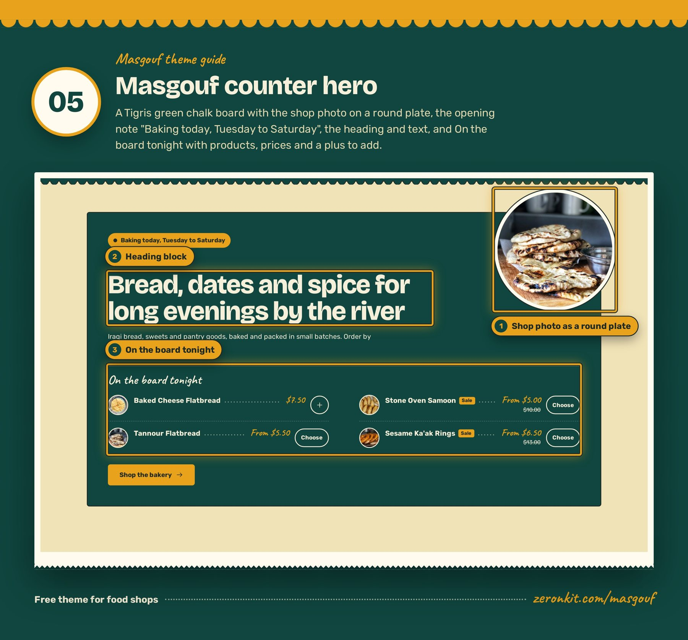](images/home-counter-en.jpg)
- `Image`: your best photo. It shows as the round plate.
- `Opening note`: the small turmeric label above the heading, for example "Baking today, Tuesday to Saturday". Leave it empty to hide it.
- Inside the board you add blocks: a small text, a `Heading`, a `Text` and a `Button`. Click `Add block` to add or move them.
- Under `Counter board`: `Products` lets you pick up to eight products for the menu lines. If you leave it empty, `Collection` is used, or your newest products. `Products to show` sets how many.

Each menu line has a plus button. A product with one size goes straight into the cart. A product with several sizes shows "Choose" and opens its sizes in place.

### 5.2 Fill your basket (Collection list)

Your shelves, shown as name tabs hanging from an awning over a photo of the stall.
[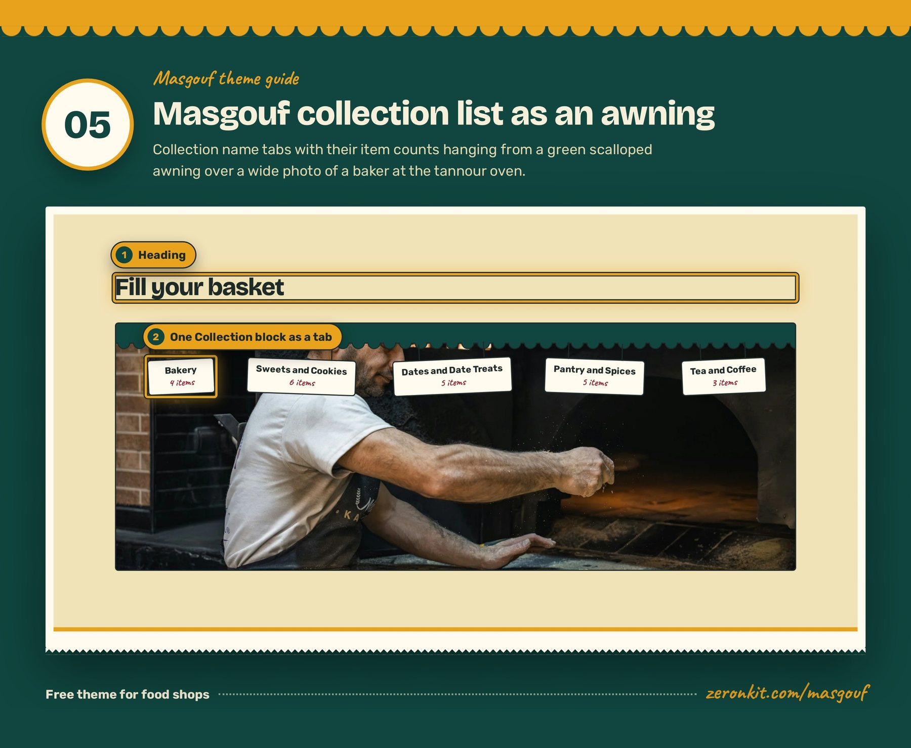](images/home-awning-en.jpg)
- Set `Card shape` to `Tabs hanging from an awning over a stall photo`. The other shapes are `Round plates` and `Cards`.
- `Stall photo`: a wide photo of your shop, your oven or your counter.
- Add one `Collection` block per shelf.

### 5.3 When the tannour is lit (Bake schedule)

A turmeric strip with the day at the oven, hour by hour.
[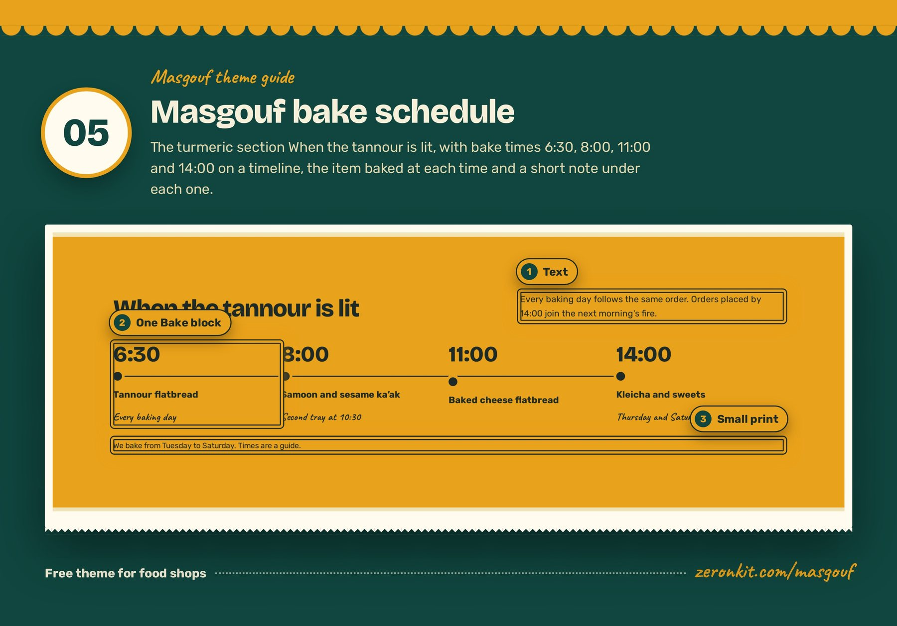](images/home-bake-en.jpg)
- Add one `Bake` block for each time: `Time`, `Item name` and `Note` (for example "Every baking day").
- `Product` links the line to a product. If `Item name` is empty, the product's title is used.
- `Small print` is the line under the timeline, for example "We bake from Tuesday to Saturday. Times are a guide."

People like to know when the bread comes out warm, and it nudges them to order before the cut-off.

### 5.4 Fresh this week (Featured collection)

A tray of round plates, each with a price tag.
[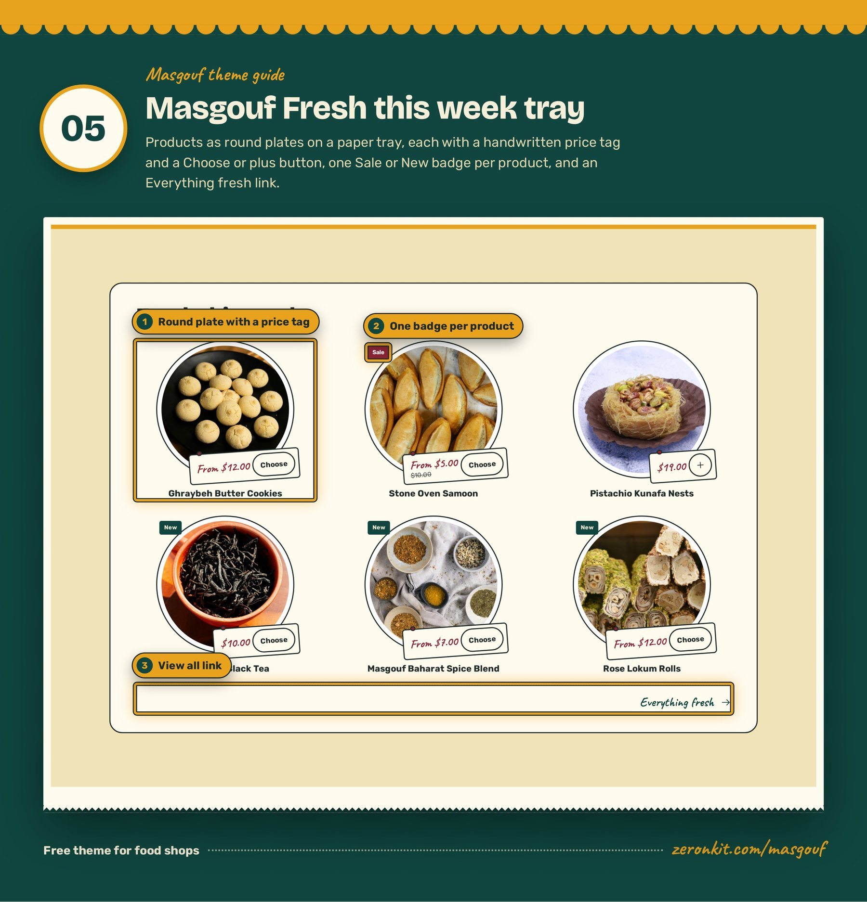](images/home-tray-en.jpg)
- `Collection`: pick your new or seasonal products.
- `Layout`: `Tray of round plates`. You can also choose `Grid` or `Scrolling row`.
- `Products to show` and `Columns on desktop` set the size of the tray.
- `Show View all link` adds the handwritten link at the end.

Each product shows one badge at most: Sold out first, then Sale, then New. Section 11.3 explains how New is decided.

### 5.5 The whole board (Menu board)

Your full menu written on chalk boards, in columns, with a short description under each name.
[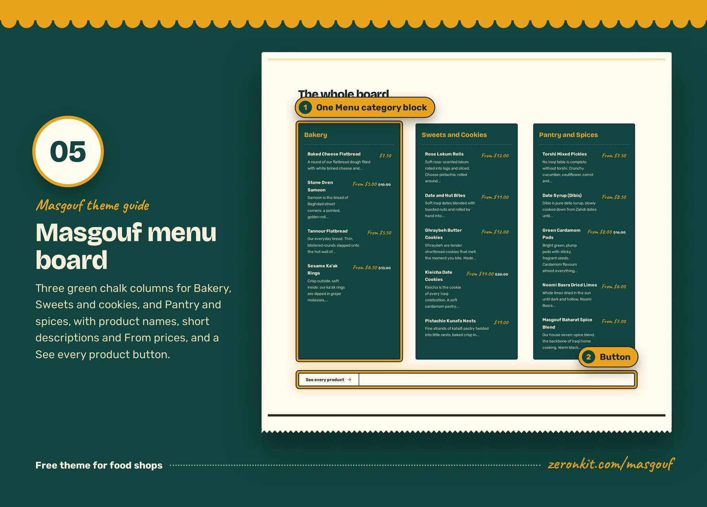](images/home-menu-board-en.jpg)
- Add one `Menu category` block per column. Pick its `Collection`. `Title` replaces the collection name if you want a shorter one. `Products to show` sets the lines.
- `Show short descriptions` adds a line from each product description.
- `Show small photos` adds a small plate to each line.
- `Button label` and `Link` make the button under the board.

### 5.6 What goes into it (Ingredients and allergens)

One product, with its full ingredient list and its allergens, on a dark charcoal section. It tells shoppers that you are open about what you put in your food.
[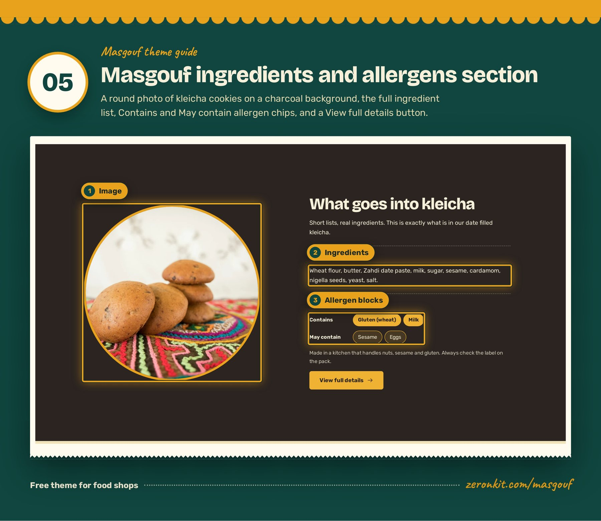](images/home-ingredients-en.jpg)
- `Product`: the product to show. Leave it empty to use the first product in stock.
- `Heading` and `Text`: leave the heading empty to use the product title.
- `Ingredients`: leave it empty to use the product's `masgouf.ingredients` metafield.
- Add an `Allergen` block for each allergen and set its `Status` to `Contains`, `May contain` or `Free from`. With no blocks, the `masgouf.allergens` metafield is used.
- `Small print`: for example "Made in a kitchen that handles nuts".

Check every allergen against your real product labels.

### 5.7 Today's special (Featured product)

One product on a chalk card, with its sizes and an Add to cart button right on the home page.
[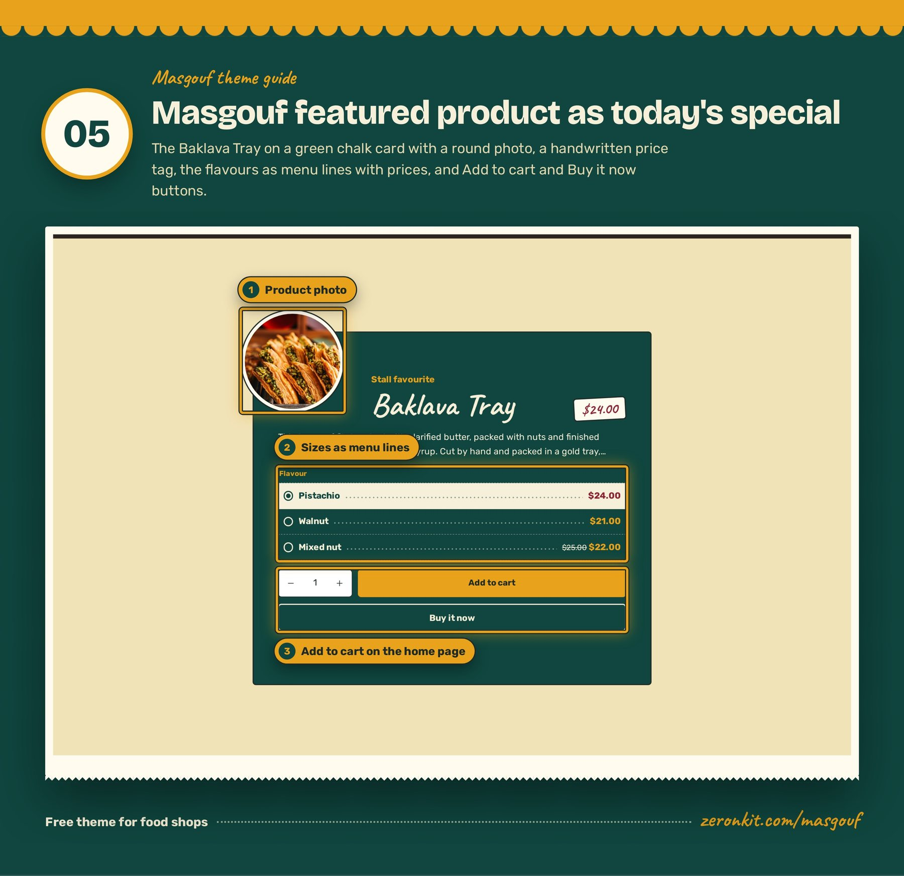](images/home-special-en.jpg)
- `Product`: the special.
- `Eyebrow text`: the small line above the name, for example "Stall favourite".
- `Show accelerated checkout buttons` shows Buy it now and other fast payment buttons.

### 5.8 Baking days (Visit the shop)

Your opening hours, where to find you, and a newsletter sign-up as a tear-off stub at the foot of the card.
[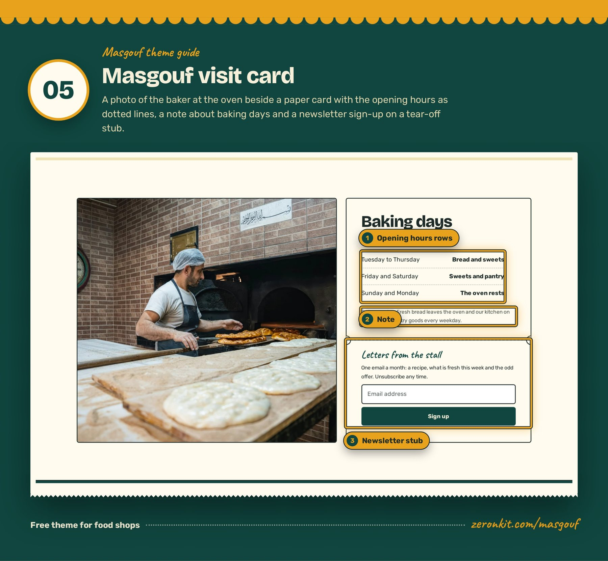](images/home-visit-en.jpg)
- Add an `Opening hours row` block for each line, with `Days` and `Hours`. "Hours" can be words, like "The oven rests".
- `Address`: leave it empty to use your store address.
- `Map link` and `Button label` add a button to a map.
- Under `Sign-up stub`, `Show the newsletter stub at the foot of the card` turns the sign-up on. Sign-ups go to your customer list.

## 6. The menu card: product page

Every product page is set like a menu card. The name and price are one menu line across the top. Under it, a paper order ticket holds everything needed to order. The photo sits on the ticket's corner as a round plate.
[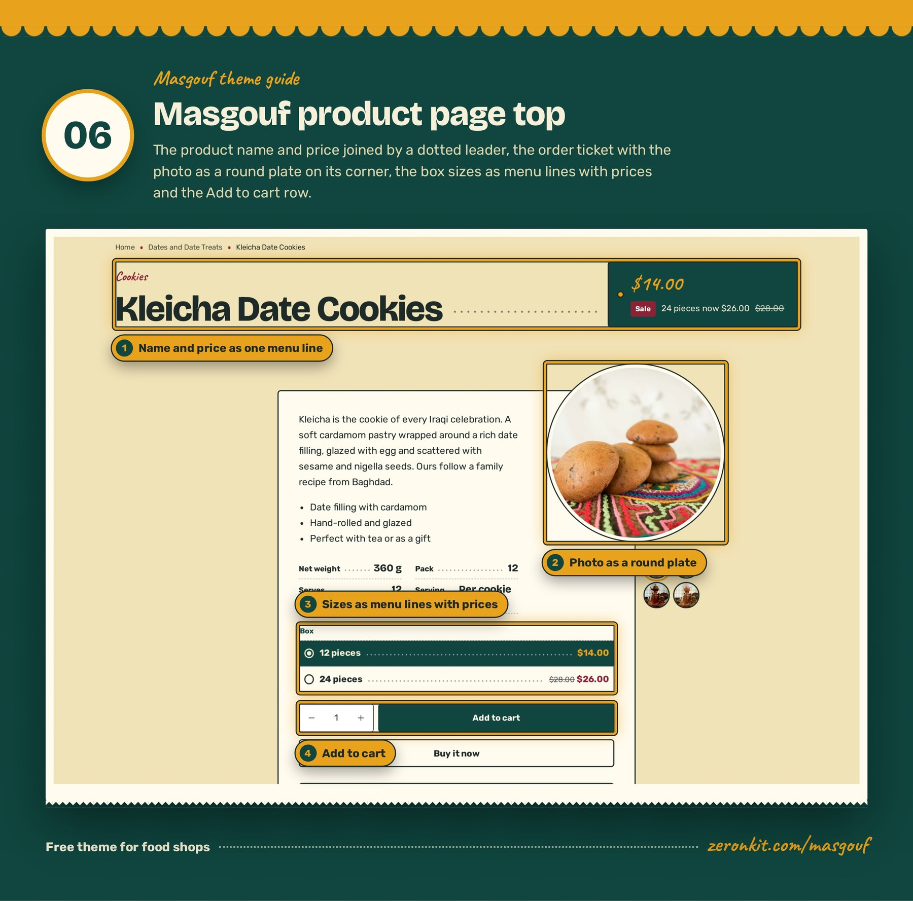](images/product-top-en.jpg)
Click `Product information` in the editor (open a product with the page picker first).

Section settings:

- `Title and price position`: `Above the photos` gives the menu line across the top. `In the order panel` puts them on the ticket.
- `Gallery layout`: `Plate with thumbnails` is the round plate with small plates beside it.
- `Keep product details in view while scrolling` keeps the photo beside the ticket as the shopper reads.
- `Show breadcrumb` shows the small path above the name.
- `Heading above the food details` is the title over the pantry panels, "From the pantry" by default.

The ticket is made of blocks. Drag them to change the order. Each one is explained below.

### 6.1 Ordering on the ticket

- `Title` and `Price`: the name and price. `Show stock status` adds the stock line.
- `Description`: your product description.
- `Weight and servings`: net weight, pack size and servings as dotted lines. It reads the metafields from 4.3. `Use the variant weight when no net weight is set` uses the weight from the variant.
- `Variant picker`: set `Style` to `Menu lines with prices`. Each size is a line with its own price. `Buttons` and `Dropdown` are the other styles.
- `Buy buttons`: quantity, Add to cart and Buy it now. Add to cart is the only filled button. Buy it now is an outline. `Show pickup availability` shows local pickup if you offer it.
[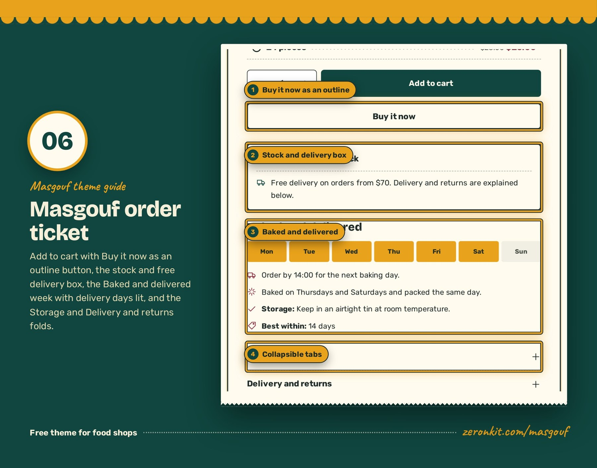](images/product-ticket-en.jpg)
Under the buttons a small box says if the product is in stock and gives one delivery line. That line is built from your free delivery settings (2.3) and the shopper's country.

- `Delivery days and freshness`: a week with your delivery days lit in turmeric. Tick the days under `Delivery days`. Write your cut-off in `Order cut-off note` ("Order by 14:00 for the next baking day") and a line in `Freshness note`. A product's `masgouf.delivery_days` metafield replaces the ticked days, so pantry goods can ship on other days than fresh bread.
- `Collapsible tab`: a fold. Set `Content source` to `Storage` or `Shipping and returns` and the content comes from the product or your policies. `Custom text only` uses your own `Content`. Keep the full delivery and returns text in one fold, so it isn't repeated on the page.
- `Complementary products`: products that go with this one, set in the Search & Discovery app.

Every food block has `Placement`. `In the order panel` puts it on the ticket. `Below the photos` puts it in the pantry row under the ticket.

### 6.2 A size on sale

Say the large box is reduced and the small one isn't. The price board at the top tells the shopper about the large box even while the small one is picked.
[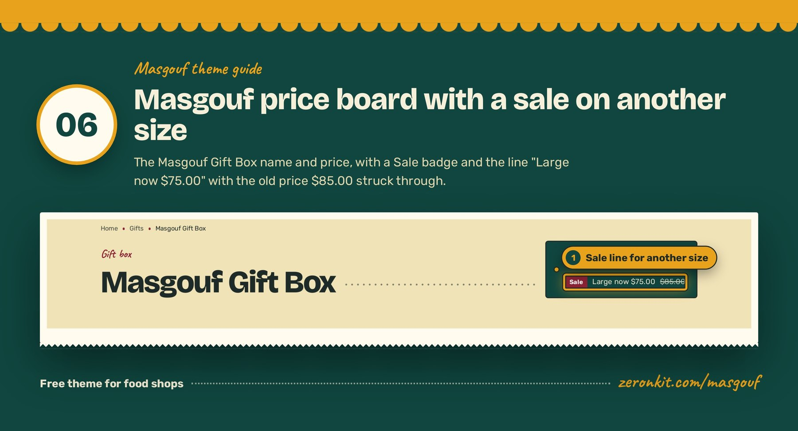](images/product-sale-en.jpg)
You don't set anything. Add a `Compare-at price` to the size on sale and the line appears.

### 6.3 From the pantry

Under the ticket is a row of cards with the food details.
[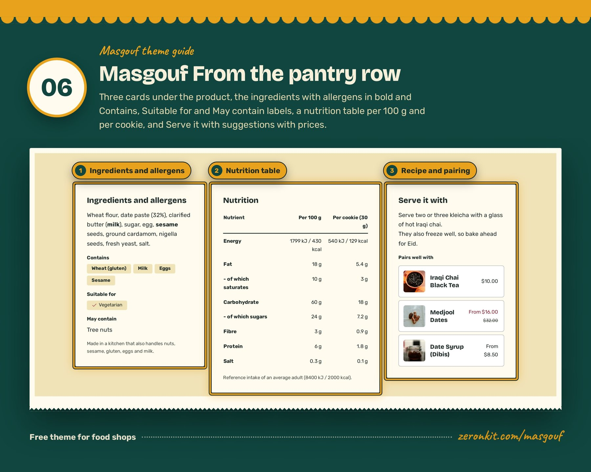](images/product-pantry-en.jpg)
- `Ingredients and allergens`: the ingredient list from `masgouf.ingredients`, with allergens and diet labels. `Bold allergens in the ingredient list` makes the allergens bold inside the list, as food labels do. `Allergen note` is the line about your kitchen.
- `Nutrition table`: reads `masgouf.nutrition`. `Amount column heading` and `Serving column heading` set the column titles when the metafields are empty.
- `Recipe and pairing`: a serving idea and products that go well with it. It reads `masgouf.recipe`, `masgouf.recipe_article` and `masgouf.pairing`. With `Fill with products from the same collection when none are chosen` on, it never stays empty.

The text fields inside these blocks (`Ingredients text`, `Nutrition rows`, `Recipe or serving idea`) are only fallbacks. They show on every product that has no metafield. Use them only on a template made for a single product, so a cookie never shows the nutrition of a loaf.

### 6.4 Related products
[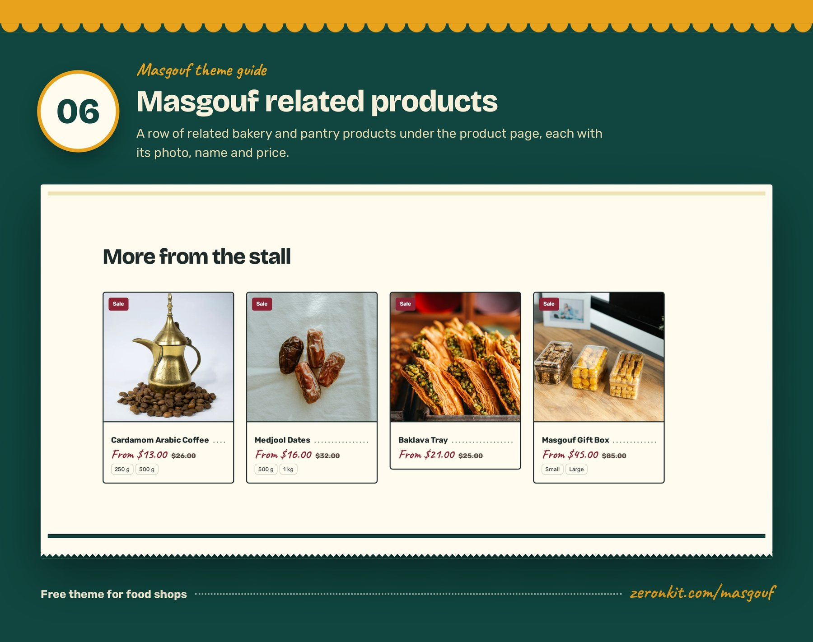](images/product-related-en.jpg)
Click `Related products` to set `Heading`, `Layout` (`Grid` or `Scrolling row`) and `Products to show`. Shopify learns which products to suggest over time. Until it has enough orders, Masgouf shows products from the same collection.

### 6.5 Gift cards

Gift card products show no Buy it now, no delivery lines and no food panels. There is nothing to set.

## 7. Shelves: collections and search

### 7.1 A collection page

A collection is one chalk board. Products are menu lines in two columns: a round plate, the name, a dotted leader and the price.
[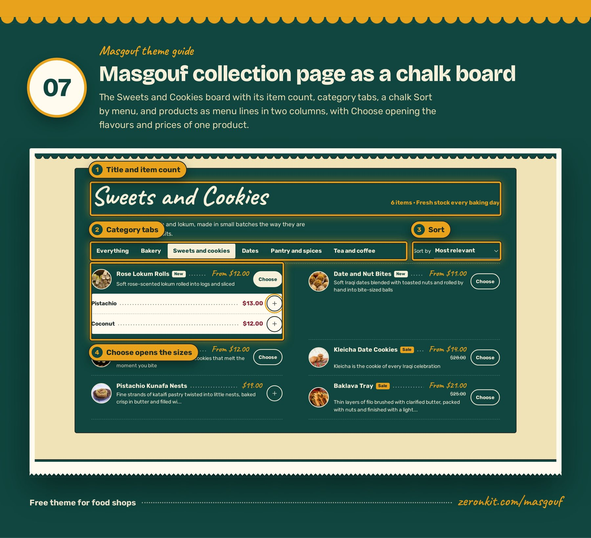](images/collection-en.jpg)
- A product with one size has a plus to add it straight away. A product with several sizes has "Choose", which opens its sizes as lines with prices, each with its own plus. A regular who knows what they want can fill a basket without opening one product page.
- The tabs along the top come from your filters, or from `Category tabs menu`.
- `Banner note` is the short handwritten label on the board, for example "Fresh stock every baking day".
- `Show round product photos` and `Show a short description under each name` change the lines.
- `Products per page` and `Pagination` (`Load more button`, `Numbered pages` or `Infinite scroll`) set how lists load.
[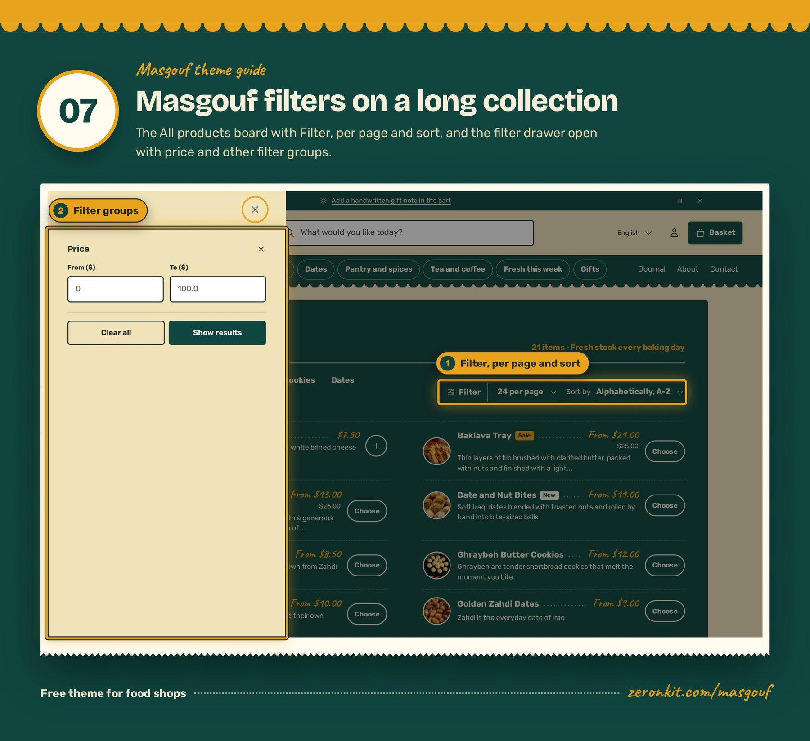](images/collection-filters-en.jpg)
On lists with 12 products or more, a Filter button and a per page choice appear. On short lists they stay hidden, because a shopper can read twelve lines at a glance. Filter groups with only one choice are hidden too. Set the filters themselves in the free Search & Discovery app.

### 7.2 Search results
[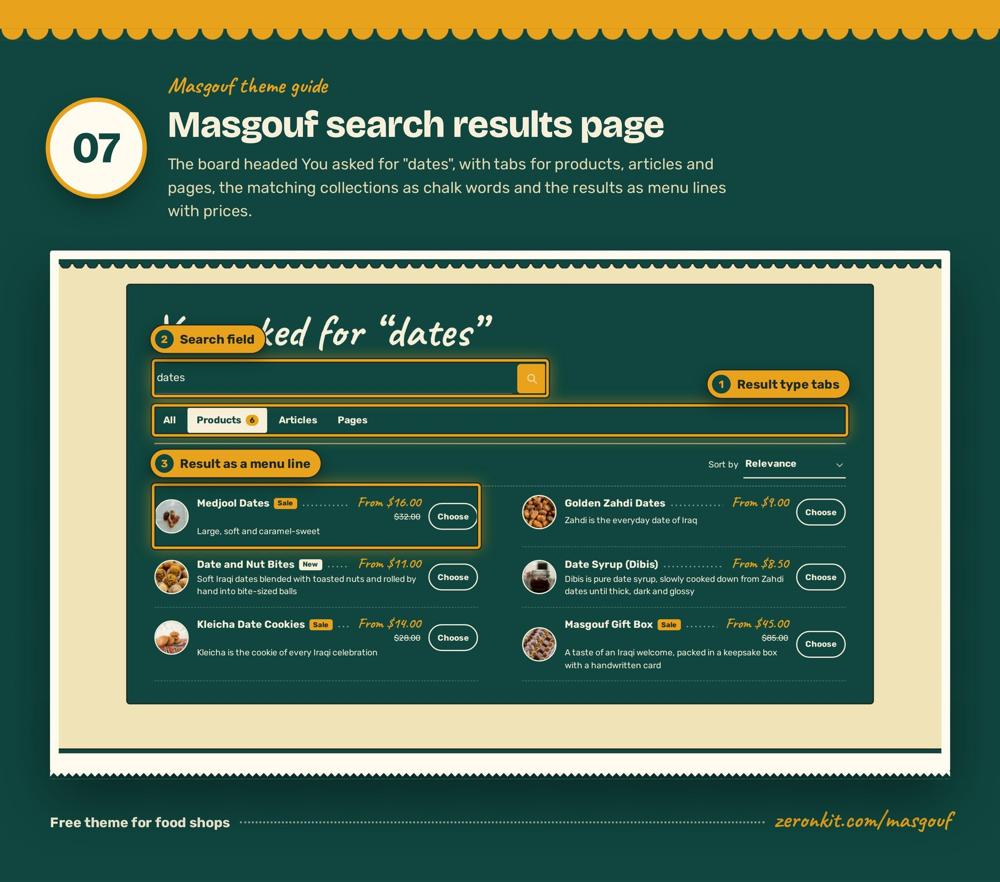](images/search-results-en.jpg)
Click `Search results` (open the search page with the page picker). You can set `Heading`, `Products per page`, filtering and sorting. `Suggested collection when nothing is found` fills an empty search with products, under the words "Not on the board today".

### 7.3 All your shelves (collections list)

The page at `/collections` is a map of your stall: a wide photo with numbered pins and a key under it.
[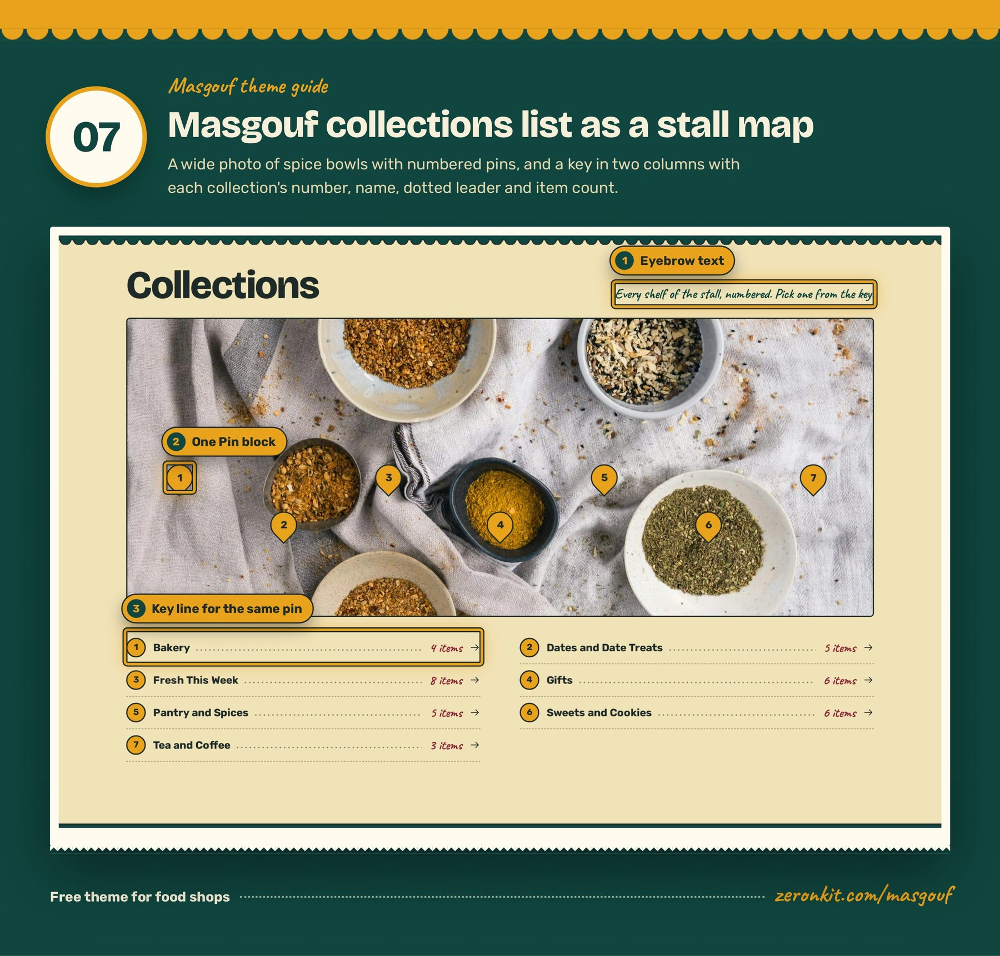](images/collections-map-en.jpg)
- `Stall photo`: a wide photo of your shop or market table.
- Without blocks, every collection gets a pin along the bottom. Add a `Pin` block per collection to place it yourself: `Across the picture` and `Down the picture` move the pin, in percent.
- When a shopper points at a key line, its pin lights up, and the other way round.

## 8. The basket

### 8.1 The basket ticket (cart drawer)

Add something to the cart and a narrow paper ticket drops from the Basket button.
[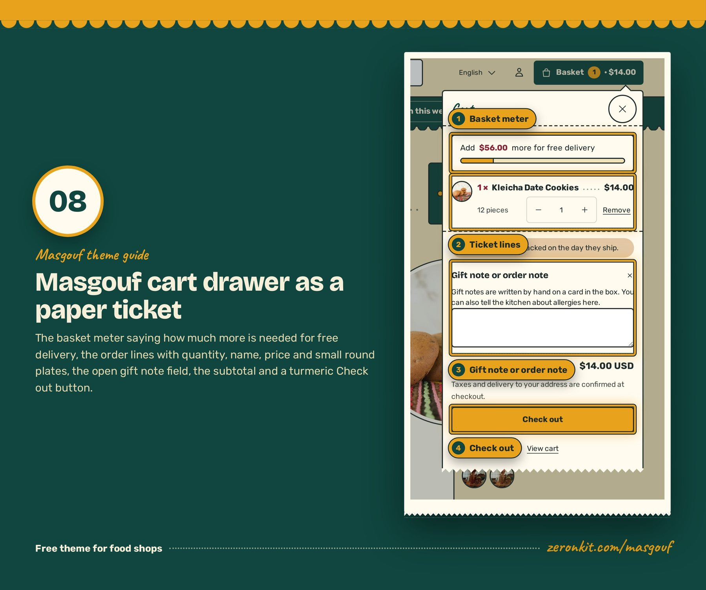](images/cart-drawer-en.jpg)
From top to bottom:

- **The basket meter.** "Add $56.00 more for free delivery", with a bar that fills up. At the goal it says the basket travels free. It uses `Free delivery from (amount in the store currency)` and `Countries with free delivery` (2.3). It only shows to shoppers in those countries.
- **The lines.** Quantity, name and price, then the size, a small stepper and Remove. `Show small round photos on the ticket lines` in `Cart drawer` adds the plates.
- **A note.** `Note above the subtotal` in `Cart drawer`, for example "Fresh bakes are packed on the day they ship."
- **Gift note or order note.** An open field. It needs `Enable order note` (2.3). The hint under it says gift notes are written by hand on a card. If you don't do that, change the hint as shown in 11.2.
- **Subtotal, Check out and View cart.**

If the cart is empty, it shows a few products to start with. Pick them in `Collection` under `Empty cart`.

To use a full page instead of the drawer, set `Cart type` to `Page` in `Theme settings`, `Cart`.

### 8.2 The cart page (the counter)
[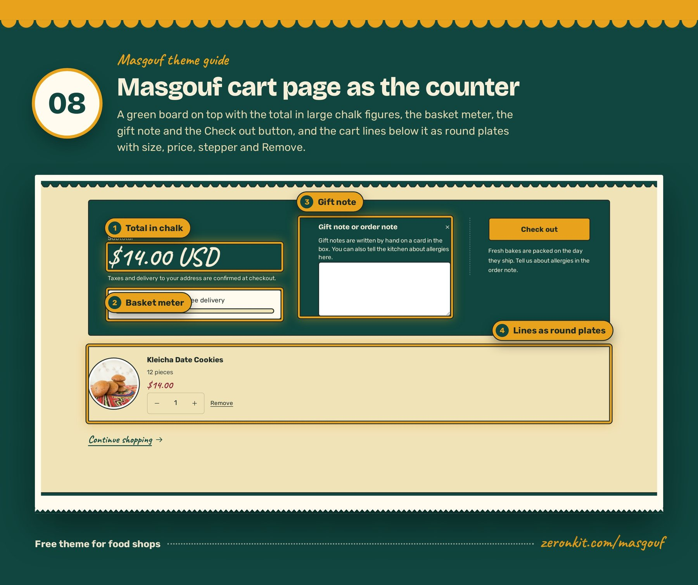](images/cart-page-en.jpg)
The cart page puts the bill first. The board on top holds the total in large chalk figures, the meter, the gift note and Check out. The lines follow as round plates in two columns. Click `Cart` in the editor for `Heading` and `Order note under the summary`.

An empty cart keeps the board. It says the basket is empty and lists a few products still for sale under "Still on the board". Turn the list on or off with `Show product suggestions` under `Empty cart`, and pick its products in `Collection`.

The Check out button is turmeric in both the drawer and the page, so the last step always looks the same.

### 8.3 The checkout

Shopify's checkout is not part of the theme. To match it to the stall, open `Settings`, `Checkout`, `Customize` and set the colours and fonts there: reed `#F1E3B8` or paper `#FFFBEF` for the background, ink `#1E2A28` for text, Tigris `#10463F` for links, turmeric `#E9A21B` for buttons. Use Rubik for text.

## 9. The other pages

### 9.1 Contact: the stall front
[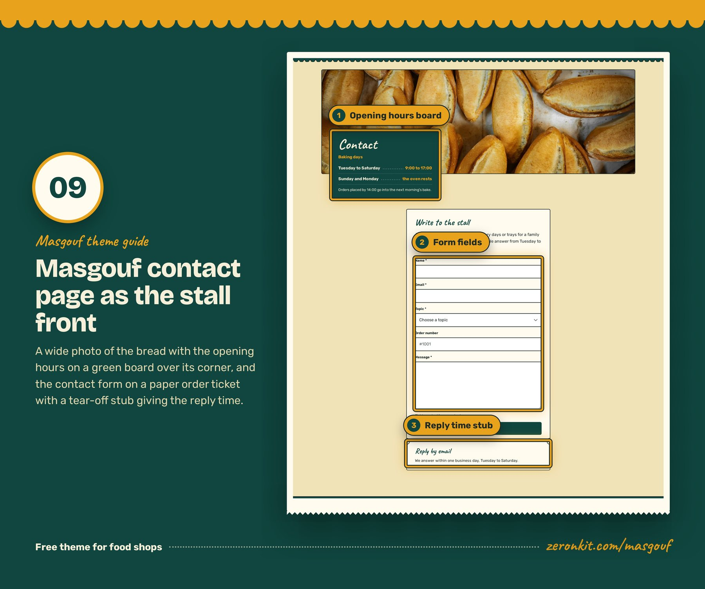](images/contact-en.jpg)
Click `Contact form` in the editor (open the contact page first).

- `Layout`: `Stall front: photo, hours board and a ticket form`. The other layouts are `Form only` and `Form and information column`.
- `Stall photo`: the wide photo at the top.
- Add an `Opening hours row` block for each line of the hours board. `Phone` adds a phone line.
- The form fields are blocks: `Name field`, `Email field`, `Phone field`, `Order number field`, `Topic dropdown` and `Message field`. Add, remove and order them. In `Topic dropdown`, write the topics separated by commas, for example "Orders, Allergens, Trays and gifts, Wholesale".
- `Heading`, `Intro text`, `Button label` and `Success message` set the words.
- The email line comes from `Contact email`, then from `Store contact email` in `Brand assets`. If both are empty, only the form shows.

Messages go to your store email in `Settings`, `General`.

### 9.2 About: a day at the stall
[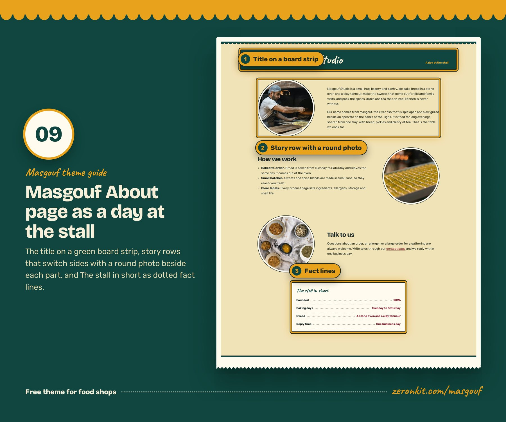](images/about-en.jpg)
Give the About page the `about` template. The page content is split at each Heading 2 into rows. Each row gets a round photo, switching sides as the shopper scrolls.

- Add `Photo for a row` blocks to choose the photos, in order. Without them, collection photos are used.
- To write the rows in the editor instead, add `Story row` blocks (`Image`, `Heading` and `Text`).
- Add a `Fact line` block for each fact at the end, with `Label` and `Value`, for example "Baking days ....... Tuesday to Saturday".

### 9.3 FAQ: questions on the board
[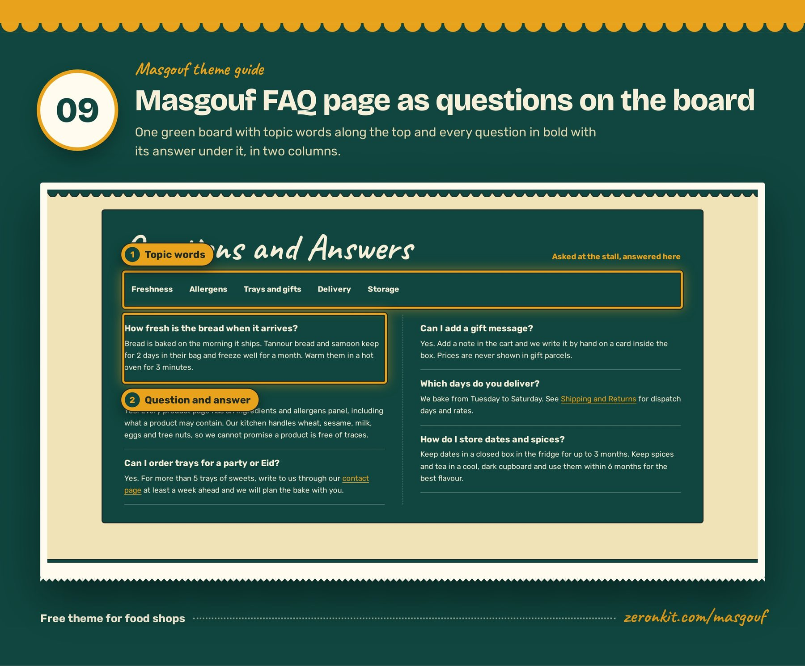](images/faq-en.jpg)
Give the FAQ page the `faq` template. Each Heading 2 in the page becomes a question, and the text under it is the answer. All answers show at once. Someone checking for allergens can read every answer without a single click.

Add a `Topic word` block for each topic, with `Label` and `Jumps to question number`. The words sit along the top and jump to that question.

### 9.4 The journal
[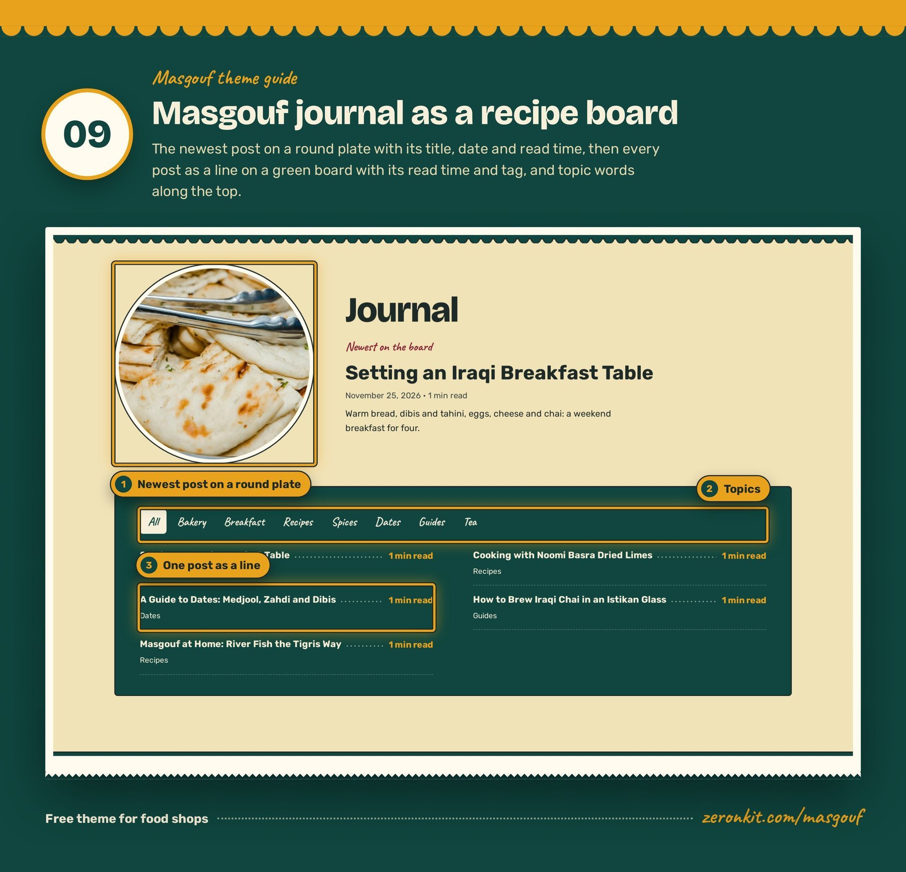](images/journal-en.jpg)
The newest post sits on a round plate at the top. Every post follows as a line on the board, with its read time. The topic words come from your post tags. Click `Blog posts` for `Show the newest post as a wide card` and `Posts per page`.

### 9.5 A post as a recipe card
[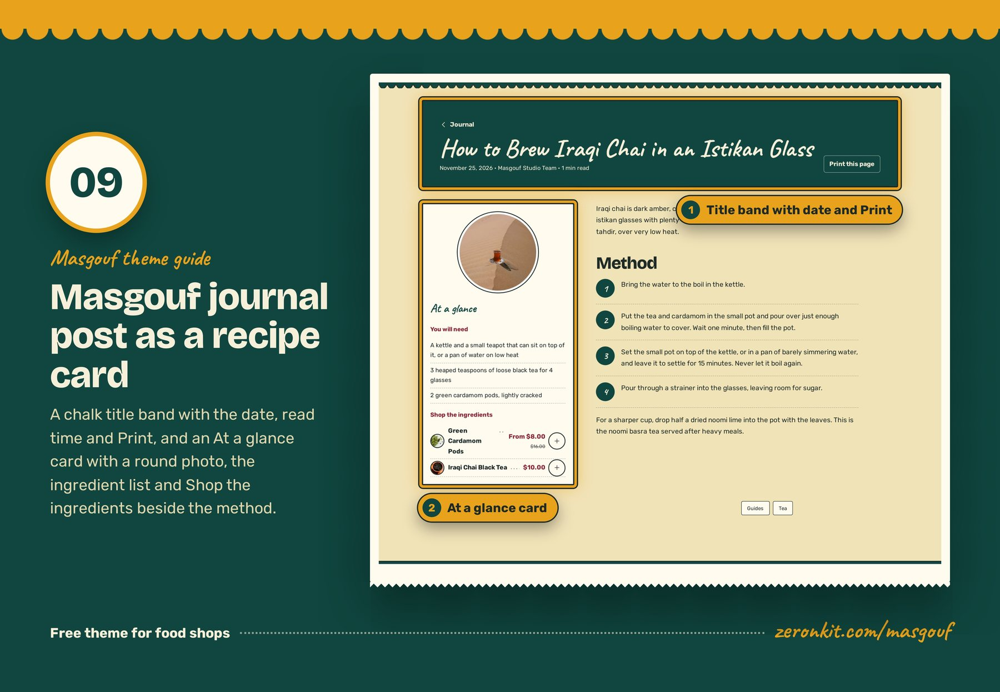](images/article-en.jpg)
If a post has a bulleted list, Masgouf moves the first list to an "At a glance" card beside the text. Put a Heading 2 such as "You will need" just before the list and it becomes the card's title.

Under the list, "Shop the ingredients" shows up to four of your products with prices. A product is picked when its name is in the post, or when its `masgouf.recipe_article` metafield points to the post. So a post about chai that mentions "Iraqi Chai Black Tea" and "Green Cardamom Pods" sells both.

Click `Blog post` for `Show author`, `Show reading time` and `Show print button`. The print button prints the recipe without the header and footer.

### 9.6 Normal pages
[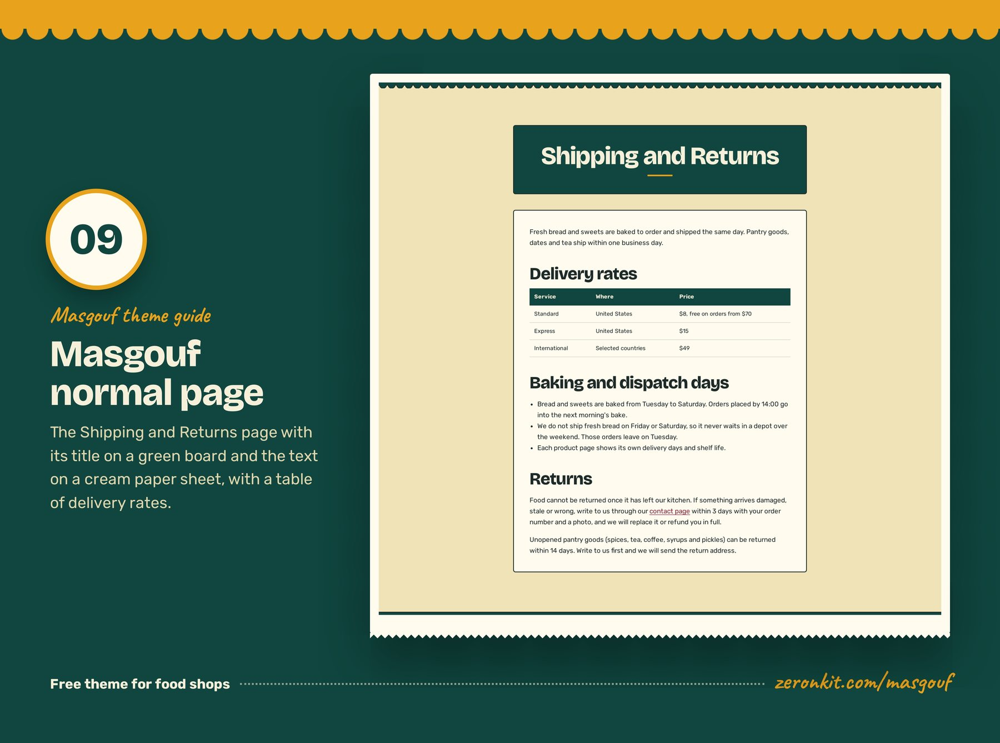](images/page-en.jpg)
Shipping and returns, privacy and other plain pages use the `Page` section. `Alignment` sets the title to the start or the centre.

### 9.7 Page not found
[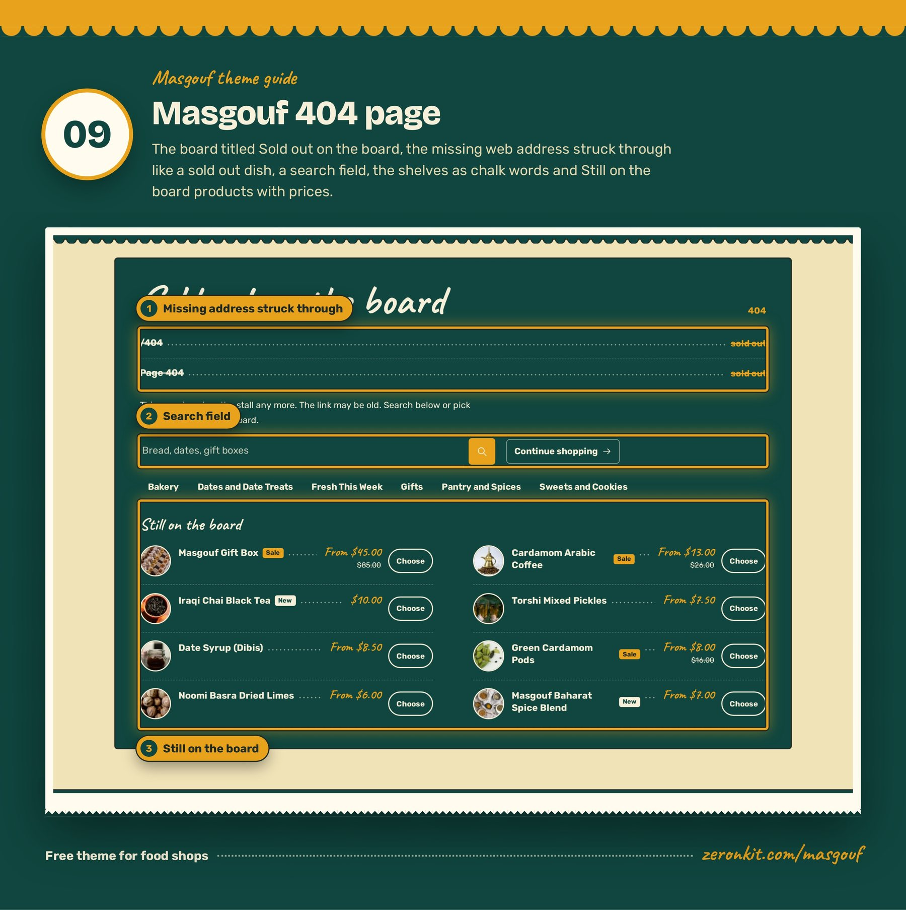](images/not-found-en.jpg)
A wrong address shows a board that says "Sold out on the board", with the address struck through like a dish that ran out. Under it are a search field, your shelves and products still for sale. Click `Page not found` to set `Heading`, `Show popular collections` and `Show products`.

### 9.8 The password page

While your store is locked, visitors see the shutter down: a full screen board with "Closed until opening day", your opening and bake times as menu lines, the password as one chalk line, and a newsletter sign-up. Click `Password page` to add `Fact line` blocks and to turn `Show newsletter sign-up` on or off.

## 10. The footer and the baking week
[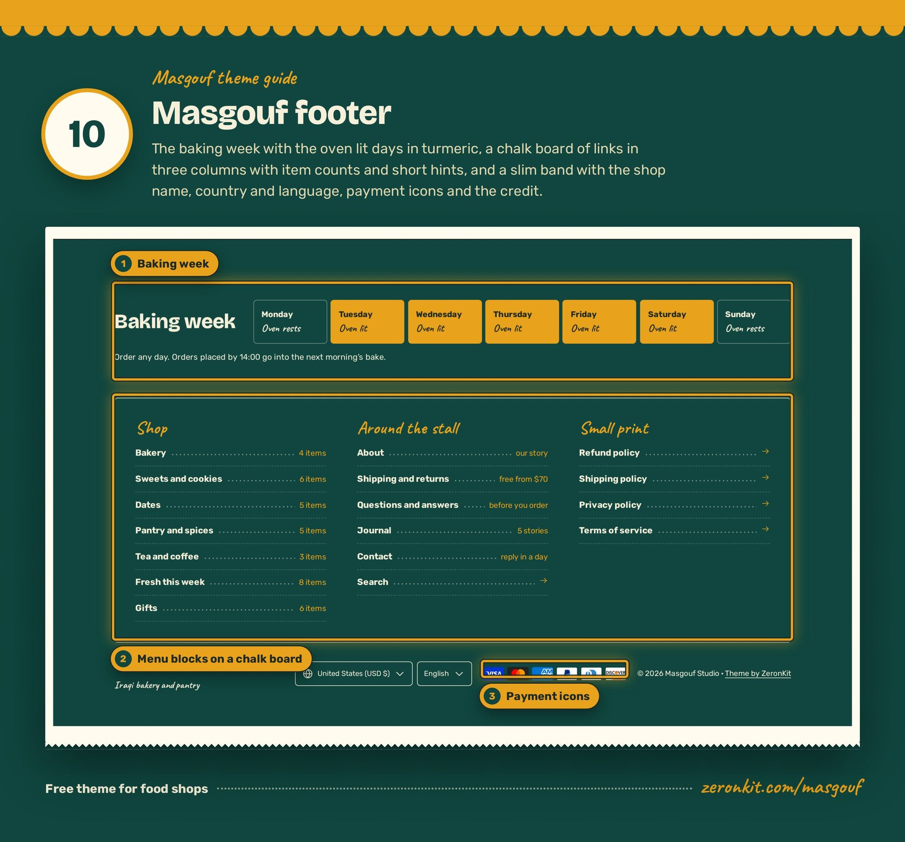](images/footer-en.jpg)
The footer opens with the baking week: seven days, with the days the oven is lit in turmeric. Under it, one chalk board holds your links in three columns. Each line has a small hint: the number of items on a shelf, the number of stories in the journal, or your free delivery amount.

Click `Footer` in the editor:

- `Layout`: `Riverside: baking week, menu boards, letter slip`.
- `Show the baking week` and `Baking days`. Write the day codes separated by commas, for example `tue,wed,thu,fri,sat`.
- Add a `Menu` block per column and pick its menu. The third column lists your policies when `Show policy links` is on.
- `Show social icons`, `Show payment icons`, `Show country/region selector` and `Show language selector` control the slim band at the bottom. Social links are set in `Theme settings`, `Social media`.
- The small "Theme by ZeronKit" link can be turned off in `Theme settings`, `Theme credit`.

## 11. Small settings that matter

### 11.1 Editing any page

1. Open the page in the editor with the page picker at the top.
2. Click a section on the left to see its settings.
3. Drag the dots beside a section or block to move it. Click the eye to hide it.
4. `Add section` at the bottom adds a new one. Masgouf has a `Content canvas` section for your own mix of headings, text, images, buttons and app blocks, and a `Custom Liquid` section for code.
5. Click `Save`.

### 11.2 Words the theme writes for you

Many small lines come from the theme, like "Oven lit", "Order any day" or "Gift notes are written by hand". To change them, open `Online Store`, `Themes`, the `...` menu, then `Edit default theme content`. Search for the words and change them. Change them in Arabic too.

### 11.3 Product cards and the New badge

In `Theme settings`, `Product cards`:

- `Show New badge for` sets how many days a new product keeps its New badge. Products tagged `new` always show it. Set it to 0 to use the tag only.
- `Show sizes in stock` lists the sizes on cards and strikes through sold out ones.
- `Show second image on hover` and `Image ratio` change the photos on cards.

## 12. Arabic and other languages

Masgouf ships with English and Arabic. Every word of the theme is written in both, in natural Arabic, and every page mirrors from right to left.

1. In Shopify admin open `Settings`, `Languages`. Add Arabic and click `Publish`.
2. Install the free Translate & Adapt app to translate your products, collections, pages, menus and metafields.
3. Shoppers switch language with the selector in the footer, on the menu board or in the header.

Two things to know:

- If you type English into a section setting, that English shows in every language until you translate it in Translate & Adapt. Clear a field to go back to the theme's own text in both languages.
- Translate the food metafields too, such as the ingredients and the storage note. An Arabic page with English ingredients is hard to read for the people who need it most.

## 13. On a phone

Many of your shoppers will order from a phone, often on the way home.
[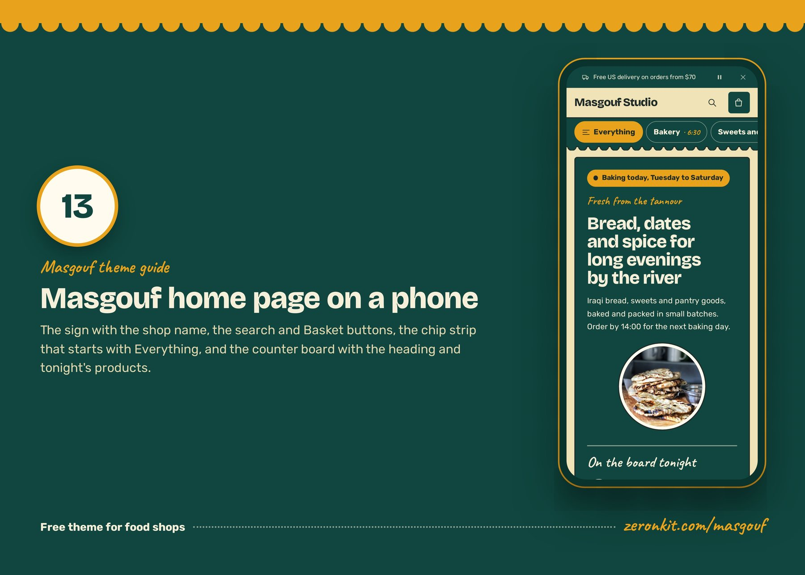](images/m-home-en.jpg)
- The header shows the name, search and the Basket. The chip strip scrolls sideways and starts with `Everything`.
[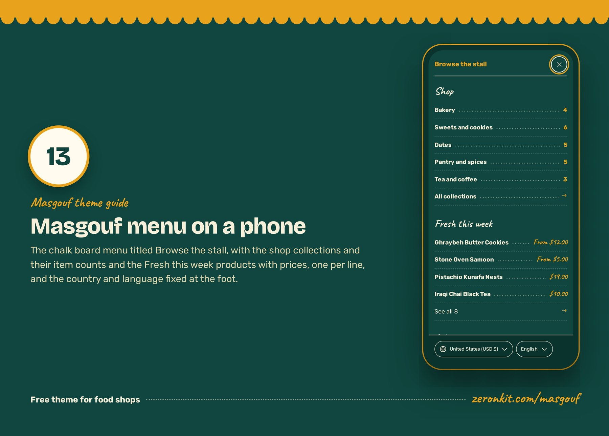](images/m-menu-en.jpg)
- On a phone the menu fills the screen as a chalk board titled "Browse the stall", with every link on one line. Each column heading stays at the top while its lines scroll past, and the country and language stay at the foot of the board.
[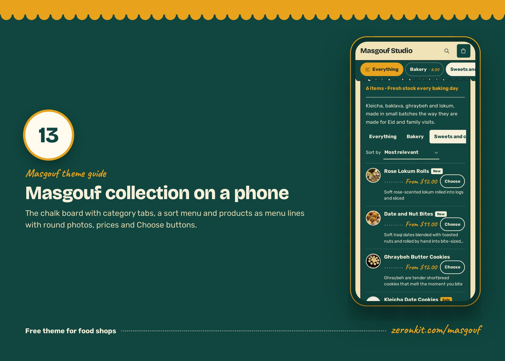](images/m-collection-en.jpg)[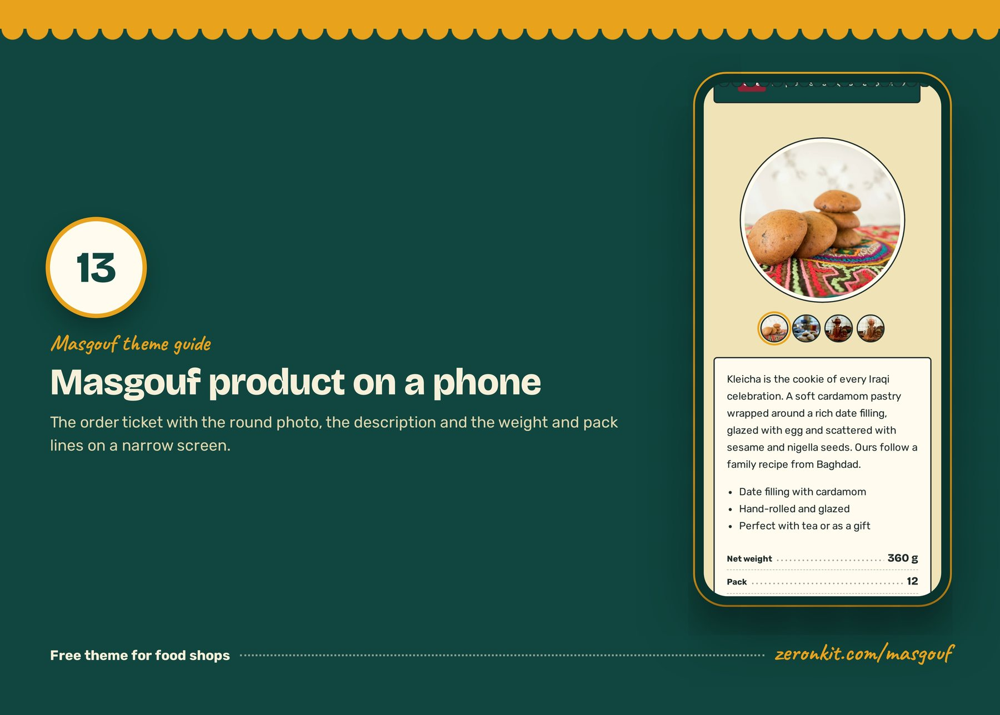](images/m-product-en.jpg)[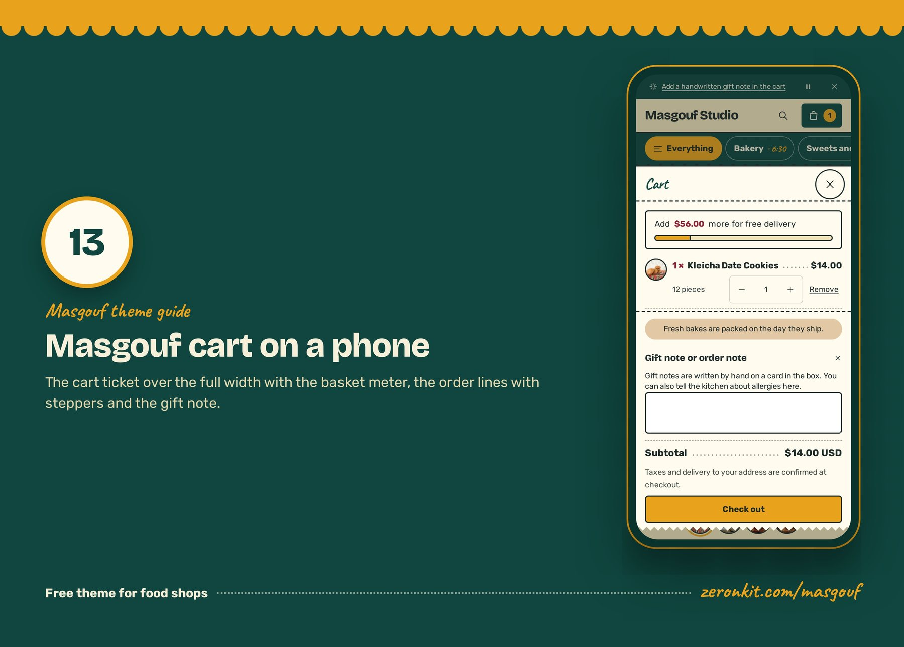](images/m-cart-en.jpg)[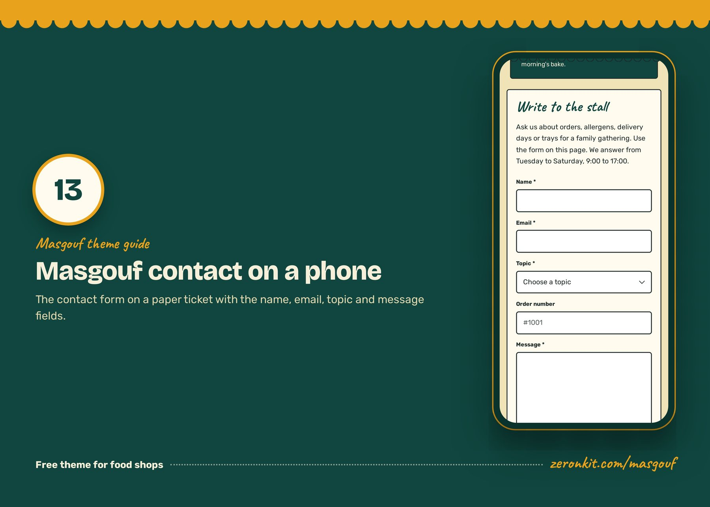](images/m-contact-en.jpg)
Every button and link is at least 44 pixels tall on phones, so it is easy to hit with a thumb. You don't need to set anything for phones. A few sections have their own phone setting, such as `Logo width on mobile` in `Header`.

## 14. When something looks wrong

**Products show as sold out for shoppers in some countries.** Open `Settings`, `Markets`. If a country sits in a market that has no catalogue or no shipping, Shopify shows your products as unavailable there. Move those countries into your main market, and make sure they have a rate in `Settings`, `Shipping and delivery`.

**Products say sold out but you have stock.** Check that the stock is at a location that fulfils online orders, in `Settings`, `Locations`.

**The basket meter doesn't show.** Check `Free delivery from (amount in the store currency)` in `Theme settings`, `Cart`. Then check the country list: the meter only shows to shoppers in those countries, and only when they shop in your store currency.

**The meter and the checkout disagree.** The meter only reads the theme setting. Use the same amount as the free rate in `Settings`, `Shipping and delivery`.

**There is no gift note in the cart.** Turn on `Enable order note` in `Theme settings`, `Cart`.

**The About or FAQ page is one long text.** Check that the page uses the `about` or `faq` template, and that the parts or questions are Heading 2, not bold text.

**No "At a glance" card on a recipe.** The post needs a bulleted list. A numbered list is read as the method.

**A cookie shows the nutrition of bread.** Text typed into a food block on the main product template shows on every product without its own metafield. Clear those fields, and use metafields per product.

**No bake time on a chip.** In `Hints on the category chips`, the part before the colon must be the collection handle (as in its web address), not its title.

**English text on the Arabic store.** Translate the setting in Translate & Adapt, or clear it so the theme's own Arabic shows.

**No filters on a collection.** Filters show on lists of 12 products or more. Install Search & Discovery and add filters there.

**Contact messages don't arrive.** Check the store email in `Settings`, `General`, and your spam folder.

## 15. Help and changes

Help is free and best effort. Write through https://zeronkit.com or to info@zeronkit.com. There is no fixed schedule for updates.

### Changelog

**1.0.0, updated zip (26 November 2026)**: small fixes after the layout review. The column headings on the menu board line up. On the product page the round photo no longer covers the facts table. In Arabic the little point on the basket ticket points at the Basket. The search ticket has no button over the field, so nothing covers what the shopper types. On phones the country and language bar stays above the menu headings. An empty cart page keeps its board and lists products still for sale. If you installed 1.0.0 before this date, download it again and follow 2.4.

**1.0.0 (25 November 2026)**: first public release. Before release, the theme went through store reviews and a round of page layouts. It includes the menu board header and search ticket, the menu card product page with sizes as menu lines, the basket meter and open gift note, the about, FAQ, recipe card and stall map pages, one badge per product, a description for every page for search engines, the Store contact email setting, and Arabic for all theme texts.
